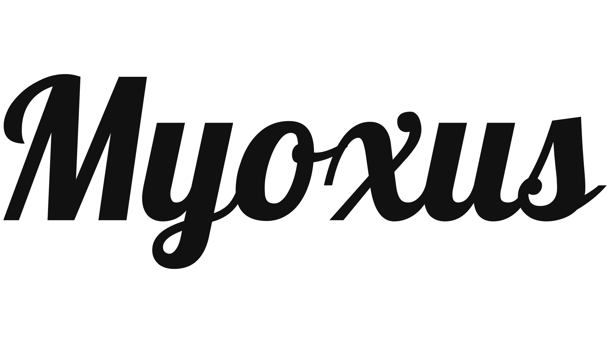
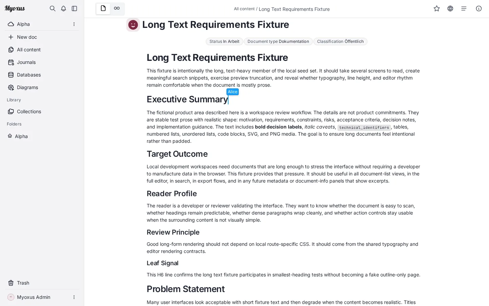
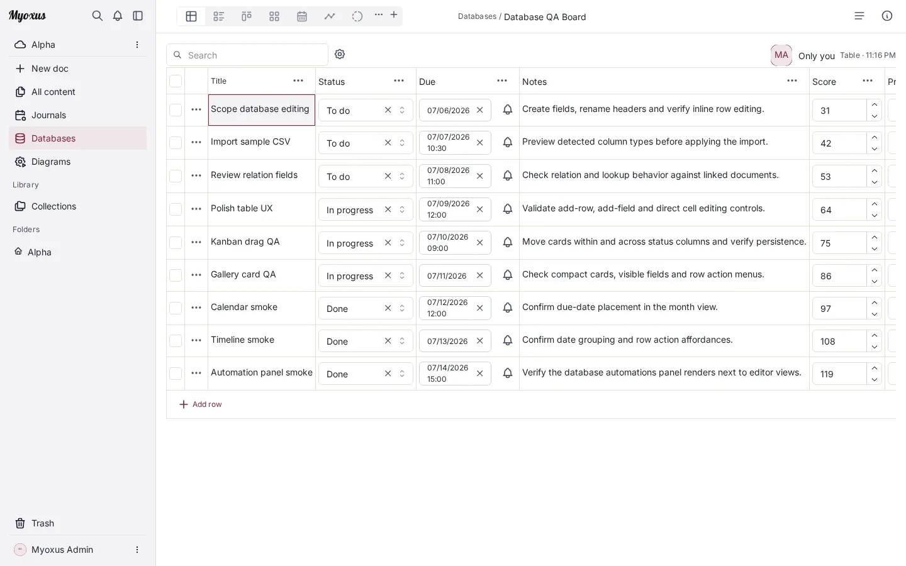
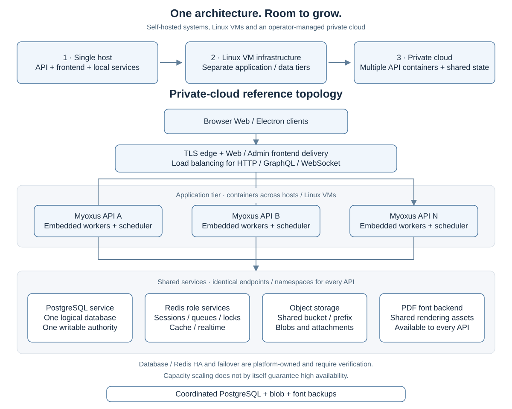

<!-- SPDX-License-Identifier: AGPL-3.0-or-later -->

  

  
<strong>Your knowledge. Your projects. Your infrastructure.</strong>

  
Documents, visual thinking, databases and teamwork in one self-hosted workspace.

  
<strong>Open source · Self-hosted · Beta</strong>

  

    <a href="#start-now">Start now</a> ·
    <a href="./docs/user/README.md">User guide</a> ·
    <a href="#from-one-host-to-an-enterprise-installation">Run and scale</a> ·
    <a href="./CONTRIBUTING.md">Contribute</a>
  

Myoxus brings collaborative writing, visual planning, structured information
and publishing into one workspace. Start with your own notes, bring a team
together, or run a centrally managed installation for your organization.
Your content and the services behind it stay on infrastructure you control.

## Start now

The simplest starting point is **one Linux host or VM with Docker Compose**.
It runs the Rust server, Browser Web and Admin alongside PostgreSQL 16, Redis 8
and persistent file storage. Use published container images; no application
build or Rust/Node.js toolchain is needed.

A practical starting budget for the standard Compose stack is **4 vCPUs,
16 GiB RAM and SSD storage**. Plan attachment and backup space for your own
content; the [sizing guide](./docs/ops/deployment/sizing.md) explains the workload
assumptions and smaller or larger allocations.

1. **Choose a published version.** The [download overview](./docs/user/downloads.md)
   lists the available Server, Web and Admin artifacts. Use a matching set.
2. **Install the container stack.** Follow the
   [Docker Compose installation](./docs/ops/deployment/docker.md#deploy-published-myoxus-images)
   to obtain the deployment bundle, configure secrets and persistent storage,
   and start your installation behind HTTPS.
3. **Open Myoxus.** Create the first administrator at `/adminfrontend/setup`,
   sign in through Browser Web and start in your personal workspace. Add shared
   workspaces when you want to work with others.

**[Install with Docker Compose →](./docs/ops/deployment/docker.md#deploy-published-myoxus-images)**

Once you are signed in, the [English handbook](./docs/user/handbook/index.md)
and [deutsches Handbuch](./docs/user/handbook/de/index.md) walk through daily use.
For a host without containers, use the
[installation overview](./docs/ops/getting-started/installation-decision.md).
Native **DEB/APT and RPM server packages** are available in
[GitHub Releases](https://github.com/superions/myoxus/releases/tag/v0.41.38).
Follow the [native package installation](./docs/ops/getting-started/installation.md#native-server-packages),
or use the [Linux/systemd source installation](./docs/ops/deployment/systemd/README.md).

## One place for your work

Everyone has a **personal workspace, private by default**. Shared workspaces
give teams, departments and projects their own content, members and roles.
Documents and structured records belong to that same working context.

### Write and think together

Write rich documents, connect them with links, discuss changes in comments and
return to earlier states through history. Use the visual canvas to work through
ideas spatially, or create diagrams from source text. Folders, collections,
tags and search help keep growing knowledge navigable.

### Turn information into shared work

Use server-backed databases for project trackers, service catalogues and
research collections. Typed fields, filters, grouping and saved views let people
work with the same records in different ways. Calendar, timeline and Gantt
views add a time perspective; tasks, reminders and activity connect information
to follow-up work.

### Bring knowledge in, and publish the result

Import documents and structured data through supported Markdown, HTML, DOCX,
CSV/JSON, Notion and legacy-workspace formats. Obsidian-compatible vault ZIP
import and export preserve supported notes, properties, links and attachments,
with previews and diagnostic reports for the transfer.

Publish selected documents as **public, read-only HTML pages**, or produce
**Typst PDFs** with centrally maintained templates, fonts and document branding.
Git Sync, calendars, configurable AI/Copilot and authenticated MCP tools connect
Myoxus to other workflows.

The [feature guide](./docs/user/features-in-depth.md) explains these capabilities
and their individual limits. The [client overview](./docs/user/web-and-rich-clients.md)
compares Browser Web with the independently distributed desktop clients and
their limited offline capabilities.

## From one host to an enterprise installation

Start with the smallest layout that fits your work. As the installation grows,
you can separate services and add application capacity while keeping the same
workspace, access and administration model.

| Stage | How you run it | What changes |
| --- | --- | --- |
| **Personal use or a small team** | One Linux host or VM with the Compose stack | One API instance, local PostgreSQL/Redis and persistent files; a straightforward installation to operate and back up |
| **Growing teams and departments** | Application and data services on separately sized hosts or VMs | Database, Redis and storage capacity can grow independently; central Admin manages people, workspaces and shared settings |
| **Enterprise or private cloud** | Multiple API instances behind a load balancer, using shared data services | Application capacity spans hosts; your platform operates database, Redis and storage availability |

For organizational use, Admin brings **organizations, roles, SSO and group
mapping** together with shared themes, fonts and versioned template
distribution. Document standards and publishing rules remain centrally managed
as teams and application nodes are added.

The [scaling guide](./docs/ops/deployment/scaling.md) explains this growth path.
Use the [multi-instance guide](./docs/ops/deployment/multi-instance.md) for shared
PostgreSQL, Redis, blob/font storage, routing and rollout configuration.
Capacity planning and high availability are separate decisions; additional API
instances do not by themselves make the data services highly available.
The [operations manual](./docs/ops/README.md) covers maintenance, updates and recovery.

## Project status and contributing

Myoxus is **beta software**, developed as a hobby project by Daniel Scharf,
with contributions welcome. Public beta releases target self-hosting with
the Rust server, Browser Web and Admin. Application source is public. Use the
[download overview](./docs/user/downloads.md) to select a published release and
its installation instructions.

Desktop packages follow their own release and installation requirements.
Mobile clients are outside the current release scope. Diagram maturity is
explicit: Flowchart is Beta, other Mermaid/BPMN entries are Alpha, and some
families currently support source editing only.

To build from source or contribute, start with [Contributing](./CONTRIBUTING.md).
Use [GitHub Issues](https://github.com/superions/myoxus/issues) for public feedback
and the [security policy](./SECURITY.md) for confidential vulnerability reports.
The [documentation index](./docs/README.md) links to user, operator and API guides.

## License and acknowledgements

Myoxus is licensed under [AGPL-3.0-or-later](./LICENSE). Its independently
developed Rust server and Admin frontend work alongside browser, desktop and
Virgultum editor components with retained MIT-licensed AFFiNE/BlockSuite roots.
Retained MIT files remain MIT, including our modifications. Independently new
Myoxus files are AGPL-3.0-or-later.
Third-party components keep their own licenses and attribution; see the
[source provenance and notices](./docs/provenance-inventory.md).

AFFiNE, BlockSuite, Notion, Obsidian and other third-party names identify origins,
components, compared products or interchange formats. Their trademarks belong
to their respective owners. Myoxus is independent and has no affiliation with,
sponsorship by or endorsement from those owners.
