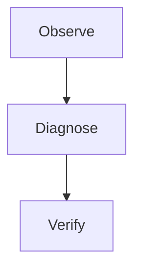

# Operations Runbook Fixture

This runbook-style document gives local test workspaces a realistic operational
page with checklists, command examples, incident tables, status language, and
rich formatting.

Inline marks cover **bold evidence**, _italic context_, ~~obsolete guidance~~,
`literal_code()`, and a [runbook link](https://example.test/runbook).

## Scope

Use this fixture to inspect long technical documents, admin-facing previews,
workspace search, and export behavior. The commands are illustrative and should
not be executed as production instructions.

### Incident Overview

An incident runbook needs stable hierarchy, readable dense lists, and predictable
code-block formatting. It also needs tables that can be scanned quickly.

#### Severity Definitions

| Severity |        Description         |   Response Target | Evidence                        |
| :------- | :------------------------: | ----------------: | ------------------------------- |
| SEV-1    |  Customer-visible outage   |         Immediate | [API](https://example.test/api) |
| SEV-2    |   Degraded core workflow   |        30 minutes | `sync --check`                  |
| SEV-3    | Partial non-critical issue | Same business day | literal \*marker\* and A \| B   |
| SEV-4    |                            |           Planned | Minor copy mismatch             |

| Unaligned | Empty | Rich                |
| --------- | ----- | ------------------- |
| Plain     |       | **bold** and `code` |

##### Severity Notes

Severity labels are intentionally short while descriptions are longer, creating
mixed-width table cells for layout review.

> Keep the incident channel factual; quote verified observations and preserve
> literal Markdown punctuation in exported evidence.

A soft
line break normalizes to a space, while this hard break\
also normalizes without losing either side.

###### Severity Leaf

The smallest heading confirms that runbook subnotes remain readable.

### Triage Checklist

- [ ] Confirm the impacted workspace.
- [ ] Check server health and logs.
- [ ] Reproduce in a browser session.
- [ ] Inspect GraphQL and WebSocket errors.
- [ ] Capture screenshots before changing code.
- [x] Record the verified outcome.
  - [ ] Link the nested follow-up evidence.

#### Command Block

```bash
build/scripts/server/stack-status.sh
build/scripts/server/smoke-api.sh --quick
build/scripts/server/smoke-frontend-selfhost.sh
```



##### Command Notes

The code block should use a stable monospace face from the shared typography
system. It should not inherit body text spacing in a way that harms readability.

###### Command Leaf

Inline command references such as `stack-status.sh` should remain visually
distinct in normal paragraphs.

## Response Procedure

### Phase 1 - Confirm

1. Identify the reported route or API.
2. Check whether the issue is local, containerized, or remote.
3. Confirm whether the currently served bundle matches the repository commit.

#### Phase 1 Evidence

| Evidence       | Source                         | Required  |
| -------------- | ------------------------------ | --------- |
| Screenshot     | Browser                        | Yes       |
| Console errors | Browser DevTools or automation | Yes       |
| Server logs    | Stack logs                     | Yes       |
| Commit hash    | Git and container metadata     | Preferred |

##### Phase 1 Rich Text

The phrase **confirmed regression** should stand out. The phrase _suspected regression_
should be more subtle. The phrase `servedBundleHash` should read as a technical
identifier.

###### Phase 1 Closure

Do not close the incident until the visible route has been rechecked.

### Phase 2 - Mitigate

Mitigation should minimize product risk. Prefer a small server-side fix for
authoritative data defects and a shared Facade/Mantine primitive fix for visual
frontend defects.

#### Phase 2 Checklist

- Remove accidental local CSS before adding new style rules.
- Prefer shared primitives over route-local widgets.
- Update docs when operational behavior changes.
- Add a regression test that fails when the fix is removed.

##### Phase 2 Nested Steps

1. Create a narrow patch.
   1. Keep unrelated changes out.
   2. Avoid local visual forks.
2. Run focused checks.
   1. Typecheck or cargo check.
   2. Browser smoke where relevant.
3. Commit and push.

###### Phase 2 Closure

The mitigation is done when evidence is attached and the route is visually sane.

### Phase 3 - Review

Review the final state critically. If the patch only moves complexity without
reducing it, open a follow-up or continue refactoring until the architecture is
clean enough to maintain.

#### Phase 3 Table

| Review Question           | Good Signal              | Bad Signal      |
| ------------------------- | ------------------------ | --------------- |
| Is behavior covered?      | Failing regression test  | Snapshot only   |
| Is UI shared?             | Facade/Mantine primitive | Route-local CSS |
| Is data authoritative?    | Server owns rules        | Client guesses  |
| Is documentation updated? | Dev and ops docs align   | Notes missing   |

##### Phase 3 SVG


###### Phase 3 PNG


## Post-Incident Notes

### Learning Capture

Write a learning only when a systematic cause is found. Do not create a learning
for every small typo or one-off visual adjustment.

#### Learning Template

```md
# Learning

Cause:
Impact:
Prevention:
Follow-up:
```

##### Learning Notes

The embedded Markdown code block gives renderer tests another language-neutral
preformatted sample.

###### Learning Leaf

This runbook ends with enough depth to test the editor outline and small heading
levels.
