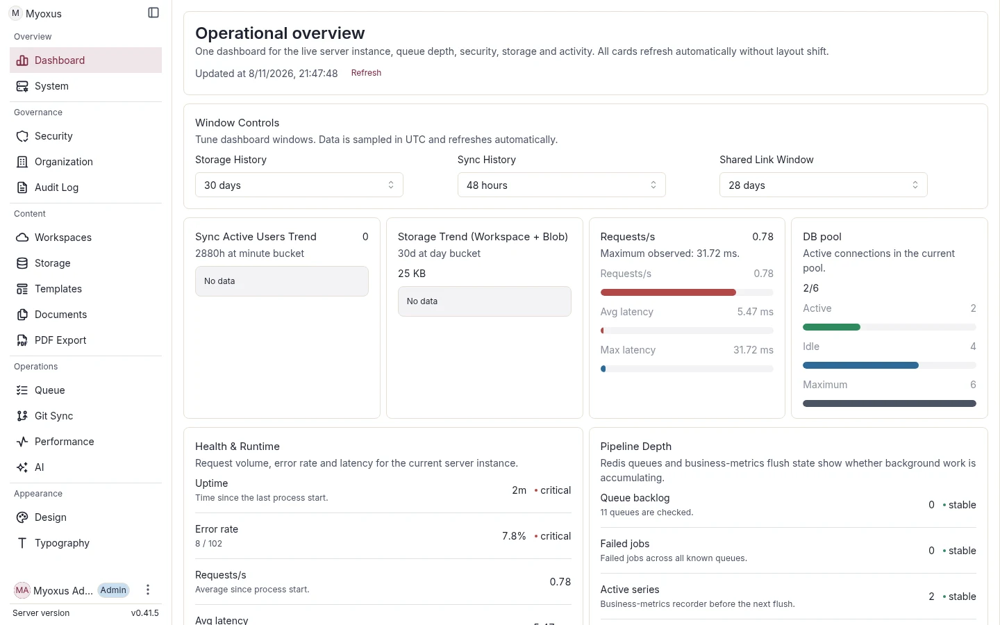

<!-- SPDX-License-Identifier: AGPL-3.0-or-later -->

# Administration

[Documentation](../../README.md) / [Operations](../README.md)

Use the Admin frontend for centrally managed system and organization settings,
the trusted local CLI for maintenance, and the API for scripts and integrations.

## System and organization

| Guide                                            | Use it for                                                |
| ------------------------------------------------ | --------------------------------------------------------- |
| [System operations](./system-operations.md)      | Admin navigation, setup order and configuration ownership |
| [Organization and workspaces](./organization.md) | Units, members, managers, SSO and group mapping           |
| [Appearance and branding](./design.md)           | Global themes, typography and application identity        |
| [Browser client updates](./client-updates.md)    | Traffic fencing and reloads during coordinated updates    |
| [User preferences](./user-preferences.md)        | Account-owned settings and synchronization diagnosis      |

## Content and maintenance

| Guide                                                        | Use it for                                                |
| ------------------------------------------------------------ | --------------------------------------------------------- |
| [Workspace content operations](./workspace-content.md)       | Copy, Move, Extract, Link and recovery                    |
| [Document graph](./document-graph.md)                        | Asynchronous graph indexing and repair                    |
| [Document identity](./document-identity.md)                  | Stable keys, integrity checks and supported repairs       |
| [Metadata and versioning](./document-metadata-versioning.md) | Status schemas, named history, retention and restores     |
| [Local CLI](./cli.md)                                        | Users, workspaces, configuration, imports and queued work |
| [Administration via API](../../api/server/administration.md) | Organization operations and interchange for automation    |

Authentication belongs to [Security](../security/README.md); durable data and
portable vault interchange belong to [Data](../data/README.md).
