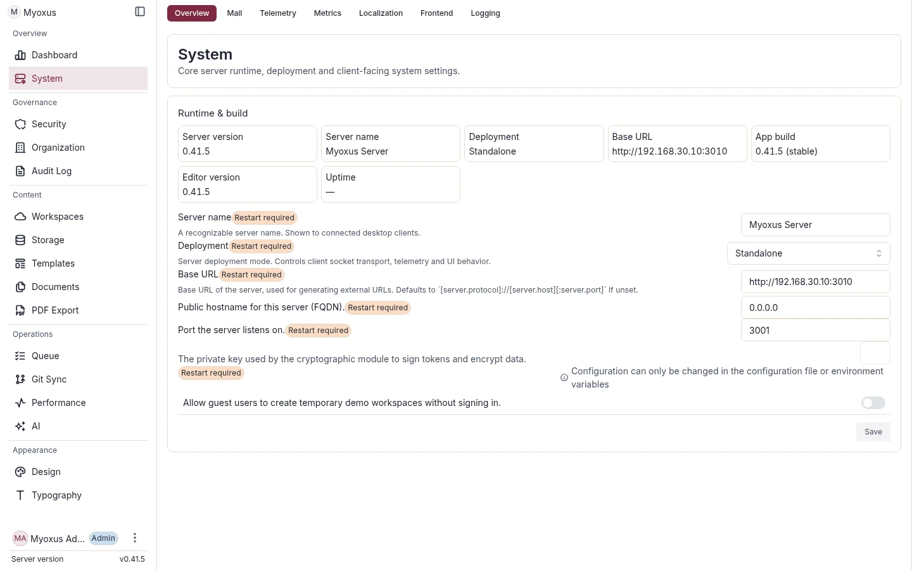

<!-- SPDX-License-Identifier: AGPL-3.0-or-later -->

# Admin operations guide

[Documentation](../../README.md) / [Operations](../README.md) / [Administration](./README.md)

This guide describes the Admin interface from an operator's perspective: which
page owns each decision, a practical setup order, and which settings provide a
stable runtime contract across Web, Admin, and Server.



<details>
<summary>On this page</summary>

- [Principle: one operational owner per domain](#principle-one-operational-owner-per-domain)
- [Recommended order](#recommended-order)
- [Admin UI vs. YAML/ENV](#admin-ui-vs-yamlenv)
- [Quality rules for Admin configuration](#quality-rules-for-admin-configuration)

</details>

## Principle: one operational owner per domain

| Domain                                    | Admin area                     | Source of truth                                |
| ----------------------------------------- | ------------------------------ | ---------------------------------------------- |
| Organization, members, OUs                | Organization                   | PostgreSQL + Admin GraphQL                     |
| Authentication, CAPTCHA, CORS             | Security                       | YAML/ENV plus eligible `app_configs` overrides |
| System, Mail, Metrics, Telemetry, Logging | System                         | Config registry + runtime endpoints            |
| Blob storage, orphans, technical quotas   | Storage                        | Server config + database limits                |
| AI, Copilot, providers                    | AI                             | `copilot.*`, `indexer.*`, provider credentials |
| Design and branding                       | Design and Typography          | Branding/theme config + runtime CSS endpoints  |
| PDF export                                | PDF Export/Templates           | Template registry, ICC assets, PDF config      |
| Font library                              | Design                         | Global theme/font catalog                      |
| Git, Calendar, MCP                        | Integration pages and runbooks | Integration tables + worker queues             |

## Recommended order

The Dashboard is a read-only operational entry point. Window selectors request
UTC ranges; chart captions and axes show the range actually returned by the
server. Sync windows are displayed in hours, storage and shared-link windows
in days. A shared-link range that differs from the selection is shown explicitly.
The server remains authoritative for the effective window.

Refresh updates the overview and its separate shared-link ranking. While a
request is pending, the last successful response remains visible with its
original update timestamp. Failed or incomplete responses show a warning and
Retry rather than replacing counters with zeros. An initial failure offers
Retry instead of an endless skeleton. Empty history means no samples; a real
zero sample stays chart data, and missing values are not connected as zero.

```text
System -> Security -> Organization -> Storage -> AI -> Design -> PDF -> Integrations
```

### 1. System

- Verify the public/external URL. YAML, `app_configs`, CLI, and the Admin API
  use the single canonical path `server.origin`.
- Verify mail sender, SMTP host, port, user, and password.
- Keep the deployment type at `standalone` for self-hosted installations.
- Enable or disable Metrics and Telemetry deliberately.
- Increase logging temporarily and use automatic reversion.

### 2. Security

- Enable CAPTCHA when login is publicly reachable.
- Configure OAuth/OIDC providers only after `server.origin` is final.
- Allow CORS only for actual frontend origins.
- Verify password and mail flows with test users.
- Suspending a user updates status, sessions, and MCP API keys in one atomic
  server operation. Suspension immediately defeats cached sessions, and later
  reactivation does not revive old credentials.

### 3. Organization

- Name the organization.
- Select the organization-unit type catalog.
- Create OUs before distributing many workspaces manually.
- Do not use Manager capabilities as a substitute for global administrator access.
- Treat organizational units as the active structure model; Teams are not an
  alternative administration surface.

### 4. Storage

- Verify the backend and root/bucket.
- Set the free-space threshold (`storage.min_free_space_mb`).
- Set the global technical workspace limit deliberately.
- Do not treat orphaned workspaces as routine cleanup; review the audit first.

### 5. AI

- Enable providers only after the privacy decision is complete.
- Treat provider credentials as sensitive configuration.
- Verify embedding configuration separately from chat configuration.
- Monitor ready backlog, permanent failures, and feature-owned completion
  latency after activation.

### 6. Design and typography

- Save branding and theme settings through Admin, not through a parallel CSS override.
- Verify runtime CSS at `/api/branding/theme.css`; static
  `/style/theme-fallback.css` is exclusively the Electron offline catalog.
- Typography settings must reach Admin, Web, and export-adjacent previews consistently.

### 7. PDF export and templates

- Do not delete system templates.
- PDF uses the global theme/font catalog; PDF Export owns neither a separate
  font library nor a separate font picker.
- Back up operator-provided font add-ons like other blob data. Only PDF-capable
  TTF, OTF, and variable-font assets are accepted.
- Enable veraPDF only when PDF/A validation is an explicit operational requirement.

### 8. Integrations

- Operate Git Sync, Calendar Sync, and MCP with their respective runbooks.
- Integration failures often surface in worker queues; do not inspect only UI errors.
- Never copy credentials into logs or screenshots.

### 9. Delete organization units safely

**Organization -> Units** is the only Admin UI owner for status transitions and
permanent deletion. The detail view first shows a server-generated blocker
preview. Resolve relationships in their owning surfaces, then reload the
preview. Delete remains disabled until the unit is inactive, has no blockers,
and the operator confirms its exact current name. Never delete an OU directly
with SQL or bypass foreign keys.

## Admin UI vs. YAML/ENV

| Setting type              | Prefer YAML/ENV                                 | Prefer Admin UI                   |
| ------------------------- | ----------------------------------------------- | --------------------------------- |
| Boot secrets              | Yes                                             | No                                |
| Database/Redis URL        | Yes                                             | No                                |
| Storage backend           | Yes                                             | Only with a deliberate migration  |
| SMTP                      | Either                                          | Yes, for managed runtime changes  |
| OAuth provider            | Either                                          | Yes, when Admin audit is desired  |
| Metrics/Telemetry toggles | Optional                                        | Yes                               |
| Branding/Typography       | No                                              | Yes                               |
| Provider API keys         | Protected environment or sensitive Admin config | Yes, with suitable audit/rotation |

## Quality rules for Admin configuration

- Every change needs visible ownership: who changed what, and why?
- Trace runtime changes through the Admin audit where possible.
- YAML remains the startup baseline; Admin overrides are deliberate operational decisions.
- After changing Origin, Auth, Storage, or AI, perform a real browser/API verification.
