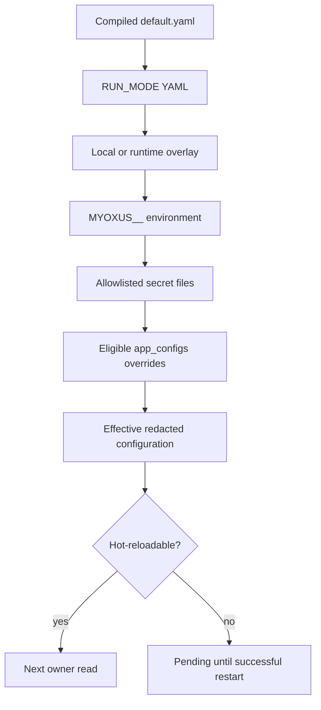

# Configuration

[Documentation](../../README.md) / [Operations](../README.md)

Example and template configuration files for Myoxus deployments.

<details>
<summary>On this page</summary>

- [Files](#files)
- [Usage](#usage)
- [Additional certificate authorities](#additional-certificate-authorities)
- [Related](#related)
- [Configuration lifecycle and precedence](#configuration-lifecycle-and-precedence)
- [Effective values and restart state](#effective-values-and-restart-state)
- [Environment variable format](#environment-variable-format)

</details>

## Files

| File                                                                    | Contents                                                                                                                                                          |
| ----------------------------------------------------------------------- | ----------------------------------------------------------------------------------------------------------------------------------------------------------------- |
| [`selfhost.local.example.yaml`](./examples/selfhost.local.example.yaml) | Credential-free local configuration example. Native deployments may copy it to their package-local config directory; containers use the writable runtime overlay. |

## Usage

```bash
cp docs/ops/configuration/examples/selfhost.local.example.yaml server/config/local.yaml
# Edit non-sensitive values such as server.origin and storage paths.
# Provide database.url and crypto.private_key through the documented secret files.
```

## Additional certificate authorities

Admin operators manage additional trust on **Security → Authentication**
(`/adminfrontend/security?tab=auth#global-tls`). Git Policy links to this surface;
its independent HTTPS/SSH verification policies remain there. The view separates
current configured file metadata (SHA-256 fingerprint, count and earliest expiry)
from the loaded startup snapshot (`/ready`, distinct from gateway `/health`).
Missing status is an explicit error. Legacy Git-only database trust remains
marked migration-required.

**Upload and Apply** accepts at most 1 MiB of complete, currently valid CA PEM.
Existing relative paths are preserved. Without a configured path, the server
publishes `additional-ca.pem` in the runtime-config directory and then enables
that path in the writable runtime YAML overlay. Replacement keeps at most one
sibling `.filename.previous` backup. Identical uploads preserve this backup.
**Restore Previous** validates the backup again; an absent, invalid or identical
backup is unavailable. **Remove Additional Trust** first persists an explicit
empty bootstrap path and verifies that no additional bundle resolves, then
deletes the configured file and its backup. An empty value masks a base YAML path.
No certificate contents or arbitrary server filesystem paths are exposed.

Administration is unavailable when trust is ENV-owned or the runtime YAML
writeback is unavailable/read-only. Resolve those restrictions in operator
configuration. A post-rename directory-sync failure reports uncertain
publication: inspect the refreshed file state before retrying. If cleanup fails
after disabling trust, startup remains disabled; an operator must remove the
remaining files. File actions never mutate the running process's trust snapshot.
Restart every consuming API, worker and CLI and compare loaded identifiers.

`tls.additional_ca_bundle_path` is owned by YAML or
`MYOXUS__TLS__ADDITIONAL_CA_BUNDLE_PATH`, never by a database override. Paths
are relative to the active runtime-config directory and cannot escape through
parent components or symlinks. Only currently valid CA certificates in a complete
PEM bundle are accepted. Invalid configured bundles fail before PostgreSQL is
contacted. The config mount may be read-only; the process materializes its own
temporary snapshot and removes it on normal shutdown.

Changing the path or replacing the file requires restarting every API, worker
and CLI process. The `additional_ca_trust` startup status reports the loaded
source, additional CA count and snapshot ID, not the current contents of a file
edited after startup. Public-library root counts are not inferred.

HTTP, SMTP, SQLx PostgreSQL and Redis composition consume this snapshot. Mail
keeps its explicit STARTTLS/implicit/plain and verification settings. Database
SSL modes remain operator-owned; use `verify-full` when server identity must
be verified. Redis `rediss://` verifies hostname and certificate and retains
native public trust; `redis://` remains plaintext. Backups scope a combined CA
file to the child process; see [CLI backup trust and connection
handling](../administration/cli.md#outgoing-tls-and-backups).

Verify the loaded trust snapshot for every consuming process after restart.
See [Git trust migration](../integrations/git-sync.md#additional-ca-migration)
for the bounded deployed-key transition.

## Related

- [Configuration reference](./reference.md) — full documentation of all configuration options, including [language availability and translation coverage](./reference.md#i18n)
- [Installation guide](../getting-started/installation.md) — step-by-step setup including config

## Configuration lifecycle and precedence



Myoxus configuration is loaded from multiple sources in this order (later sources override earlier ones):

1. `server/config/default.yaml` — built-in defaults, always present
2. `server/config/${RUN_MODE}.yaml` — optional package-owned mode overrides
   when that file exists
3. Optional package-local `server/config/local.yaml` (native development only)
4. The configured runtime overlay (`/opt/myoxus/runtime-config/local.yaml` in containers)
5. Environment variables with `MYOXUS__` prefix
6. Allowlisted secret files for `database.url` and `crypto.private_key`
7. Eligible `app_configs` database overrides

**In Docker**, `/opt/myoxus/config` is immutable image content. Compose mounts
the operator overlay directory at `/opt/myoxus/runtime-config` and provides
database and crypto credentials through the two allowlisted `*_FILE` variables.
Do not bind-mount over `/opt/myoxus/config` or mount only the overlay file.

For the repository container topology, put non-sensitive operator overrides in
the runtime overlay and use the supported Docker/Swarm secret files for the
database and crypto credentials.

---

## Effective values and restart state

The optional runtime overlay is enabled only by
`MYOXUS__CONFIG__WRITEBACK_PATH`. Admin changes are persisted in
`app_configs`; eligible changes are also mirrored to that file using an atomic,
locked write. Startup-owned fields are reported as pending until the mirror has
been loaded by a successful server restart.

Configuration uses one path spelling everywhere: the actual serde/YAML field
name. Examples are `server.origin`, `mail.smtp_host` and
`git_sync.network_timeout_secs`. The same dotted path is used as the
`app_configs.id`, in REST/CLI import/export and by the Admin schema. Unknown,
retired or file-only database rows fail startup instead of being translated.

Structured OAuth provider fields are the bounded exception inside the
`oauth.providers.<name>` object: their canonical external spelling is
camelCase (`clientId`, `groupMapping`, `targetUnitId`). Deployed snake_case
spellings are accepted once at the source boundary and emitted as camelCase.
Duplicate aliases in one source and unknown provider fields are rejected;
ordinary precedence still applies between separate YAML, environment and DB
layers. Provider ids and field values remain case-sensitive and are never
folded by the loader.

Use the CLI to inspect the three distinct views:

```bash
myoxus-cli config export --effective
myoxus-cli config export --overrides
myoxus-cli config export --raw-source --format json
myoxus-cli config check --verbose
```

All export modes mask secrets. `crypto.private_key` and other file-only fields
cannot be written through Admin, HTTP import, or `myoxus-cli config set`.
Prefer `MYOXUS__CRYPTO__PRIVATE_KEY_FILE` for the production crypto key.
The key is file/environment-owned and restart-bound. The Admin configuration
wizard therefore explains this deployment boundary but never generates, reads,
or writes `crypto.private_key` through the database configuration mutation.
See the configuration reference in this section for the public contract.
for the resolver and lifecycle contract.

`myoxus-cli config import` and the REST import endpoint use `null` to release a
database override. The underlying YAML/environment/default value then wins.
The CLI accepts `-` in place of the file path to consume bounded YAML from
stdin; extension-selected JSON input remains file-based.
Both imports reject duplicate raw keys before conversion to a map. YAML input
is bounded to one document and retains supported scalars, nulls, sequences and
anchors; dotted and nested spellings that resolve to the same registry path are
conflicts. Imports neither resolve includes nor interpolate or load external
content.

The shared configuration codec uses `yaml_serde` 0.10.7, with a 4 MiB input cap,
one-document framing and parser depth/alias safeguards. Empty/comment-only YAML
remains null; quoted strings, string-key identity, nulls, sequences and anchor
values are preserved. `<<` is an ordinary key, not an expanded merge, and
`!!binary` retains its string value. Unsupported tags, nonfinite numbers,
duplicate keys and malformed/trailing documents are rejected with sanitized
diagnostics. YAML output may change presentation without changing values;
comments and original anchors are not retained by writeback. Feature files keep
their existing typed spellings/tags, defaults and unsupported-feature filtering.

CLI `--dry-run` performs the same full startup-candidate preparation as apply,
including full-mode removals, and returns failure for an invalid candidate.
It does not reserve the previewed database state. With global `--json`, dry-run
and apply return structured counts, field-only errors and the mirror outcome
(`written`, `unchanged`, `disabled` or `failed`); raw configuration values are
never included. REST imports expose the same outcome. Admin saves show a
warning, rather than a false save failure, when the database commit succeeds
but the optional mirror does not.

When optional overlay mirroring fails after a successful DB commit, the server
logs `CONFIG_WRITEBACK_FAILED`; repair the overlay path or permissions and
repeat the identical set, removal or full import. The retry retains explicit
write intent even when PostgreSQL is already in the requested state, so it can
repair a stale YAML value or remove a registered leaf whose DB row is already
absent. It does not create a second audit event for an unchanged DB value.

PostgreSQL remains authoritative during recovery. If an operator restored an
older YAML file after a successful database commit, repair the file access and
repeat the original save; do not overwrite the retained DB override with a
masked export. A failure before atomic rename preserves the previous file. A
failure while syncing the parent directory after rename is reported as
`failed` with publication/durability uncertainty: the valid new candidate may
already be visible, so inspect the configured path and safely repeat the save.
Do not edit or rename generated mirror files while the server is writing them.

For non-secret automation, a stdin dry-run exercises the same candidate as an
apply without leaving an intermediate file:

```bash
printf '%s\n' 'server:' '  name: Myoxus' \
  | myoxus-cli --json config import - --dry-run
```

---

## Environment variable format

Any config key can be overridden with an environment variable. The convention is:

- Prefix: `MYOXUS__`
- Nested keys: separated by `__` (double underscore)
- Array values: not supported via env vars; use the config file

Examples:

| Config key                                    | Environment variable                                    |
| --------------------------------------------- | ------------------------------------------------------- |
| `database.url`                                | `MYOXUS__DATABASE__URL`                                 |
| `server.origin`                               | `MYOXUS__SERVER__ORIGIN`                                |
| `redis.url`                                   | `MYOXUS__REDIS__URL`                                    |
| `storage.backend`                             | `MYOXUS__STORAGE__BACKEND`                              |
| `logging.file_path`                           | `MYOXUS__LOGGING__FILE_PATH`                            |
| `public_publishing.dynamic_routes_enabled`    | `MYOXUS__PUBLIC_PUBLISHING__DYNAMIC_ROUTES_ENABLED`     |
| `public_publishing.site_shell.search_enabled` | `MYOXUS__PUBLIC_PUBLISHING__SITE_SHELL__SEARCH_ENABLED` |

---

- [Bundled font provenance](./font-provenance.md)

Database starter files are human-maintained YAML under
`templates.root_dir/databases/`, alongside the other template families. Prepare
the complete selected release root before coordinated API startup. See the
[template-root reference](reference.md#template-root) and
[template preparation](../integrations/document-template-bundles.md) for immutable
versions, catalog promotion and restart/failure behavior.
