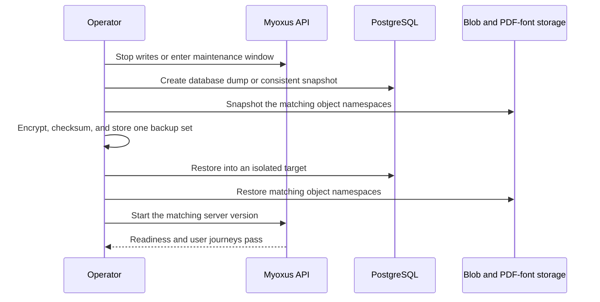

<!-- SPDX-License-Identifier: AGPL-3.0-or-later -->

# Backup and restore

[Documentation](../../README.md) / [Operations](../README.md) / [Data operations](./README.md)

A recoverable Myoxus checkpoint combines PostgreSQL, the configured blob
namespace, and uploaded PDF fonts from the same write boundary. Redis is
rebuildable runtime state and must not be restored over a newer database.

The operator defines retention, encryption, off-site copies, RPO, and RTO.
Myoxus does not provide default policy values for them.



<details>
<summary>On this page</summary>

- [Required backup set](#required-backup-set)
- [Portable workspace exports](#portable-workspace-exports)
- [Create a checkpoint](#create-a-checkpoint)
- [Restore drill](#restore-drill)
- [Failed restore and rollback](#failed-restore-and-rollback)

</details>

## Required backup set

| Target                    | Contains                                                                                                             | Recovery consequence when omitted                                                                   |
| ------------------------- | -------------------------------------------------------------------------------------------------------------------- | --------------------------------------------------------------------------------------------------- |
| PostgreSQL                | Users, workspaces, documents, organization state, configuration, audit state, durable jobs, templates, and blob keys | No authoritative application state                                                                  |
| Configured blob namespace | Uploads, attachments, branding assets, and template objects                                                          | Database references resolve to missing bytes                                                        |
| PDF font storage          | Administrator-uploaded PDF fonts referenced by `pdf_fonts.blob_key`                                                  | Renders using those fonts fail                                                                      |
| External template sources | Operator-authored files under `MYOXUS_TEMPLATE_HOST_DIR` (Swarm default: `$MYOXUS_SWARM_STATE_ROOT/templates`)       | Customized source files are lost; Registry/PDF database and blob backups remain separately required |

The `myoxus-cli backup create` command produces `dump.sql` and
`manifest.json`. It does **not** copy the blob namespace or PDF fonts. Bundle
those storage snapshots and the external mail-template directory with the CLI
output before calling the set complete.

## Portable workspace exports

### Obsidian vault interchange

See the [CLI command reference](../administration/cli.md#workspace-import-and-document-operations)
for exact invocations. The workflow and operational limits below apply to both
the product controls and the CLI.

#### Prepare

Browser Web, Electron and `myoxus-cli workspace import` can submit an explicitly
selected Obsidian vault ZIP to the durable server import lifecycle. Create the
ZIP from the vault contents so its root is the intended workspace root. A sole
top-level folder is a real folder, not an automatically removed archive wrapper.
Keep the original ZIP until the preview and exported result have been inspected.
Every deliberate new import creates a new server-owned workspace; it never
restores over or merges into an existing workspace.

Supported interchange currently covers ordinary Markdown, native highlights
and Mermaid, document links, images and supported attachments, YAML
properties/aliases/tags and folder structure. Native annotations, typed/foldable
callouts and whole-document embeds are also supported. Callouts retain exact
type identifiers, editable titles, authored `+`/`-` defaults and supported nested
paragraphs/headings, lists, quotes, callouts, ordinary code and annotations.
Unknown types use neutral presentation but survive export unchanged. Temporary
viewer expansion/collapse does not change the saved default. Annotations are
editable content, distinct from collaborative comments; reading HTML/public/PDF
projections hide them, while all callout bodies remain visible, including folded
ones. Tables, raw HTML, images, display math, Mermaid and document embeds within
callouts remain diagnosed recovery content. Nesting uses the existing 100-level
document limit; excessive depth blocks native conversion. Obtain a fresh preview
after this conversion-policy change. Whole-document embeds
retain references to their targets rather than copied bodies. Heading and block
links resolve to stable native targets. Ordinary Markdown footnotes keep complete
editable definition bodies in their source parent, including normal images and
precise links. Repeated markers share one local definition; no additional
workspace document is created. Unreferenced definitions remain and export once
with a preview diagnostic. Missing/duplicate/conflicting/nested definitions and
malformed recognizable citation metadata block Apply before product writes,
with a bounded label and source path. Code and escaped syntax stay literal;
deployed citations keep Sources. Obtain a fresh preview after this cutover;
existing experimental documents are not migrated or deleted. Selected
heading/block embeds remain unsupported.
Native snapshots and Myoxus HTML preserve Footnote/Endnote placement. Standard
Markdown/vault export preserves complete definitions and assets but cannot carry
that placement: the existing export report lists `NormalizedEndnote` for each
affected definition. Standard Obsidian reimport yields footnotes. Preserve native
snapshots when placement fidelity is required; no proprietary Markdown or extra
archive file is emitted.
Preview identifies excluded,
unsupported and recovery-only content. Canvas, Bases, plugin execution,
Dataview evaluation, themes/CSS and synchronization are not supported.

A native precise link whose target was deleted, trashed or made inaccessible is
shown as unavailable and does not navigate to a substitute document root. Undo
of a block deletion restores its original target identity. Check access and the
actual target before treating an unavailable link as an import error; heading
renames and moves alone do not invalidate the native ID.

Inline and standalone display formulas use the existing native LaTeX models and
retain authored source. Paragraphs, lists and inline formulas in supported table
cells are supported. Currency, escaped dollar signs, code and literal annotation
bodies remain literal. Unsupported formula placements retain source with preview
diagnostics rather than a native-math claim. This codec cutover invalidates older
preview confirmations; obtain a fresh preview before applying.

#### Preview and apply

Review Preview before Apply: malformed or ambiguous content blocks Apply,
while normalized and source-preserved content requires explicit product
confirmation. The server repeats the bound plan before publication; client
confirmation is not permission to bypass blocking findings. Policy/configuration
changes invalidate old confirmations. Cancel the obsolete job where possible
and submit the original source as a new import to obtain a current preview;
already imported recovery content is never automatically reinterpreted.

The CLI `preview` and `apply` commands each stage a new job. `apply` performs
its own preview before applying; it does not consume the ID printed by a prior
`preview` command. See the command reference for this distinction before retrying.

#### Status and recovery

Jobs, status and previews are durable server state. The product remembers the
active ID only within its current client session: closing and reopening that
dialog reconnects to the same job, but a new browser session is not a promise of
automatic rediscovery. Record the import ID for operator status inspection.
Worker retries within one job reuse its planned identities rather than create
another workspace. Starting a new upload is a deliberate new import, not that
retry mechanism; the product's Start over requests cancellation first for an
active job.

Cancellation or failed Apply compensates the job's created documents, assets and
hidden workspace. If status is `cleanup_required`, inspect it and use the
existing CLI `cleanup` operation to retry compensation before treating the
failure as clean. A waiting CLI timeout does not itself cancel the server job:
inspect the recorded ID instead of immediately repeating `apply`. Do not delete
staged bytes, import records or compensation state by hand. Safe staging/terminal
records are subject to configured retention; cleanup-required records are held
for operator recovery. Successful publication is not undone by import cleanup.

Source-preserved files are authorized recovery attachments, not editable native
notes and not public reading content. They do not overwrite subsequent edits.
Retention of a source is explicit; neither a report nor a later export can
recover bytes that were never retained.

#### Export and inspect

For a server-backed workspace, Workspace Settings can download the current
supported content as an Obsidian vault ZIP. The same projection is available to
operators through `myoxus-cli export-docs --format obsidian`; both callers use
the server-owned exporter and include `myoxus-export-report.json`. Re-importing
that ZIP intentionally creates another new workspace rather than replacing the
source workspace. Current supported note content, YAML properties and aliases,
links, folders and referenced assets are projected; explicitly unsupported
source constructs remain listed in the report and their preserved source is
kept in the nested `.myoxus-recovery/sources.zip` archive when available.

Inspect `myoxus-export-report.json` alongside the notes, links and assets. It
lists projected notes, assets, empty folders, partial-projection diagnostics and
preserved-source hashes. Recovery source does not mean every construct in the
editable projection survived. Keep the report and recovery archive together;
re-export merges existing recovery archives instead of recursively nesting them.
Sole inline annotations normalize to blocks on fresh Markdown import; multiline
inline annotations and bodies outside the supported escape/code grammar carry
loss diagnostics rather than an unqualified hidden-comment fidelity claim.
Standalone multiline annotations remain supported.

The existing document HTML download is a separate reading export, not a vault
download. With or without a mounted editor, it loads current authorized direct
embed targets, bounds nested content to authorized relation titles, and hides
annotations while keeping note callouts visible. Missing targets or revoked
access fail the download with the existing error feedback, even when target
content was previously cached. HTML clipboard and Markdown/vault exports retain
references instead of silently copying embed content.

HTML and public reading projections expose complete formula source as code;
they do not promise MathJax rendering. PDF uses the existing Typst math renderer,
not a TeX converter: LaTeX macros such as `\frac{a}{b}` reach that renderer
unchanged and can fail with its compilation error. Adjacent TeX variables
(`E=mc^2`) can likewise fail as an unknown Typst identifier (`mc`); a successful
browser rendering is not evidence of PDF compatibility. Native source preservation is
not universal renderer parity. Inspect the exported notes and report; formulas
outside the supported Markdown grammar produce explicit loss diagnostics.

The export is bounded to 10,000 documents, 10,000 blob inventory entries and
512 MiB of uncompressed output. Each document is captured from its own current
snapshot plus tail, so the archive does not claim one workspace-wide atomic
instant while users are editing multiple documents. Missing required content or
lost read authorization fails the download instead of returning a partial ZIP.

An Obsidian vault ZIP is a document interchange artifact, not a Myoxus backup:
it does not contain authoritative memberships, permissions, audit history,
comments, jobs or all server configuration. Use the PostgreSQL/blob/font
checkpoint procedure in this document for disaster recovery.

Document snapshot ZIPs and server-backed Electron workspace SQLite exports fetch
Labels (Tags) from SQL for the explicitly exported documents. One authorized
projection contains the catalog, descriptions, semantic colors, archive timestamps
and ordered assignments. It rejects missing/forbidden documents, unavailable API
responses and metadata exceeding the configured workspace import/export limits.

Snapshot archives carry `workspaceTags` in `info.json` and ordered `meta.tags`
inside each document snapshot. When serialization replaces document IDs, the
assignment follows the source document into its new snapshot ID. Electron writes
labels into the root metadata of a temporary SQLite copy before publishing the
file; it never patches its live cache or synchronized root for export. A missing
canonical projection fails the export instead of producing a silently label-free
backup. Local-only native workspaces retain their local source.

These portable files are not a complete server backup. Full/quick native export
still follows its existing content/blob synchronization scope; SQL label metadata
does not make a partial content cache complete. Database JSON retains its own
`workspaceTagsManifest`, CSV retains its explicit loss diagnostics, and
Markdown/HTML/PDF gain no new label presentation. Use the complete checkpoint
procedure below for disaster recovery.

## Create a checkpoint

Prerequisites: PostgreSQL client tools matching the server major version,
credentials supplied outside shell history, enough protected destination
space, and an operator-approved maintenance or snapshot mechanism.

1. Record the running source commit/image digest and Myoxus version.
2. Stop user writes at the edge and allow in-flight requests and workers to
   settle. Abort if writes cannot be quiesced and the storage provider cannot
   produce a coordinated snapshot.
3. Create the database portion. Point the CLI at the owner-only file that
   contains the database URL; do not place the URL itself in an argument or
   shell variable:

   ```bash
   myoxus-cli --database-url-file /protected/path/database-url \
     backup create --output /secure/checkpoints/myoxus-YYYYMMDD
   myoxus-cli --database-url-file /protected/path/database-url \
     backup verify /secure/checkpoints/myoxus-YYYYMMDD
   ```

4. Snapshot the complete configured blob prefix and PDF-font backend while
   writes remain stopped. For local storage, preserve file ownership and modes;
   for S3-compatible storage, preserve keys, versions, and metadata.
5. Store a manifest containing the source version, database dump checksum,
   storage snapshot identifiers, object counts, and creation time.
6. Encrypt the complete set and place copies according to operator policy.
7. Re-enable writes only after every component and checksum is present.

For an upgrade, this checkpoint is the rollback decision point. Do not start a
schema-changing candidate until its complete checkpoint is verifiable.

## Restore drill

The restore target must be isolated and disposable. Never test a restore over a
running production database.

1. Provision an empty PostgreSQL database and empty object namespaces. An unused
   Myoxus installation already has a schema and is not an empty restore target.
   Do not start the API before restoring. Keep the production edge pointed at
   the original instance.
2. Install the Myoxus version recorded in the manifest. A version mismatch makes
   `myoxus-cli backup restore` fail unless `--force` is supplied; do not use
   `--force` until compatibility has been reviewed and explicitly accepted.
3. Restore the database:

   ```bash
   myoxus-cli --database-url-file /protected/path/database-url \
     backup verify /secure/checkpoints/myoxus-YYYYMMDD
   myoxus-cli --database-url-file /protected/path/database-url \
     backup restore /secure/checkpoints/myoxus-YYYYMMDD
   ```

   `restore` invokes `psql` with the clean dump and is destructive to objects in
   the target database. The restore runs in one transaction and stops on the
   first SQL error. Stop immediately if the target is not the isolated restore
   environment.

4. Restore the matching blob prefix and PDF-font storage without changing keys.
5. Start Myoxus. The migration runner may advance only an empty database or a
   database already recorded at baseline `1000` with an exact forward prefix.
   The old 0.41.4/0.41.5 and all other pre-baseline or unknown ledgers remain
   unchanged and fail startup; restore them with their matching older server
   rather than forcing the current server.
6. Require `/health` and `/ready` to pass, then compare workspace and blob counts
   with `manifest.json`.
7. Verify sign-in, one document with history, one attachment download, one
   branded asset, one PDF using an uploaded font, and one Database journey.
8. Record duration and findings against operator RPO/RTO policy, then destroy
   the isolated target securely.

## Failed restore and rollback

Do not repair SQLx history or delete unknown rows. Preserve the failed target
for diagnosis, stop its API, and return the edge to the unchanged original
deployment. Correct the backup or use an earlier complete checkpoint in a new
empty target. A restored PostgreSQL database and mismatched object snapshot are
never an acceptable partial rollback.
