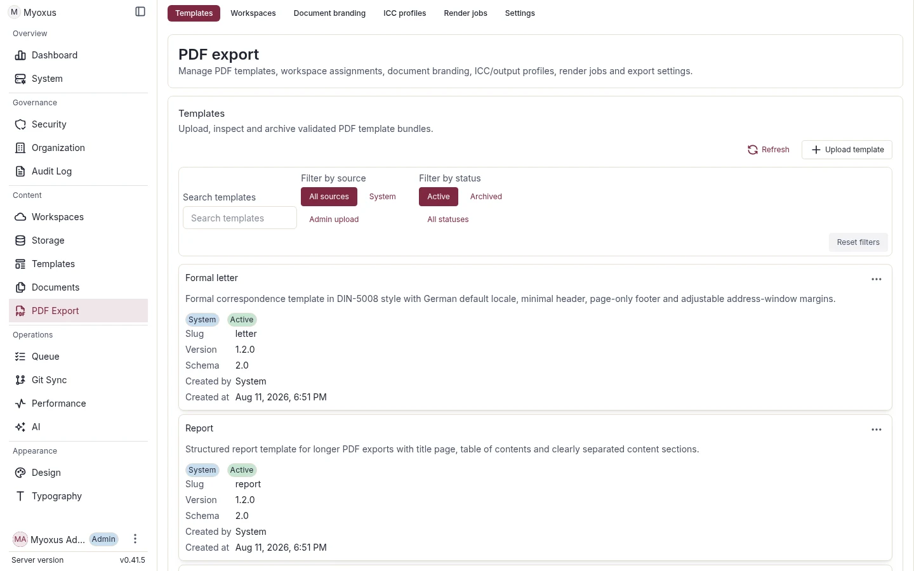

# Typst PDF production

[Documentation](../../README.md) / [Operations](../README.md) / [Data operations](./README.md)

Manage PDF templates, document branding, approved fonts and color profiles.
Myoxus renders documents through Typst; this guide covers operator controls,
render diagnostics, retention and recovery.



The optional veraPDF Compose profile supplies PDF/A validation.

<details>
<summary>On this page</summary>

- [Parent-local note support](#parent-local-note-support)
- [1. System-templates](#1-system-templates)
- [Admin workflows](#admin-workflows)
- [3. Render-audit retention](#3-render-audit-retention)
- [4. Troubleshooting](#4-troubleshooting)
- [5. Configuration reference](#5-configuration-reference)
- [6. Recovery runbooks](#6-recovery-runbooks)
- [Export through MCP](#export-through-mcp)

</details>

## Parent-local note support

Local footnotes render at the page foot through Typst; long entries can continue
onto later pages and repeat references reuse one entry. Explicit endnotes use a
separate counter and follow the body once. Unreferenced retained bodies stay in
a labelled section without reference numbers. Normal private image authorization
and current/historical snapshot selection apply to both kinds.

A nested/cyclic note reference, unsupported definition block, missing ordinary
child or unavailable definition image fails before delivery with `DecodeError`
and a bounded reason. The server does not silently substitute an endnote or
truncate a body. Local markers in titles, captions or other text outside the
canonical body/table sequence are rejected before rendering. Standard
Markdown/vault interchange preserves content and reports endnote-placement
normalization; use native/HTML for placement fidelity.

---

## 1. System-templates

The bundled system-template set ships with every server build and is
reconciled with `pdf_templates` on every boot via
`infrastructure::pdf_export::template_bootstrap::seed_system_pdf_templates`.

| Slug                     | Use case                                                                                 |
| ------------------------ | ---------------------------------------------------------------------------------------- |
| `default`                | Neutral baseline; filename/version header and date/organisation/page footer.             |
| `report`                 | Branded report — cover page, automatic TOC, brand-and-page footer.                       |
| `letter`                 | DIN-5008 Form B correspondence; German default locale.                                   |
| `myoxus-doc`             | Documentation based on ilm 2.1.1; cover, TOC and chapter footer; English default.        |
| `presentation-clean`     | Spacious Simple-based presentation with cover, slide boundaries and continuation labels. |
| `presentation-focus`     | Metropolis-based presentation with strong section hierarchy and progress footer.         |
| `presentation-navigator` | Dewdrop-based presentation with compact top navigation above the content area.           |

**Stable IDs.** System templates use deterministic UUIDv5 ids derived
from the system-template namespace. The same `default` slug always
resolves to the same UUID across cold starts — handy for fleet
automation and cross-instance defaults.

**On-disk layout.** Bundle source lives under
`server/templates/pdf/<slug>/`:

```text
default/
  manifest.json
  main.typ
  preamble.typ
  theme.typ
  i18n/en.json
  i18n/de.json
```

The server captures all seven manifests and declared assets from the configured
`templates.root_dir/pdf` at startup. It rejects missing, escaping, symlinked,
oversized or invalid inputs before any PDF write. Every system-owned bundle
that needs insertion or replacement must compile with the packaged compiler and
configured render deadline before any catalog entry is uploaded or activated.
Unchanged, Admin-owned and newer stored bundles do not trigger compilation.
Exports use the captured database/blob bundle, including queued, CLI and MCP
exports; they never read the host catalog while rendering.

**Idempotency and updates.** Existing system-owned rows are compared with the
manifest and complete file-hash set. Both initial creation and replacement use
content-addressed revision keys. The database transaction rechecks the observed
owner, header and files before swapping the stable UUID's bundle; workspace
assignments remain intact. Matching concurrent writers are idempotent, while
incompatible same-version winners cause an explicit startup conflict. Admin-owned
rows and newer versions are preserved, including under reserved system slugs.
Revision keys are not deleted as upload compensation: concurrent writers and
in-flight exports can still reference those bytes.

Maintain the complete root with the common
[template preparation workflow](../integrations/document-template-bundles.md#distribution).
Review changes in a separate extraction; preparation does not overwrite operator
files. Restart after editing external PDF files. Manifest versions retain the
PDF SemVer/downgrade rules; unlike native Registry revisions, system PDF
reconciliation also detects changed bytes under the same version. A pure path
relocation with unchanged manifests and file hashes performs no replacement or
version bump and never rewrites existing documents. Invalid required input stops
readiness while the previously active database/blob bundle remains intact.

The `myoxus-doc` bundle vendors ilm 2.1.1 at revision
`b8429f456ec519717a11e24656ceaf0cc1435d82`. Its `vendor/NOTICE` records upstream
and adapted source hashes; `vendor/LICENSE` preserves MIT-0 licensing. The
small adapter parameterizes typography, document colors, page policy and footer
content. Bundle locale files cover EN/DE/FR/ES. Bibliography, appendix and
specialized indices remain inactive. This template
is available for explicit workspace assignment, not automatically assigned.

Presentation templates share one adapter and one pinned dependency source under
`server/templates/pdf/vendor/`. Touying 0.7.4 and uniwarn 0.1.1
are captured into every consuming bundle, so rendering never fetches packages
or reads another template's database files. Their archive hashes, licenses and
the single bundle-local uniwarn import adaptation are recorded in
`vendor/NOTICE`; the runtime-source inventory is registered in
`server/provenance/components.json`. Bundled dependencies remain available
without network access, with their licensing and adaptations recorded in the
bundle notices.

Upload validation and Admin preview use the manifest's cover, TOC and language
defaults with a fixed sample document, so their default layout branches are
compiled before a bundle is accepted.

Enum capabilities list a nonempty supported subset of their closed V2 tokens.
A template may disable confidentiality labels with `max_items: 0`; the upper
limit remains eight. Existing complete capability lists remain valid.

### Documentation export controls

`myoxus-doc` uses typed `title`, optional `subtitle`, `author` and ISO
`report_date` inputs. The date uses the shared `format: "date"` validator and
requires a real, zero-padded YYYY-MM-DD calendar date. Omitted inputs use document
metadata; handbook version information belongs in document metadata/content. Cover and TOC controls
emit each section once. Automatic TOC requires at least two outlined headings.
Headings retain source numbering; the template does not add a second scheme.
Links use underlined document text color so an accent intended for decoration
cannot make link text unreadable.
The footer choices are none, page number only, or document identity/chapter/page;
Arabic, Roman and hidden numbering are independent choices. Color treatment uses
the effective document palette: grayscale, grayscale with accent highlights, or
full palette. Typography uses the effective heading/body/mono roles and approved
PDF fonts. Page dimensions and orientation remain ordinary export settings.
Bibliography, appendix and specialized indices are not exposed.

### Presentation authoring contract

`presentation-clean`, `presentation-focus` and `presentation-navigator` use the
ordinary typed title, subtitle, author and date inputs plus the existing cover
and TOC controls. Clean uses Touying Simple, Focus uses Metropolis with a progress
footer, and Navigator uses Dewdrop with compact inline navigation above the
content area. With a cover enabled, the selected template owns the document
title so it appears once. Document structure maps to slides as follows:

- Content before the first H2 becomes an introductory content slide.
- H1 starts a section slide and retains the content following that heading.
- H2 starts a regular slide. H3 through H6 remain inside that slide.
- A document without headings still produces one content slide.

Text that exceeds a page continues at the same font size on pages labelled
`Continued` (localized for EN/DE/FR/ES). Images, diagrams and canvas snapshots
remain indivisible fitted items in source order. Wide visuals with an aspect
ratio of at least 2:1 may expand to the presentation content width; narrower or
small visuals retain their natural size. The template uses the selected page
size and orientation. Its optional `paperSize` capability advertises A4,
Letter, A3, A5 and `16:9`; templates without that capability retain the four
established print formats. For slides, choose `16:9` landscape. The renderer
uses exactly 960 × 540 pt in landscape and 540 × 960 pt in portrait, while an
explicit format remains selected across template switches and is rejected if
the next template does not support it.

### Document appearance mapping

Bundled templates consume the effective workspace theme snapshot captured when
the export is dispatched. Heading, body and monospace font metrics retain their
separate PDF roles. Cover text, running text and captions use named ratios of
those role sizes, so administrators change them through the ordinary theme
typography editor rather than through template-local point sizes. Paragraph,
list and caption rhythm is body-relative; multiline code uses the monospace
role's leading. Physical page margins, letter-window geometry, image sizing and
technical stroke widths remain template-owned.

Document colors follow the resolved export palette. Secondary text blends the
effective text and background colors, neutral surfaces blend the effective
background and rule colors, and structural strokes use the effective rule
color. Callout labels continue to identify their type while their surface and
edge use the effective background and accent. Explicit document branding keeps
its existing precedence over theme defaults, and the selected document color
policy remains independent from the application light/dark mode.

Paper size and orientation are resolved for each export. `portrait` is the
default; an explicit `landscape` choice is captured in the render inputs, hash
and audit data before synchronous rendering or queue dispatch. The selected
geometry applies to every page produced by the template, including enabled
cover and table-of-contents pages. Diagrams remain ordinary document content:
they reflow within the template's usable page area without rotating their
source geometry. Bundled templates contain Mermaid, images and Edgeless
snapshots within both the usable width and usable height while preserving their
aspect ratio. A visual that does not fit the remaining flow area moves intact
to the next page; small visuals keep their natural size. The letter template
keeps its DIN fold and punch marks in portrait and omits those physical-sheet
marks in landscape.

Uploaded templates receive the boolean Typst binding `page-flipped` and must
use it in their page rule to honor landscape exports. Reconciliation never
rewrites administrator-owned Typst source to add that rule. The bundled visual
fitter is opt-in template behavior, so existing administrator-owned layouts are
not silently changed.

These semantic bindings are additive renderer inputs. Bundled templates use
them directly; existing administrator-uploaded bundles keep their declared
files and explicit styles and require no new import.

### Bundle-local compiler files

Rendering, upload validation and Admin previews resolve local Typst imports,
includes, data reads and assets from the validated in-memory bundle map.
Relative imports resolve from the importing module, including nested directories;
absolute Typst paths refer to this virtual bundle root, never the host filesystem.
Missing files, non-UTF-8 source modules, package roots and paths escaping the
virtual root fail compilation. No Universe packages are fetched. Bundle keys must
be canonical relative paths, without colons, backslashes or normalization aliases.
Document `blob:` assets are a separate namespace and cannot be imported as source.

The generated main source has an unaddressable identity distinct from bundle
`main.typ`. Production still concatenates dynamic bindings, `theme.typ`,
`preamble.typ` and the rendered body; it does not execute `manifest.entry`.
Existing cover/TOC markers retain their meaning. Validation and preview use the
same composition when the theme/preamble pair exists; their existing custom-entry
fallback includes the declared entry when that pair is absent. Such validation
does not remove production's requirement for the theme/preamble pair.

### 1.1 Typst engine upgrades

The server embeds Typst `0.15.1`; persisted manifests declare the compatible
line `0.15.x`. Template registry loads reject every other line. Startup first
reconciles the stable `default`, `report`, `letter`, `myoxus-doc`,
`presentation-clean`, `presentation-focus`, and `presentation-navigator` UUIDs
and then runs a
bounded metadata guard over every active template. A missing system template,
an incompatible administrator template, or a failed system-bundle write stops
startup before HTTP readiness.

Administrator-owned bundles are migrated with the configured production
storage adapter, not a CLI-only filesystem shortcut:

```bash
# Verify hashes, schema, assets, and target-renderer compilation without writes.
myoxus-cli pdf templates migrate-engine --from 0.14 --to 0.15

# Repeat validation under row locks and update only /engine/version atomically.
myoxus-cli pdf templates migrate-engine --from 0.14 --to 0.15 --confirm

# Machine-readable evidence uses the same dry-run contract.
myoxus-cli --json pdf templates migrate-engine --from 0.14 --to 0.15
```

The report contains template IDs and slugs, old and target engine declarations,
old and target manifest hashes, file paths and content hashes, explicit compile
success, action counts, and dry-run or confirmed state. It never includes
source bytes, document content, credentials, storage URLs, or raw adapter and
compiler errors. Confirm normalizes a compatible exact target such as `0.15.1`
to `0.15.x`; an exact `0.15.x` declaration remains byte-identical.

This recovery command loads only the static file/environment storage
configuration. It deliberately does not materialize unrelated live
`app_configs` overrides, so it remains available before a candidate server has
canonicalized historical configuration keys. FS, S3, and R2 still use the
same production adapter and prefix as the API.

#### Maintenance and rollback sequence

1. Stop API and worker processes. Verify that queued and running PDF jobs are
   both zero.
2. Disable blob garbage collection for the complete change window.
3. Create and restore-test a database backup and a matching object-storage
   backup. Neither backup alone is sufficient because file rows and blobs are
   one logical template bundle.
4. Run the dry-run. Resolve every incompatible manifest, missing blob, hash
   mismatch, schema error, or compile failure before continuing.
5. Run `--confirm`. A publication lock prevents concurrent template inserts,
   updates, and deletes while all manifests, file rows, hashes, blobs, and
   compilation results are revalidated. Any changed set or failed bundle
   aborts the transaction. No template is partially migrated and the command
   never rewrites blob bytes.
6. Start the API. Require successful system-template reconciliation and the
   startup engine guard, then render `default`, `report`, `letter`, and every
   migrated administrator template synchronously.
7. Start the worker and render at least one migrated administrator template
   asynchronously. Compare output and audit metadata with the synchronous path
   before restoring normal traffic.
8. Re-enable blob garbage collection only after the verification is complete.

On any failure, stop the new API and worker, restore database and object
storage as one backup set, and start the previous API and worker images. Since
the migration does not rewrite blobs and garbage collection remains disabled,
restored file rows resolve to the original bytes. Never roll back only the
manifest JSON.

---

## Admin workflows

Open **PDF export** in the Admin frontend. Use its tabs for routine operations:

| Tab                   | Use it for                                           |
| --------------------- | ---------------------------------------------------- |
| **Templates**         | Upload, inspect, update and archive template bundles |
| **Workspaces**        | Assign templates and select a workspace default      |
| **Document branding** | Logos, document colors and layout defaults           |
| **ICC profiles**      | Color-profile inventory and uploads                  |
| **Render jobs**       | Status, timings, diagnostics and cancellation        |
| **Settings**          | Global export settings and render limits             |

For scripts and integrations, see [PDF production via API](../../api/server/pdf-production.md).

### 2.1 Upload a new template

In **Templates**, use the upload action to supply the manifest, declared files
and rights confirmation. Myoxus validates the complete bundle before saving:

1. Manifest schema and package metadata validation. `id`, `name`, stable
   SemVer `version`, renderer-compatible Typst engine and complete
   license/source `provenance` come only from the manifest.
2. Locale and rights-confirmation validation.
3. Safe relative-path validation; absolute paths, backslashes, empty segments
   and `.`/`..` traversal are rejected.
4. `manifest.assets` ↔ `filePaths` set-equality check (every declared
   asset must be uploaded; no extras).
5. The configured `pdf_export.max_template_bytes` value is enforced both per
   file and across the complete bundle.
6. Typst compile validation (`render_stub_pdf_bytes_with_limits_and_permit`) — a stub
   document is rendered through the template to catch syntax errors,
   missing fonts, and runaway loops at upload time. Validation and preview use
   the packaged `myoxus-pdf-compiler` process. A deadline terminates and reaps
   compiler execution before returning `Timeout`; caller cancellation also
   triggers cleanup. Compiler transport uses bounded pipes without tempfiles.
   The existing `pdf_export.limits.max_memory_mb` setting (default 1024, MiB)
   also applies to upload/replacement, preview, sync and queued export. The
   packaged Linux 64-bit compiler enforces a hard address-space limit before
   decoding untrusted input, after trusted worker startup; insufficient startup
   memory or allocator exhaustion returns `TooLarge`. Failed execution publishes
   no PDF artifact or successful export audit event. Core dumps are disabled,
   temporary font inputs remain owned until reaping, and compiler stderr is
   never logged. Unsupported platforms fail closed instead of rendering without
   a memory limit. Existing lower inherited process limits and container cgroups
   are preserved. Live Admin resource overrides are snapshotted per execution;
   removing an override restores file/ENV values. This is a per-compiler budget,
   not a reservation across simultaneous compilers.
   Stub compilation does not certify PDF/A conformance. Output standards and
   optional external validation follow each export's `compliance_profile`,
   independently of upload/replacement acceptance.
7. Blob-store write under a fresh template UUID (replacements use content-addressed revision keys).
8. DB insert (transactional: template row, every file row and the authenticated
   upload audit in one transaction).

Upload, replacement, metadata update and archive commit with their authenticated
audit event. Audit storage failure rejects the operation and leaves the active
header, file inventory and reuse inputs unchanged. Replacement checks the observed
header and complete inventory under the same row lock; a conflicting writer
activates no files and emits no successful-change audit. Cache invalidation follows
commit. The trusted CLI and startup reconciler retain their existing audit policy.

The database insert is atomic. A failed initial upload compensates only its own
fresh-UUID blob keys; a storage cleanup failure can retain inactive bytes.
Replacement revision keys remain available because another writer or an
in-flight export can reference them. Database activation and blob storage do not
form a shared transaction. Audit event: `pdf_template.upload`
(`category = pdf_export_config`).

### 2.2 Delete a template

Archiving a template keeps its row in `pdf_templates` with `deleted_at` set.
An active workspace assignment prevents removal. Unassign the template in
**Workspaces** first.

Template and captured revision files remain readable after archiving. A missing
or already archived template returns `false` without another audit.

Audit event: `pdf_template.delete`.

### 2.3 Update template metadata

Metadata updates patch the `name` column and `manifest.name` /
`manifest.description` under the template row lock. Omitted fields retain their
current values, including concurrent edits. A valid update emits an audit even
when the supplied value already matches the row.
To publish a newer capability matrix or file set, use
`replacePdfTemplateBundle`. The replacement must preserve `manifest.id`, carry
a strictly newer SemVer release and pass the complete upload pipeline.
Template UUID, workspace assignments and workspace-default selections survive
the atomic swap. Bundled system templates are reconciled from the configured
filesystem catalog; Admin-owned uploads retain their catalog authority.

The manifest is the sole package-metadata authority and requires
`provenance.license_spdx`, `copyright_notice`, HTTPS `source_url` and
`source_revision`; optional attribution text belongs in `provenance.notice`.

Audit event: `pdf_template.update_metadata`.

### 2.4 Workspace template assignments

In **Workspaces**, select the workspace, enable its templates and choose the
default. Clear the default before unassigning that template.

Setting a default updates `pdf_export_settings.default_template_id`, the single
PDF-settings owner for workspace defaults. It must not write a brand-side
mirror. Unassigning the current default is **refused** — admins must clear the
default first.

### 2.5 Document branding

In Admin's **Document branding** tab, select the workspace before editing.
Switching between workspaces retains unsaved footer and custom-color drafts
for each visited workspace while the page remains open. **Save** writes the
selected workspace and waits for readback; **Discard** restores that section
from the current server profile without a write. A rejected save retains the
draft. **Reset document branding** requires confirmation and clears only the
selected workspace's branding and retained drafts, not PDF export settings.

Workspace assignment/default, settings and document-branding mutations commit
with their audit event. An audit storage failure rejects the change and leaves
the prior configuration intact. Replacement logos use a fresh immutable storage
key; failed uploads remove only their own staged file. Committed logo files remain
readable after replacement, deletion or reset for exports that already captured
them. Existing stored logo keys remain readable without migration.

The workspace settings form loads persisted defaults before creating its editable
draft. Background readback preserves unsaved edits; saving uses the selected
workspace. Changing the default template updates its assignment and settings
reference in one transaction.

SVG uploads run through `usvg`-AST-roundtrip sanitisation —
`<script>`, `on*`-handlers, `<foreignObject>` HTML, and external
`href` schemes are stripped. PNGs go through magic-byte detection;
unknown formats are refused. `pdf_export.max_brand_asset_size_mb`
caps the upload (default 8 MiB).

PDF font families and theme typography are not configured in the PDF-export
admin module. Exports use
the effective theme profile selected by the workspace, or the global profile
when the workspace inherits the default. The server projects
`typography_styles.pdf_role` into `render_inputs.theme_fonts` and
`render_inputs.theme_typography` (weight, style, size, line height and
tracking), and materialises the referenced files through
`render_inputs.theme_font_assets`. The PDF module owns only that
mapping/materialisation layer, not a separate admin/PDF font theme. Bundled
templates consume the role metrics for document body, headings and monospace
content; intentionally smaller running headers, footers and DIN/report layout
details remain template geometry.

The PDF-export settings panel does own two global technical conversion factors:
`pdf_export.heading_font_scale` and `pdf_export.body_font_scale` (both bounded
to `0.5..=1.5`). They scale Web CSS typography after the standard px→pt
conversion and deliberately have no workspace override. The defaults are `0.95`
for headings and `1.05` for body/mono/symbol text. Thus the standard theme's
14 px body role becomes `14 × 0.75 × 1.05 = 11.025 pt`; heading sizes continue
to derive from the selected theme and the template's semantic heading levels
rather than from a second set of absolute PDF point sizes. Paper size, colour
profile and image quality use global defaults (`A4`, `sRGB`, `high`) plus the
existing workspace overrides. Locale falls back to the main Web locale
(`i18n.default_locale`); orientation is selected per export and defaults to
portrait.

### 2.6 Uploaded font add-ons

This AdminRoot surface is an operator add-on path, not a PDF-export module
font picker. Bundled product/theme fonts are owned by the global
`font_families` / `font_assets` catalog and reach rendering through
`render_inputs.theme_font_assets`.

Uploads accept only raw SFNT PDF fonts (`.ttf`, `.otf`, including variable
TTF). Browser containers (`.woff`, `.woff2`) are rejected before DB/blob writes.
Accepted uploads land in `license_status = 'pending'`. License auto-detection
reads the SFNT name table (id 13/14) and keyword-matches OFL / Apache-2.0 /
MIT / GPL; the auto-suggestion can be overridden with the `license` argument.
The render pipeline materializes only `approved` add-on fonts; pending and
rejected fonts are skipped. Rejection requires an operator reason; the server
persists it in `admin_audit_log.new_value.reason` for forensic review.

PDF add-on font upload, approval, rejection and deletion commit with their
authenticated audit event. Before/after status and deletion metadata are read
under the row lock. An audit failure rolls back the row; failed upload cleanup
removes only that operation's immutable staging key. SHA-256 row deduplication
remains unchanged, and a conflicting upload leaves committed font bytes intact.
The trusted CLI keeps its existing local audit policy; its optional license
override now commits together with approval.

### 2.7 ICC profiles

The bundled sRGB v4 profile (CC0 1.0 — Compact-ICC-Profiles project)
is seeded automatically on every server boot under the name
`"sRGB v4 (system)"`; `uploaded_by` stays NULL for system seeds.
Admin uploads carry `Some(uploaded_by)`.

ICC upload and deletion also commit their audit in the row transaction.
Replacement staging uses operation-owned immutable keys, including bootstrap
attempts; a losing upload or seed cannot delete another profile's bytes. Existing
stored keys and system rows are preserved without migration. Blob cleanup after
deletion uses the removed row returned by the committed transaction.

The server accepts RGB/CMYK display, input and output ICC profiles. Admin's ICC
panel offers deletion only for uploaded profiles. The server's existing deletion
policy also allows system entries; referenced global/workspace defaults follow
`ON DELETE SET NULL`. Audit failure rolls back those reference changes as well.

### 2.8 Inspect render jobs

Open **PDF Export > Render jobs** to filter by status, workspace/user ID and
creation dates. IDs must be valid UUIDs. Loading and failed readback are not
empty results: **Retry** or **Refresh** reloads the current filters without
repeating an export. Server events also refresh the list.

**Details** opens the native drawer with the actual document/workspace,
requester, timings, render audit and available error details. Cancellation is
available only for queued/running jobs and requires confirmation. A failed job
with audit data does not establish that an export succeeded; inspect its error
class and details, including invalid source images, before retrying the export.

---

## 3. Render-audit retention

The `pdf_export_render_audit` table records one row per export call.
Rows are immutable by design — no UPDATE/DELETE-one path exists. Purging is
irreversible and removes the on-record link between renders, actors, and brand
snapshots. Before continuing, approve the retention boundary, capture and
verify a database backup, and confirm that the CLI targets the intended
deployment.

Preview the exact UTC boundary and row count:

```bash
# Dry-run (shows what WOULD be deleted)
myoxus-cli pdf audit purge --before 2026-01-01

# JSON output
myoxus-cli --json pdf audit purge --before 2026-01-01
```

`--before` accepts both `YYYY-MM-DD` (interpreted as 00:00 UTC on
that day) and full RFC-3339 timestamps. Without `--confirm` the
command runs in dry-run mode and prints the row count that would be
deleted; this matches the pattern of `workspaces delete` /
`users delete`.

Abort if the parsed timestamp or preview count differs from the approved
record. Apply during the approved maintenance window:

```bash
myoxus-cli pdf audit purge --before 2026-01-01 --confirm
```

The result must report the same affected-row count as the immediately preceding
dry-run. Repeat the dry-run and require zero rows. If the wrong rows were
removed, stop further exports and restore the verified database checkpoint;
there is no row-level undo.

---

## 4. Troubleshooting

### 4.1 Render error classes

The mutation returns failures as GraphQL errors with a stable
`extensions.class` field. **Pin user-facing translations on the
class, never on the error message** — the message is for log lines.

| `class`         | Cause                                                                                        | Operator action                                                              |
| --------------- | -------------------------------------------------------------------------------------------- | ---------------------------------------------------------------------------- |
| `Forbidden`     | Caller lacks workspace Read OR template not assigned                                         | Verify assignment via `pdfWorkspaceAssignments`                              |
| `Throttled`     | Workspace already has `max_concurrent_per_workspace` jobs in `queued`/`running` (1 h window) | Wait, or raise the limit in `pdf_export.limits.max_concurrent_per_workspace` |
| `TooLarge`      | Document exceeds `max_input_blocks` OR rendered PDF exceeds `max_pages`                      | Split the document                                                           |
| `Timeout`       | Typst render exceeded `pdf_export.limits.render_timeout_seconds`                             | Inspect the doc for runaway recursion / template infinite loops              |
| `RenderError`   | Typst compile failure during render                                                          | Inspect the `error_detail` log line; usually a template bug                  |
| `DecodeError`   | Source Yjs blob could not be parsed                                                          | Run `myoxus-cli workspaces compact-doc <workspace-uuid> <document-uuid>`     |
| `AssetError`    | Embedded image / asset failed to load                                                        | Check the workspace's blob store availability                                |
| `TemplateError` | Template registry could not load the bundle                                                  | Check `pdf_template_files` rows + blob-store integrity                       |
| `StorageError`  | Output blob write failed                                                                     | Inspect storage backend health                                               |
| `EnqueueError`  | Redis queue push failed; row marked `failed`                                                 | Check Redis connectivity                                                     |
| `Stalled`       | Job sat in `running` past the stall threshold                                                | Worker died; the nightly reaper cleans these up                              |

### 4.2 Common symptoms

| Symptom                                               | Likely cause                                                                                                    | Fix                                                                                                              |
| ----------------------------------------------------- | --------------------------------------------------------------------------------------------------------------- | ---------------------------------------------------------------------------------------------------------------- |
| Global theme font not honoured in PDF                 | Family is not bundled as TTF/OTF/VF or not approved                                                             | Pick a family exposed by `GET /api/fonts` / approve upload                                                       |
| Brand logo doesn't show up after upload               | SVG sanitiser stripped the relevant element                                                                     | Re-upload as PNG, or simplify SVG (no `<foreignObject>`)                                                         |
| Audit log silent for PDF Export                       | `admin_audit_log_category_check` constraint missing entry                                                       | Stop the API; restore a schema matching its SQLx ledger and rerun normal startup validation                      |
| `exportPdf` aborts with audit-write failure           | `pdf_export_render_audit` table missing or storage error                                                        | Check storage first; if the table is absent, restore a schema matching its ledger                                |
| Server does not become ready after a template release | System reconciliation failed, a stable system UUID is missing, or an active manifest targets another Typst line | Inspect the fatal startup error; repair storage or run the documented engine preflight/confirm before restarting |
| Workspace UI shows no templates available             | No assignment rows for the workspace                                                                            | Use `assignPdfTemplateToWorkspace` to wire each template                                                         |

### 4.3 Document storage issues

PDF export reads the same active Myoxus Yjs storage contract as the web editor:
canonical `myoxus:*` block flavours, `sys:*` system fields, `prop:*` model
fields and `Y.Text` for rich text. Headings are paragraph blocks with
`prop:type = "h1".."h6"`; there is no active `myoxus:heading` block.

Tables must arrive as active flat-data `myoxus:table` blocks. Operators should
expect row, column and cell data on the table block itself:

- `prop:rows.<rowId>.rowId`
- `prop:rows.<rowId>.order`
- `prop:columns.<columnId>.columnId`
- `prop:columns.<columnId>.order`
- `prop:columns.<columnId>.textAlign` (optional `left`, `center`, or `right`)
- `prop:cells.<rowId>:<columnId>.text` (`Y.Text`)

PDF cells retain their column's alignment after row/column ordering. Missing
or unrecognized alignment keeps the existing default alignment.

If a PDF export produces missing or empty tables, treat it as a document storage
or import-path problem first, not a template problem. Reproduce with a simple
Markdown table import, compact the affected document if the blob is stale, and
check server logs for Yjs decode or IR-build warnings before editing templates.

### 4.4 Diagnostic queries

**List all templates + assignment counts:**

```sql
SELECT t.slug, t.version, COUNT(a.workspace_id) AS assigned_workspaces
FROM pdf_templates t
LEFT JOIN pdf_workspace_template_assignments a ON a.template_id = t.id
WHERE t.deleted_at IS NULL
GROUP BY t.slug, t.version
ORDER BY t.slug;
```

**Last 50 render activity per workspace:**

```sql
SELECT created_at, actor_id, doc_id, locale, render_appearance_hash
FROM pdf_export_render_audit
WHERE workspace_id = '…'
ORDER BY created_at DESC
LIMIT 50;
```

`render_appearance_hash` is the stable audit fingerprint for the visual render
appearance: document branding, effective theme selection, resolved theme fonts
and concrete font assets. PDF policy inputs such as paper size, ICC profile,
image quality and ligatures are audited separately in the render/L3 input
snapshots.

**Render-success rate over the last 24 h:**

```sql
SELECT status, COUNT(*) AS jobs, ROUND(100.0 * COUNT(*) / SUM(COUNT(*)) OVER (), 2) AS pct
FROM pdf_export_jobs
WHERE created_at > NOW() - INTERVAL '24 hours'
GROUP BY status
ORDER BY status;
```

**Pending font approvals:**

```sql
SELECT id, family_name, license, uploaded_at
FROM pdf_fonts
WHERE license_status = 'pending'
ORDER BY uploaded_at;
```

---

## 5. Configuration reference

Key sub-tree: `pdf_export.*` (see `server/config/default.yaml`).

| Key                                              | Default  | Purpose                                                                                                                                                                                    |
| ------------------------------------------------ | -------- | ------------------------------------------------------------------------------------------------------------------------------------------------------------------------------------------ |
| `pdf_export.sync_threshold_blocks`               | 80       | Documents at or below this block count render inline (status `done` on first round-trip); above it the job goes async via Redis queue. `0` disables the sync path entirely.                |
| `pdf_export.limits.max_concurrent_per_workspace` | 3        | Per-workspace concurrency cap, evaluated over a 1 h window so dead `running` rows don't lock out the workspace.                                                                            |
| `pdf_export.limits.max_input_blocks`             | 10000    | IR builder rejects documents above this block count.                                                                                                                                       |
| `pdf_export.limits.max_pages`                    | (config) | Post-compile page-count check; rejected after Typst finishes but before PDF byte serialisation.                                                                                            |
| `pdf_export.limits.render_timeout_seconds`       | (config) | Compiler process deadline including admission and pipe transport. Timeout terminates and reaps execution before returning `Timeout`; temporary fonts and capacity remain owned until then. |
| `pdf_export.max_brand_asset_size_mb`             | 8        | Cap on brand-asset uploads. Enforced at read time so an attacker cannot DoS with an unbounded multipart payload.                                                                           |

### 5.1 Optional PDF/A and PDF/UA validation with veraPDF

The selfhost and test compose files provide an optional `pdfa` profile with a
`verapdf` service:

```bash
cd build/server
docker compose -f docker-compose.selfhost.yml --profile pdfa up -d verapdf
```

The API container receives
`MYOXUS__PDF_EXPORT__VERAPDF_VALIDATOR_URL` from
`MYOXUS_VERAPDF_VALIDATOR_URL`. It is intentionally empty by default. Set it to
`http://verapdf:8080` inside the compose network when the optional `verapdf`
service is running and compliance exports should receive an external conformance
gate. The server calls it for requested PDF/A and PDF/UA-1 profiles. Ordinary
Tagged PDF 1.7 exports skip the validator.

The runtime client posts multipart PDF bytes to the veraPDF REST endpoint shape
`POST /api/validate/{profileId}` with `1b`, `2b`, `2u`, `3b` or `ua1` and an explicit
JSON response request. These are the native REST flavour IDs, not names such as
`pdfa-2-u` (unknown IDs can invoke the validator's fallback profile).
A
configured validator must return an explicit boolean `true` in `isCompliant`
or `compliant` for every validation result in every job. Both object and nonempty
array result forms are supported. Missing, empty, malformed, negative or
contradictory results fail with `PdfaValidationFailed` for PDF/A or
`PdfuaValidationFailed` for PDF/UA-1 before the generated PDF is stored, in both synchronous and queued exports. Supplied `failedRules` and
`passedRules` counts must be nonnegative integers; optional counts may be omitted.
Positive verdicts cannot override failed rules, an unvalidated sibling job or a
missing/mismatched `profileName`. The configured runtime must support the requested
profile in its `/api/profiles` catalog. UA reports must identify
`PDF/UA-1 validation profile`; an unsupported UA flavour or fallback PDF/A
report fails closed. Explicit `pdfa-2u` uses native PDF/A-2u,
including Unicode text mapping, in both sync and queued paths. Omitted profiles
resolve to PDF/A-2u for newly admitted exports. The Web dialog initially selects
A-2u; choose **PDF 1.7 (Tagged)** for the explicit `standard` alternative. Other
shipped profile choices remain available. Receipt replay keeps its original job
and PDF before today's default is applied; old captured missing profiles remain
standard. PDF/A is incompatible with encryption.
Transport/HTTP failures and configured validator timeouts also prevent publication. Request audits and failure
diagnostics remain available; a rejected render has no successful output or
downloadable artifact. Validator HTTP error bodies are not retained because they
may echo document content. If the URL is unset, native `typst-pdf` standards are
still used, but no external PDF/A or PDF/UA verification occurs. UA validation
checks machine rules only; review actual reading order and meaningful image
alternatives. Authored image captions supply alternatives; a generic fallback
is not evidence of meaningful alternative text.

Operational checks:

```bash
# Validate the compose topology without starting containers.
docker compose -f build/server/docker-compose.selfhost.yml config >/dev/null
docker compose -f build/server/docker-compose.selfhost.yml --profile pdfa config >/dev/null

# Start the normal stack first.
build/scripts/server/stack-up.sh

# Then enable only the validator profile service when PDF/A validation is needed.
cd build/server
docker compose -f docker-compose.selfhost.yml --profile pdfa up -d verapdf

# Enable the validator for API/worker processes that should call it.
cd ../..
export MYOXUS_VERAPDF_VALIDATOR_URL=http://verapdf:8080
build/scripts/server/stack-rebuild-api.sh

# Smoke the validator REST API and a minimal validation roundtrip.
build/scripts/server/smoke-pdfa.sh

# Optional conformance gate: render a real Myoxus PDF/A-1b document and fail
# on negative veraPDF reports.
VERAPDF_URL=http://localhost:8080 \
  build/scripts/test/cargo-diagnostic.sh --timeout-seconds 600 -- \
  test --manifest-path server/Cargo.toml -p myoxus-infrastructure \
  --test pdfa_verapdf_live -- --nocapture
```

The test compose file exposes the same profile for integration-test
environments:

```bash
docker compose -f build/server/docker-compose.test.yml --profile pdfa up -d verapdf
```

Do not add veraPDF to the default stack: it is optional infrastructure, has a
separate memory budget (`mem_limit: 1g`), and should only be started for PDF/A
validation checks or deployments that explicitly need PDF/A conformance
verification.

### 5.2 Runtime native libraries in the final server image

The final server image does not install HEIF/AVIF or Little CMS runtime packages because the current Rust pipeline does not consume them. ICC validation uses the pure-Rust `moxcms` crate, and the workspace `image` dependency enables only PNG, JPEG, and WebP. The release SBOM records the libraries included in the server image.

### 5.3 Cleanup after a PDF/A smoke run

The profile container is independent of the normal stack. Stop and remove
**only** the profile container; do not touch the normal stack, the shared
`server_default` bridge network, or any of the four normal containers:

```bash
cd build/server
# Preferred: scoped removal that does not touch the shared bridge network.
docker compose -f docker-compose.selfhost.yml --profile pdfa rm -sf verapdf

# Equivalent two-step form:
docker compose -f docker-compose.selfhost.yml --profile pdfa stop verapdf
docker compose -f docker-compose.selfhost.yml --profile pdfa rm -f verapdf
```

Both forms avoid the `docker compose ... down` family, which attempts a
project-wide network teardown alongside the targeted container removal and
fails when the shared `server_default` network is still in use by the
normal stack.

After the command, `docker compose -f docker-compose.selfhost.yml ps` must
still show `server-api-1`, `server-frontend-1`, `server-postgres-1`,
`server-redis-1` as `Up` + `healthy`. `pdf-fonts-init` is a one-shot
service and will report `Exited (0)` after success — that is expected.
The `server_default` bridge network is shared and remains in place as long
as the normal stack runs.

---

## 6. Recovery runbooks

### 6.1 Re-seeding system templates

If bundled `default` / `report` / `letter` / `myoxus-doc` /
`presentation-clean` / `presentation-focus` / `presentation-navigator` rows are
missing or their stored
system bundle differs from the server build, restart the server. The
`seed_system_pdf_templates` bootstrap inserts or atomically reconciles them;
repeated runs are safe.

If reconciliation still fails after a restart, preserve the logs and restore
the matching database and blob-storage backup set. Do not delete system
template rows: their stable identifiers, file rows, blob revisions and
workspace assignments form one transactionally reconciled bundle.

### 6.2 Re-seeding the bundled sRGB profile

Restart the server and verify that `seed_system_icc_profiles` reports a valid
bundled profile. If it cannot reconcile the row, restore the matching backup
set rather than deleting the profile directly.

### 6.3 Stuck `running` jobs

The nightly stalled-row reaper moves jobs beyond the configured threshold to
`failed` with `error_class = 'Stalled'`. Verify worker scheduling and the
configured threshold, then allow that owner to perform the transition. Direct
status updates bypass the job and concurrency invariants and are unsupported.

---

## Export through MCP

Use authenticated MCP tools to create a PDF, poll queued work and download
the artifact with current document permissions. The [MCP PDF workflow](../integrations/mcp/README.md#create-poll-download-and-inspect-a-pdf)
owns the request example, delivery contract and retry procedure.
