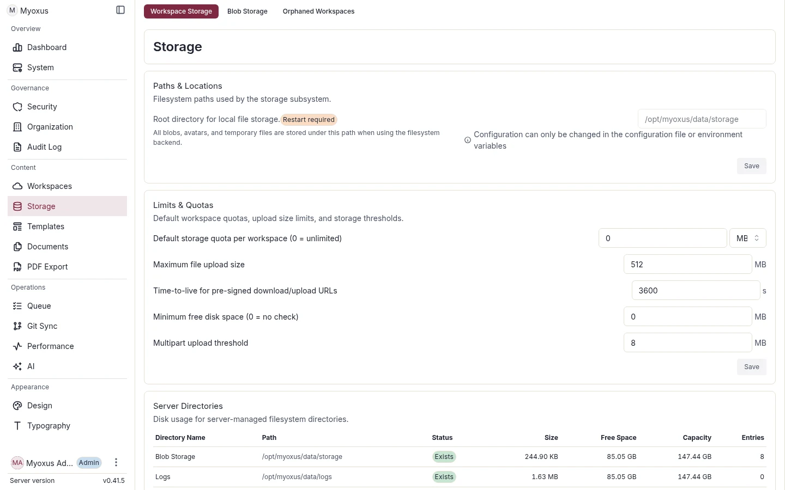

<!-- SPDX-License-Identifier: AGPL-3.0-or-later -->

# Storage

[Documentation](../../README.md) / [Operations](../README.md) / [Data operations](./README.md)

Myoxus stores authoritative metadata in PostgreSQL and binary content in the
configured blob store. These stores form one logical data set: PostgreSQL holds
the object keys and the blob store holds the bytes. A backup that contains only
one side is not a valid restore point.



<details>
<summary>On this page</summary>

- [Storage ownership](#storage-ownership)
- [Choose a backend](#choose-a-backend)
- [Quotas and capacity](#quotas-and-capacity)
- [Change the backend](#change-the-backend)
- [Workspace-content copy and cleanup](#workspace-content-copy-and-cleanup)

</details>

## Storage ownership

| Store            | Content                                                                                                                     | Include in backups?            |
| ---------------- | --------------------------------------------------------------------------------------------------------------------------- | ------------------------------ |
| PostgreSQL       | Users, sessions, workspaces, document history, configuration, audit state, durable operation records, and template metadata | Yes                            |
| Blob storage     | Uploads, attachments, branding assets, and template files                                                                   | Yes                            |
| PDF font storage | Administrator-uploaded fonts used by PDF export                                                                             | Yes                            |
| Redis            | Session cache, queues, locks, document cache, and socket fan-out                                                            | No; rebuild from durable state |

## Choose a backend

HTTPS S3/R2 requests in the server and CLI use the global
`tls.additional_ca_bundle_path` startup snapshot, including CLI recovery
storage. Roots are injected into each OpenDAL operator through its supported
HTTP transport context, without replacing public roots or the existing
timeout/retry policy. The operator never rereads a replaced CA file: restart
all consumers to activate a replacement. Filesystem storage is unaffected.
See [bootstrap configuration](../configuration/README.md). This HTTP wiring
does not by itself establish PostgreSQL/Redis or packaged-deployment acceptance.

| Backend | Appropriate use                             | Primary operator concerns                                            |
| ------- | ------------------------------------------- | -------------------------------------------------------------------- |
| `local` | A single node with one durable filesystem   | Ownership, free space, filesystem snapshots, and host recovery       |
| `s3`    | AWS S3 or an S3-compatible service          | Bucket policy, region, credentials, versioning, and lifecycle policy |
| `r2`    | Cloudflare R2 through its S3-compatible API | Endpoint, account identifier, credentials, and lifecycle policy      |

### Local storage

```yaml
storage:
  backend: "local"
  root: "/opt/myoxus/data/storage"
  min_free_space_mb: 1024
```

The container mounts `MYOXUS_DATA_DIR` at `/opt/myoxus/data`; the default blob
root is `/opt/myoxus/data/storage`. The API user must be able to read and write
the directory. `storage.min_free_space_mb` is a startup readiness check; it
does not stop later writes or replace continuous disk monitoring.

### S3-compatible storage

```yaml
storage:
  backend: "s3"
  bucket: "myoxus-prod"
  region: "eu-central-1"
  endpoint: null
  prefix: "prod/"
```

R2 uses `backend: "r2"` and an explicit account endpoint. Supply credentials
through the deployment's protected configuration/secret mechanism; do not put
them in this YAML, command arguments, shell history, or committed examples.

## Quotas and capacity

`storage.default_workspace_quota_mb` defines the default technical workspace
limit; `0` means unlimited. Set a deliberate default before production use and
monitor both database and object-store growth. Organization policy determines
the actual capacity and retention targets.

## Change the backend

A backend change after the first user data exists is a data migration, not a
safe configuration toggle.

1. Schedule a maintenance window and stop writes.
2. Capture a consistent PostgreSQL, blob, and PDF-font backup.
3. Copy every blob key without changing its key.
4. Probe read, write, and delete behavior on the target backend.
5. Change configuration, restart the API, and require `/ready` to pass.
6. Verify existing attachments, branding assets, PDF templates, and fonts.
7. Keep the source backend unchanged until the restore and user-journey checks
   pass; otherwise stop the target and restore the previous configuration.

See [Backup and restore](./backup-and-restore.md) for the complete consistency
and recovery procedure.

## Workspace-content copy and cleanup

Copy verifies native assets and Database Files/template bytes before publishing
its target catalog and references. Source assets and their accounted usage remain
intact. Target keys are operation-private; another operation's new objects do
not share their cleanup address. Committed/reused catalog objects survive
compensation. A failed commit acknowledgement requires receipt readback; an
unknown outcome retains bytes in cleanup-required recovery. Never manually
delete them based solely on a failed worker status.

Move/Extract/Undo retain source Blob rows, bytes and accounted usage too.
Target copies include current references, Database Files/templates, comment
attachments and proved history-only references. Shared assets are not ownership
inverses during Undo. New transfers emit no source-Blob delete intent; pending
legacy cleanup skips live canonical source catalog entries. Never infer an
orphan from zero current document usages or an operation's failed status.
