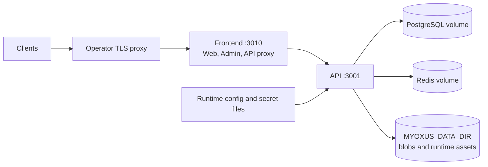

# Docker deployment

[Documentation](../../README.md) / [Operations](../README.md) / [Deployment](./README.md)

Deploy the released Docker Compose topology with immutable server and
frontend artifacts. This guide covers installation, persistent paths, upgrades
and recovery.

All wrapper scripts in this guide (e.g. `build/scripts/server/stack-up.sh`) work from any directory in the repo. Bare `docker compose` commands that appear here use the full file path (`-f build/server/docker-compose.selfhost.yml`) and must be run from the repository root.

---

<details>
<summary>On this page</summary>

- [Plan the single-host installation](#plan-the-single-host-installation)
- [Compose files](#compose-files)
- [Deploy published Myoxus images](#deploy-published-myoxus-images)
- [Services in docker-compose.selfhost.yml](#services-in-docker-composeselfhostyml)
- [Environment variables for the compose stack](#environment-variables-for-the-compose-stack)
- [Volume management](#volume-management)
- [Database migrations](#database-migrations)
- [Log access](#log-access)
- [Upgrade procedure](#upgrade-procedure)
- [Uninstall or clean-slate reset](#uninstall-or-clean-slate-reset)
- [Using a prebuilt frontend](#using-a-prebuilt-frontend)
- [Reverse proxy (Nginx or Caddy)](#reverse-proxy-nginx-or-caddy)
- [Health checks and readiness](#health-checks-and-readiness)
- [Admin frontend](#admin-frontend)

</details>

## Plan the single-host installation

This topology runs one API instance with embedded workers, alongside PostgreSQL,
Redis and the Nginx frontend. See the [topology diagram](../getting-started/installation-decision.md#single-host-with-containers)
and [sizing estimates](./sizing.md) before provisioning the host. An API memory
ceiling is not the RAM requirement for the entire stack.

## Compose files

| File                                       | Purpose                                                |
| ------------------------------------------ | ------------------------------------------------------ |
| `build/server/docker-compose.yml`          | Development: API + PostgreSQL + Redis, no frontends    |
| `build/server/docker-compose.redis.yml`    | Development: API + PostgreSQL + Redis                  |
| `build/server/docker-compose.selfhost.yml` | Selfhost runtime: PostgreSQL, Redis, API, frontends    |
| `build/server/docker-compose.registry.yml` | Registry overlay for the published Myoxus server image |

The release deployment bundle owns `docker-compose.selfhost.yml` and its
registry overlay. Use the repository copy only for a source-built local stack.



## Deploy published Myoxus images

A published Myoxus release consists of exactly three OCI artifacts:

| Artifact                                  | Image                                               |
| ----------------------------------------- | --------------------------------------------------- |
| Rust server                               | `git.blume29.de/myoxus/myoxus:<tag>`                |
| Web static artifact and deployment bundle | `git.blume29.de/myoxus/myoxus-web-frontend:<tag>`   |
| Admin static artifact                     | `git.blume29.de/myoxus/myoxus-admin-frontend:<tag>` |

Choose the matching Server/Web/Admin set from
[Myoxus releases on GitHub](https://github.com/superions/myoxus/releases).
The release lists its image versions and immutable digests, corresponding
source, checksums and legal material. The
[download overview](../../user/downloads.md) records current availability for
containers and native server packages.

The frontend artifacts end in `scratch` and are not runtime services. The Web
artifact carries the self-contained Compose/Swarm/Nginx deployment bundle, so
this path needs no Git checkout. Server and frontend
versions are intentionally selected independently through
`MYOXUS_SERVER_IMAGE_TAG` and `MYOXUS_FRONTEND_IMAGE_TAG`. Use immutable
component release tags or the full Git commit SHA that built the corresponding
image. A moving development tag such as `wip` is suitable only for a development
deployment. Registry authentication and visibility are properties of the
selected release registry; verify pull access before the maintenance window.

These are direct Forgejo package names under the `myoxus` package owner. Do not
insert a repository or image subgroup between `myoxus` and the image name.
Release jobs initially publish only an immutable commit tag; `wip` or a
semantic version appears only after the common acceptance job has promoted the
same digest.

Publication recovery does not require a new product version or a rebuild:

```bash
build/scripts/release/release-containers.sh status <version>
build/scripts/release/release-containers.sh publish-server <version>
build/scripts/release/release-containers.sh publish-frontends <version>
```

Use only the affected component command. It publishes its retained exact image
or existing registry commit image, then runs the normal acceptance and digest
promotion. Missing images stop recovery; no build fallback is allowed. Before
upload completes, retained images depend on the original CI runner's Docker
store and must not be pruned. `verify <version>` confirms all three semantic /
commit digest pairs and the public overview. Native `retry-server` /
`retry-frontends` instead resume failed jobs in the original workflow; those
may build if no completed image exists. Neither path moves the release tags.
A historical failed run and the availability of accepted release images are
separate states; publication recovery does not deploy a stack.

```bash
export MYOXUS_SERVER_IMAGE_TAG=<server-release-or-commit-sha>
export MYOXUS_FRONTEND_IMAGE_TAG=<frontend-release-or-commit-sha>
export MYOXUS_IMAGE_PREFIX=git.blume29.de/myoxus
export MYOXUS_SERVER_ORIGIN=https://myoxus.example.com
export MYOXUS_STATE_ROOT="$PWD/myoxus-state"
export MYOXUS_FRONTEND_ASSET_ROOT="$MYOXUS_STATE_ROOT/frontends/$MYOXUS_FRONTEND_IMAGE_TAG"
export MYOXUS_STYLE_HOST_DIR="$MYOXUS_STATE_ROOT/style"
export MYOXUS_DATA_DIR="$MYOXUS_STATE_ROOT/data"
export MYOXUS_RUNTIME_CONFIG_DIR="$MYOXUS_STATE_ROOT/runtime-config"
export MYOXUS_TEMPLATE_HOST_DIR="$MYOXUS_STATE_ROOT/templates"
export MYOXUS_QA_ARTIFACT_DIR="$MYOXUS_STATE_ROOT/qa"
export MYOXUS_POSTGRES_PASSWORD_FILE="$MYOXUS_STATE_ROOT/secrets/postgres_password"
export MYOXUS_CRYPTO_PRIVATE_KEY_FILE="$MYOXUS_STATE_ROOT/secrets/crypto_private_key"

WEB_IMAGE="$MYOXUS_IMAGE_PREFIX/myoxus-web-frontend:$MYOXUS_FRONTEND_IMAGE_TAG"
ADMIN_IMAGE="$MYOXUS_IMAGE_PREFIX/myoxus-admin-frontend:$MYOXUS_FRONTEND_IMAGE_TAG"
docker pull "$WEB_IMAGE"
deployment_container="$(docker create "$WEB_IMAGE" /__myoxus_static_artifact_only__)"
install -d ./myoxus-deployment
docker cp "$deployment_container:/myoxus-artifact/deployment/." ./myoxus-deployment/
docker rm "$deployment_container"
chmod +x ./myoxus-deployment/*.sh ./myoxus-deployment/nginx/*.sh

install -d "$MYOXUS_DATA_DIR" "$MYOXUS_RUNTIME_CONFIG_DIR" \
  "$MYOXUS_STYLE_HOST_DIR" "$MYOXUS_QA_ARTIFACT_DIR" \
  "$(dirname "$MYOXUS_POSTGRES_PASSWORD_FILE")"
test -f "$MYOXUS_RUNTIME_CONFIG_DIR/local.yaml" || printf '{}\n' >"$MYOXUS_RUNTIME_CONFIG_DIR/local.yaml"
test -f "$MYOXUS_POSTGRES_PASSWORD_FILE" || openssl rand -hex 32 >"$MYOXUS_POSTGRES_PASSWORD_FILE"
test -f "$MYOXUS_CRYPTO_PRIVATE_KEY_FILE" || openssl rand -hex 32 >"$MYOXUS_CRYPTO_PRIVATE_KEY_FILE"
chmod 600 "$MYOXUS_POSTGRES_PASSWORD_FILE" "$MYOXUS_CRYPTO_PRIVATE_KEY_FILE"
sudo chown 1000:1000 "$MYOXUS_DATA_DIR" "$MYOXUS_RUNTIME_CONFIG_DIR" "$MYOXUS_STYLE_HOST_DIR"
sudo chown 1000:1000 "$MYOXUS_RUNTIME_CONFIG_DIR/local.yaml"
sudo chown 1000:1000 "$MYOXUS_POSTGRES_PASSWORD_FILE" "$MYOXUS_CRYPTO_PRIVATE_KEY_FILE"

./myoxus-deployment/materialize-static-artifacts.sh \
  --web-image "$WEB_IMAGE" \
  --admin-image "$ADMIN_IMAGE" \
  --output "$MYOXUS_FRONTEND_ASSET_ROOT" \
  --runtime-style-dir "$MYOXUS_STYLE_HOST_DIR" \
  --pull

docker compose \
  -f ./myoxus-deployment/docker-compose.selfhost.yml \
  -f ./myoxus-deployment/docker-compose.registry.yml \
  pull api frontend

./myoxus-deployment/prepare-templates.sh \
  --server-image "$MYOXUS_IMAGE_PREFIX/myoxus:$MYOXUS_SERVER_IMAGE_TAG" \
  --output "$MYOXUS_TEMPLATE_HOST_DIR"

docker compose \
  -f ./myoxus-deployment/docker-compose.selfhost.yml \
  -f ./myoxus-deployment/docker-compose.registry.yml \
  up -d --no-build
```

Replace the example origin with the real DNS name and configure the TLS edge
from [Reverse proxy and TLS](./reverse-proxy.md) before allowing user access.
The published Compose file exposes API, PostgreSQL and Redis host ports;
restrict these to loopback/private networking or remove their published
mappings in an operator-owned overlay. If the TLS proxy runs on another host,
allow only that proxy to reach frontend port 3010. Preserve the deployment
variables in an owner-restricted operator environment file and load it for
subsequent maintenance; the shell exports above do not survive a new session.

The paths above must resolve below the newly selected dedicated
`MYOXUS_STATE_ROOT`; stop if `realpath` shows an existing unrelated directory.
The non-recursive ownership changes deliberately do not rewrite ownership of a
restored data tree. Restore such a tree with its preserved numeric ownership
instead.

Set `MYOXUS_IMAGE_PREFIX` only when mirroring the images to a different OCI
registry namespace. PostgreSQL, Redis and the optional veraPDF service keep
their upstream images. `MYOXUS_NGINX_IMAGE` selects the independent upstream
Nginx runtime and may be updated without rebuilding a Myoxus artifact.

For a Docker Swarm environment use the dedicated
[Swarm deployment](./swarm.md). Do not pass the Compose topology
directly to `docker stack deploy`: the Swarm file owns secrets, state-node
placement, update order and rollback behavior explicitly.

---

## Services in `docker-compose.selfhost.yml`

| Service    | Image                                                              | Role                                                                               |
| ---------- | ------------------------------------------------------------------ | ---------------------------------------------------------------------------------- |
| `postgres` | `pgvector/pgvector:pg16`                                           | Primary database                                                                   |
| `redis`    | `redis:8`                                                          | Session/cache/queue/locking                                                        |
| `api`      | Built from `build/server/Dockerfile` or the published server image | Myoxus Rust API server                                                             |
| `frontend` | `${MYOXUS_NGINX_IMAGE}`                                            | Operator-owned Nginx serving materialized Web/Admin files and proxying API traffic |

Startup order is enforced via `depends_on` health checks:
`postgres` + `redis` → `api` → `frontend`.

SQL migrations are executed by the API process through the single Infrastructure
migration runner before readiness can pass.

---

## Environment variables for the compose stack

The compose file uses shell environment variables (with defaults) to control container behavior. You can pass them on the command line or export them in your shell.

| Variable                         | Default                                | Description                                                                                                                                                                          |
| -------------------------------- | -------------------------------------- | ------------------------------------------------------------------------------------------------------------------------------------------------------------------------------------ |
| `POSTGRES_USER`                  | `myoxus`                               | PostgreSQL user                                                                                                                                                                      |
| `POSTGRES_PASSWORD`              | `myoxus`                               | Development-only value used by the wrapper when creating a missing password secret                                                                                                   |
| `MYOXUS_POSTGRES_PASSWORD_FILE`  | `./runtime-secrets/postgres_password`  | Host file used as the PostgreSQL password secret                                                                                                                                     |
| `MYOXUS_CRYPTO_PRIVATE_KEY_FILE` | `./runtime-secrets/crypto_private_key` | Host file used as the application crypto secret                                                                                                                                      |
| `POSTGRES_DB`                    | `myoxus`                               | Database name                                                                                                                                                                        |
| `POSTGRES_PORT`                  | `5432`                                 | Host port for PostgreSQL                                                                                                                                                             |
| `POSTGRES_DATA_VOLUME`           | `myoxus-postgres-data`                 | Docker volume for Postgres data                                                                                                                                                      |
| `REDIS_PORT`                     | `6379`                                 | Host port for Redis                                                                                                                                                                  |
| `REDIS_DATA_VOLUME`              | `myoxus-redis-data`                    | Docker volume for Redis data                                                                                                                                                         |
| `RUN_MODE`                       | `development`                          | Config mode: loads `server/config/${RUN_MODE}.yaml` if present                                                                                                                       |
| `MYOXUS_SERVER_PORT`             | `3001`                                 | API listen port inside container                                                                                                                                                     |
| `MYOXUS_PUBLIC_PORT`             | `3001`                                 | API port exposed on the host                                                                                                                                                         |
| `MYOXUS_SERVER_ORIGIN`           | `http://192.168.30.10:3010`            | Public URL override. **This default is a local development address. MUST be set to your real public URL in production.**                                                             |
| `MYOXUS_API_USER`                | `1000:1000`                            | UID:GID for API container process                                                                                                                                                    |
| `MYOXUS_DATA_DIR`                | `./data`                               | Host directory for all runtime data (storage, logs, git-sync). Mounted at `/opt/myoxus/data` inside the container.                                                                   |
| `MYOXUS_RUNTIME_CONFIG_DIR`      | `./runtime-config`                     | Writable host directory mounted at `/opt/myoxus/runtime-config`; contains the Admin writeback mirror                                                                                 |
| `MYOXUS_TEMPLATE_HOST_DIR`       | `./templates`                          | Complete template root mounted read-only at `/opt/myoxus/templates`                                                                                                                  |
| `MYOXUS_STORAGE_ROOT`            | `/opt/myoxus/data/storage`             | Blob storage path inside container (override if using custom layout)                                                                                                                 |
| `MYOXUS_LOG_FILE_PATH`           | `/opt/myoxus/data/logs/myoxus.log`     | Log file path inside container                                                                                                                                                       |
| `MYOXUS_GIT_SYNC_REPO_BASE_DIR`  | `/opt/myoxus/data/git-sync`            | Git-sync mirror repo directory inside container                                                                                                                                      |
| `MYOXUS_FRONTEND_PORT`           | `3010`                                 | Public frontend port exposed on the host                                                                                                                                             |
| `CARGO_BUILD_JOBS`               | `8`                                    | Cargo parallelism for source-built API images. Lower this on memory-constrained hosts; higher values require a dedicated builder or explicit host approval (dev-01: 16; dev-02: 24). |
| `MYOXUS_FRONTEND_ASSET_ROOT`     | `./runtime-frontends/current`          | Materialized Web/Admin/deployment directory mounted read-only in Nginx                                                                                                               |
| `MYOXUS_NGINX_IMAGE`             | `nginx:stable-alpine`                  | Operator-selected Nginx image, updated independently from Myoxus                                                                                                                     |
| `MYOXUS_FRONTEND_BASE_PATH`      | _(empty)_                              | Optional base path prefix (e.g. `/myoxus`)                                                                                                                                           |
| `MYOXUS_STYLE_HOST_DIR`          | `../../client/branding`                | Host directory for operator branding assets; writable by API and read-only in Nginx                                                                                                  |
| `POSTGRES_IMAGE_TAG`             | `pg16`                                 | PostgreSQL image tag (e.g. `pg16`, `pg17`)                                                                                                                                           |
| `REDIS_IMAGE_TAG`                | `7`                                    | Redis image tag (e.g. `7`, `7-alpine`)                                                                                                                                               |

For production deployments, set `RUN_MODE=production` explicitly.

### Release secret files

```bash
export MYOXUS_POSTGRES_PASSWORD_FILE=/run/secrets/myoxus-postgres-password
export MYOXUS_CRYPTO_PRIVATE_KEY_FILE=/run/secrets/myoxus-crypto-private-key
export MYOXUS_SERVER_ORIGIN=https://myoxus.example.com
# Continue with the release deployment bundle's Compose command above.
```

> **WARNING:** Do not put secrets in Compose YAML, shell arguments or normal
> environment variables. Point the two host-file variables at files delivered
> by the operating system or secret manager.

---

## Volume management

The selfhost stack uses three named Docker volumes by default:

| Volume                  | Contents                     |
| ----------------------- | ---------------------------- |
| `myoxus-postgres-data`  | PostgreSQL database files    |
| `myoxus-redis-data`     | Redis AOF (append-only file) |
| `myoxus-pdf-fonts-data` | Uploaded PDF font material   |

Blob storage, logs and Git-sync repos live under `MYOXUS_DATA_DIR`. Runtime
config, branding and templates use separate `MYOXUS_RUNTIME_CONFIG_DIR`,
`MYOXUS_STYLE_HOST_DIR` and `MYOXUS_TEMPLATE_HOST_DIR` mounts. `start-selfhost-real.sh` prepares these paths
for the configured API UID/GID and fails before deployment when they remain
unusable. Package configuration defaults remain image-owned.

### Editable templates

`MYOXUS_TEMPLATE_HOST_DIR` selects one host root, normally the instance state
root's `templates/`. The API mounts it read-only at `/opt/myoxus/templates`.
`prepare-templates.sh` copies the complete tree from the exact selected server
image without running its entrypoint; source-built wrappers use `server/templates`.
Run preparation before the first start and after selecting a new release.
It adds missing files and new version paths, retains existing bytes, links,
ownership and permissions, and reports differing existing defaults for review.
The helper checks layout and containment; Rust loaders validate required syntax,
content and dependencies before readiness. Invalid operator files are preserved
and rejected, never repaired by the copier.

Mail lives under `mail/`, with `en/`, `de/`, `fr/`, `es/` and `it/` folders,
shared `_layout.html`, translated `_copy.json` and inline assets. Native document
bundles live under `documents/`; PDF and HTML files use their own subtrees when
their filesystem catalogs are shipped. Config, branding, fonts, ICC profiles and
blob storage keep their separate owners and mounts.

To review a release's defaults separately, extract into a temporary directory:

```bash
review_dir="$(mktemp -d)"
./myoxus-deployment/prepare-templates.sh \
  --server-image "$MYOXUS_IMAGE_PREFIX/myoxus:$MYOXUS_SERVER_IMAGE_TAG" \
  --output "$review_dir"
```

Compare the relevant files, back up operator edits, and apply deliberate changes
through the existing deployment workflow. Restart the API to activate changed
catalogs. Changing the host path requires recreating its bind mount. Existing
immutable document ZIPs must keep their registered content; publish a new version
for content changes. The helper does not change manifests, assignments or stored
documents. No whole-directory replacement is required.

Keep directories searchable and files readable by `MYOXUS_API_USER`. New files
use mode `0644`; preparation preserves existing permissions and ownership.
`--owner UID:GID` assigns only newly created files/directories when run by an
account authorized to change ownership. The preflight verifies runtime readability.

**Admin → Templates → Settings** saves the container-visible `templates.root_dir`,
independently of Registry enablement. Its default `./templates` resolves from
`/opt/myoxus`; saving a value does not change the mount or reload running catalogs.
A different in-container root also needs its corresponding operator mount.
See the [configuration contract](../configuration/reference.md#template-root).
Back up authored filesystem templates as well as the existing Registry/PDF
PostgreSQL records and blob storage; the template directory does not replace
those durable backups.

### Inspect volumes

```bash
docker volume ls | grep myoxus
docker volume inspect myoxus-postgres-data
```

### Back up durable state

Do not treat an isolated database dump as a Myoxus checkpoint. Follow
[Backup and restore](../data/backup-and-restore.md) to quiesce writes and bind
PostgreSQL, blob storage, uploaded PDF fonts, checksums, and source identity
into one verifiable set.

---

## Database migrations

Database migrations are applied automatically when the API server starts. No
separate migration container or manual SQL step is used. Fresh installations
start from baseline `1000`; databases already migrated to baseline `1000`
continue through normal append-only SQLx migrations under one
transaction-scoped advisory lock. The old 0.41.4 and 0.41.5 SQLx ledgers are no
longer supported direct upgrade sources and fail startup without being changed.

Before an upgrade, create and verify an operator-owned backup using the normal
procedure above. That backup is for recovery only: the migration runner neither
locates nor creates a backup and never uses one to classify the database.
Unknown, incomplete or checksum-altered ledgers stop API startup without
persistent schema or ledger changes. Do not rewrite `_sqlx_migrations`; restore
the exact supported source state or run the server version that owns it.

---

## Log access

```bash
# Follow API logs (via wrapper — works from any directory)
build/scripts/server/stack-logs.sh api

# Follow all services
build/scripts/server/stack-logs.sh

# Or directly (must be in build/server/ or use full path):
docker compose -f build/server/docker-compose.selfhost.yml logs -f api
docker compose -f build/server/docker-compose.selfhost.yml logs --tail=200 api
```

Log files on the host are at `${MYOXUS_DATA_DIR}/logs/` (default: `build/server/data/logs/`). See [logging.md](../observability/logging.md) for runtime log level adjustment and log rotation details.

---

## Upgrade procedure

1. Record the current server/frontend tags and resolved digests. Quiesce writes
   and create a verified database, blob, and PDF-font checkpoint.
2. Pull the intended immutable artifacts and materialize the new frontend into
   a new versioned directory. Do not replace the active directory on failed
   identity verification.
3. Update the recorded server and frontend tag variables, then run the release
   deployment bundle's Compose command.
4. Require API readiness and frontend health/info, then verify the data or
   behavior affected by this upgrade. Reuse accepted product checks for
   unchanged paths; a release adds no general document-editing tour.
5. If a migration committed, rollback requires the matching database and blob
   checkpoint. Never start an older server against a newer schema. If no
   migration committed, restore the previous tags and frontend directory and
   repeat the same probes.

Database migrations run automatically during API startup. The API remains
unready until migration validation completes.

---

## Uninstall or clean-slate reset

This procedure removes the Compose database and Redis volumes. It does not
remove operator bind mounts such as `MYOXUS_DATA_DIR`, runtime configuration,
branding assets or the backup destination.

1. Announce a maintenance window and stop writes.
2. Create and verify a complete backup outside every runtime directory:

   ```bash
   myoxus-cli --database-url-file /protected/path/database-url \
     backup create --output /secure/checkpoints/myoxus-pre-uninstall
   myoxus-cli --database-url-file /protected/path/database-url \
     backup verify /secure/checkpoints/myoxus-pre-uninstall
   ```

3. Record the effective data, runtime-config, style and secret-file paths. Stop
   the stack without deleting anything and verify that the containers stopped:

   ```bash
   build/scripts/server/stack-down.sh
   build/scripts/server/stack-status.sh
   ```

4. Only after the backup and target review pass, remove the named PostgreSQL
   and Redis volumes:

   ```bash
   build/scripts/server/stack-down.sh --volumes
   ```

5. Keep the bind-mounted blob data and configuration until the retention
   decision is complete. Verify the backup again; do not infer their removal
   from the Compose command.

To roll back, recreate the stack with the recorded paths, restore the verified
backup into the empty target, start the matching Myoxus version and require
readiness plus the restore user journeys in
[Backup and restore](../data/backup-and-restore.md) to pass.

## Using a prebuilt frontend

If you have prebuilt static frontend assets (from CI or the canonical export):

```bash
# Build static assets first (skip if using CI artifacts)
build/scripts/frontends/export-prebuilt-static.sh
build/scripts/frontends/verify-prebuilt-static.sh

# Build and materialize the two prebuilt static artifacts
REVISION="$(git rev-parse HEAD)"
CLIENT_VERSION="$(node build/scripts/release/write-release-identity.mjs \
  --role web --revision "$REVISION" --print-version)"
docker build -f build/web/Dockerfile.prebuilt \
  --build-arg GITHUB_SHA="$REVISION" \
  --build-arg MYOXUS_CLIENT_VERSION="$CLIENT_VERSION" \
  -t myoxus-web-frontend:prebuilt .
docker build -f build/admin/Dockerfile.prebuilt \
  --build-arg GITHUB_SHA="$REVISION" \
  --build-arg MYOXUS_CLIENT_VERSION="$CLIENT_VERSION" \
  -t myoxus-admin-frontend:prebuilt .
build/scripts/frontends/materialize-static-artifacts.sh \
  --web-image myoxus-web-frontend:prebuilt \
  --admin-image myoxus-admin-frontend:prebuilt \
  --output "$PWD/build/server/runtime-frontends/current"
```

The prebuilt Dockerfiles read `client/frontends/static/web/` and
`client/frontends/static/admin/` at build time. The external Nginx reads the
materialized roots and the one configuration shipped in the Web artifact. The retired
`client/web/static/` and `client/admin/static/` mirrors are not valid deploy
inputs. Materialization validates matching OCI and embedded release identities
before replacing an existing asset root.

---

## Reverse proxy (Nginx or Caddy)

The `frontend` service uses the independently selected Nginx image on port 3010.
The startup renderer reads the materialized `deployment/nginx/myoxus.conf`
template and writes runtime configuration that serves Web/Admin directly and
proxies API traffic. An additional TLS edge proxy forwards the single public
origin to port 3010; its Socket.IO timeouts must also cover the heartbeat budget.

For a custom equivalent configuration, preserve these routes:

- `/api/*` → API port 3001
- `/graphql` → API port 3001
- `/socket.io/*` → API port 3001 (must pass `Upgrade` header for WebSocket)
- `/adminfrontend/*` and `/admin/*` → materialized Admin root
- everything else → materialized Web root

See [Reverse proxy and TLS](./reverse-proxy.md) for full Nginx and Caddy
examples.

> **WARNING:** Preserve WebSocket upgrade headers and validate the upgrade path.
> Standalone clients can fall back to long-polling, but an unverified proxy may
> still impose buffering, timeout, or request-size behavior unsuitable for
> document synchronization.

---

## Health checks and readiness

The server image uses Distroless Debian 13 (`base-debian13`) plus Debian's
`libgcc-s1` runtime. It intentionally contains no shell, package manager, Git,
curl, Perl or host-administration tools. Git Sync uses the compiled libgit2
adapter, not the Git executable. Inspect logs with `docker logs` and invoke
`myoxus-cli` directly with `docker exec`; `docker exec ... sh` is not supported.

The native entrypoint is `myoxus-cli container start -- <command>`. It preserves
the `POSTGRES_*` / `POSTGRES_PASSWORD_FILE` contract, percent-encodes every
password byte after removing exactly one terminal LF/CRLF, atomically writes
`/run/myoxus/database-url` with mode 0600, checks the private-key secret file,
then replaces itself with the requested process. The server stays PID 1 and
inherits the previous entrypoint's private `umask 077`.
The image retains the shipped `myoxus` account (UID 1000, primary GID 999,
home `/home/myoxus`). Compose/Swarm retain their explicit default override
`1000:1000`; writable paths remain unchanged. Package ownership/attribution and the final OS inventory
remain in the image and OCI SBOM.

When upgrading an externally maintained stack definition, replace any API
`CMD-SHELL`/curl override with the exec-form healthcheck below **before** using
this image. The repository Compose/Swarm definitions already use it; do not
remove working secret/mount settings or change the readiness policy.

The compose file configures health checks for each service:

| Service    | Health check                  | Interval | Retries |
| ---------- | ----------------------------- | -------- | ------- |
| `postgres` | `pg_isready`                  | 10s      | 20      |
| `redis`    | `redis-cli ping`              | 10s      | 20      |
| `api`      | `myoxus-cli container health` | 15s      | 10      |
| `frontend` | `wget /health`                | 15s      | 10      |

The API has a 25-second `start_period` to allow time for startup checks to complete.
Its native loopback probe uses `MYOXUS__SERVER__PORT` (default 3001), a four-second
HTTP deadline, no proxy, and the former curl HTTP-status semantics. It does not
load PostgreSQL or TLS/secret configuration and does not require `/ready`.
`myoxus-cli container health --ready` explicitly selects readiness; the existing
multi-instance stack retains that policy. `myoxus-cli system health` remains
the separate operator diagnostic of both endpoints.
The frontend check is deliberately liveness-only: a temporary API outage does
not restart Nginx.
Deployment readiness is established by the stack smoke against `/info`, `/` and
`/adminfrontend/` after all services have converged.

### API health endpoints explained

| Endpoint       | Meaning                                                                             | When it fails                                                                    |
| -------------- | ----------------------------------------------------------------------------------- | -------------------------------------------------------------------------------- |
| `GET /health`  | Liveness response from the running API process                                      | Missing or non-success response means the process or request path is unavailable |
| `GET /ready`   | Stored startup result for DB, Redis, storage, reconciliation, and capability checks | Fails when an initial check did not pass; later outages need separate probes     |
| `GET /live`    | Alias for `/health`                                                                 | Same as `/health`                                                                |
| `GET /metrics` | JSON process metrics                                                                | Investigate API routing or process failure                                       |

The `/ready` response includes a `checks` array with per-check status:

```json
{
  "status": "pass",
  "checks": [
    { "name": "database", "status": "pass" },
    { "name": "redis", "status": "pass" },
    { "name": "storage", "status": "pass" }
  ]
}
```

All checks must show `"status": "pass"`. A check showing `"status": "fail"` includes a `"message"` field with the error.

---

## Admin frontend

The admin frontend is a single-page application that provides the operator
control panel for the Myoxus server. In the supported selfhost deployment it is
served by the same `frontend` service as the web UI.

Access: `http://localhost:3010/adminfrontend`

### Authentication

The admin frontend authenticates via the same session cookie as the main
frontend (`affine_session`, with `affine_sid` accepted as a legacy alias). Users
must have `is_admin = true` to access admin pages. A user without admin rights
who navigates to `/adminfrontend` is redirected to the shared sign-in flow.

Preferred CLI flow from the repository checkout:

```bash
docker compose \
  -f build/server/docker-compose.selfhost.yml \
  exec api myoxus-cli users set-admin admin@example.com --admin
```

The server image contains `/usr/local/bin/myoxus-cli`. It reads the same
database secret file and central configuration as the API process, so no
database URL or credential belongs in the command line. The same packaged CLI
provides the complete workspace lifecycle, for example:

```bash
docker compose -f build/server/docker-compose.selfhost.yml exec api \
myoxus-cli workspaces create --owner-user owner@example.com --name "Operations"
docker compose -f build/server/docker-compose.selfhost.yml exec api \
  myoxus-cli workspaces transfer-owner <workspace-id> --to-unit <unit-id>
docker compose -f build/server/docker-compose.selfhost.yml exec api \
  myoxus-cli workspaces undelete <workspace-id>
```

Workspace deletion is intentionally absent from this deployment quick
reference. Use the workspace-content owner with its explicit impact review,
checkpoint, confirmation, and verification instead of copying an isolated
destructive command.

The CLI is the break-glass owner for this change. Do not update the user table
directly; doing so bypasses the command's domain and audit checks.

### Admin modules

The admin frontend covers the following operator configuration areas:

| Module       | Path                          | Purpose                                                           |
| ------------ | ----------------------------- | ----------------------------------------------------------------- |
| Dashboard    | `/adminfrontend/dashboard`    | System overview, health, and key metrics                          |
| System       | `/adminfrontend/system`       | Server, mail, localization, frontends, metrics, telemetry, logs   |
| Security     | `/adminfrontend/security`     | Auth, OAuth/OIDC, CORS and CAPTCHA                                |
| Organization | `/adminfrontend/organization` | Members, organization units, managers, policies                   |
| Audit Log    | `/adminfrontend/audit-log`    | Admin and system audit trail                                      |
| Workspaces   | `/adminfrontend/workspaces`   | List, inspect, and manage all workspaces                          |
| Storage      | `/adminfrontend/storage`      | Workspace storage, blob storage, orphaned workspaces              |
| Templates    | `/adminfrontend/templates`    | Template bundle management                                        |
| Documents    | `/adminfrontend/documents`    | Document operations and diagnostics                               |
| PDF Export   | `/adminfrontend/pdf-export`   | PDF templates, ICC profiles, render jobs and export settings      |
| Queue        | `/adminfrontend/queue`        | Worker queue monitoring                                           |
| Git Sync     | `/adminfrontend/git-sync`     | Git sync profile management and conflict diagnostics              |
| Performance  | `/adminfrontend/performance`  | Server tuning, WebSockets, sync pipeline and limits               |
| AI / Copilot | `/adminfrontend/ai`           | LLM provider setup, embedding pipeline, indexer control           |
| Design       | `/adminfrontend/design`       | Runtime colors, theme presets and branding assets                 |
| Typography   | `/adminfrontend/typography`   | Font library, editor fonts, runtime typography tokens and presets |

### Upgrading the Admin frontend

The admin frontend is rebuilt as part of the standard frontend upgrade:

```bash
build/scripts/server/stack-rebuild-frontends.sh
```

### Troubleshooting

**404 on `/adminfrontend`:** Verify the `frontend` service is healthy and that
`MYOXUS_FRONTEND_ASSET_ROOT/admin/selfhost.html` exists. The single Nginx serves
this directory directly; there is no separate Admin runtime service.

**Admin features not visible:** Inspect the account with
`myoxus-cli users get <email-or-uuid>`. If the reviewed account must become a
global administrator, use `myoxus-cli users set-admin <email-or-uuid> --admin`,
sign in again, and verify the audit entry. Do not edit the user row directly.

---
