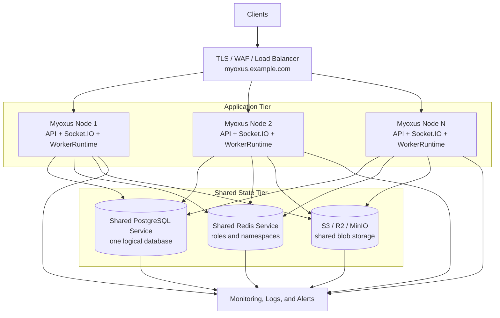
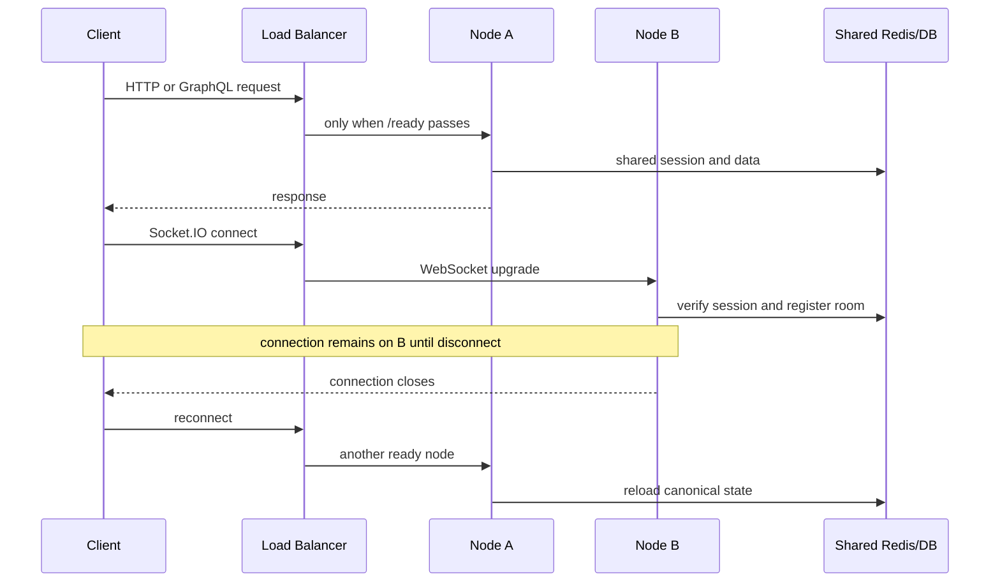
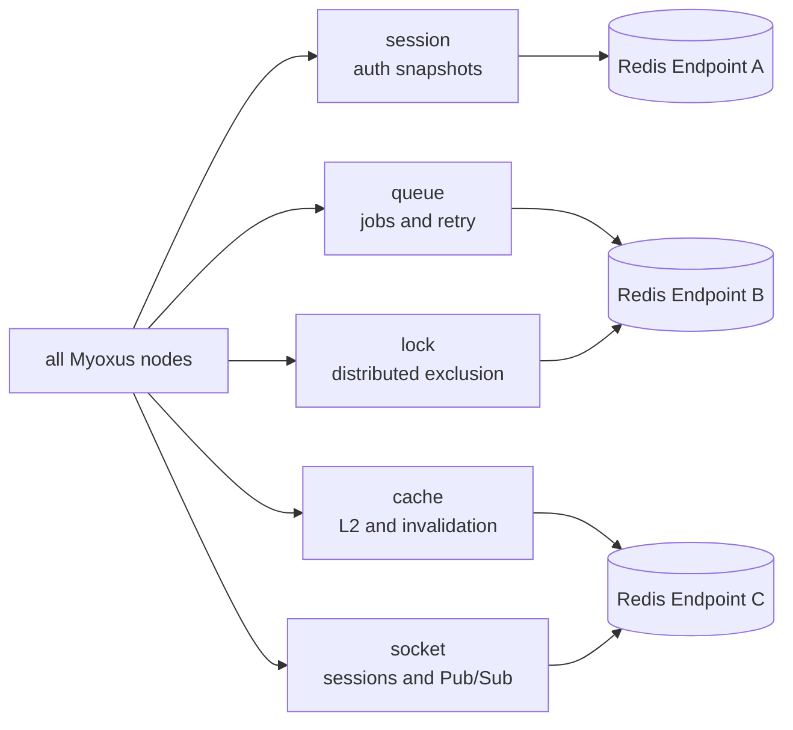
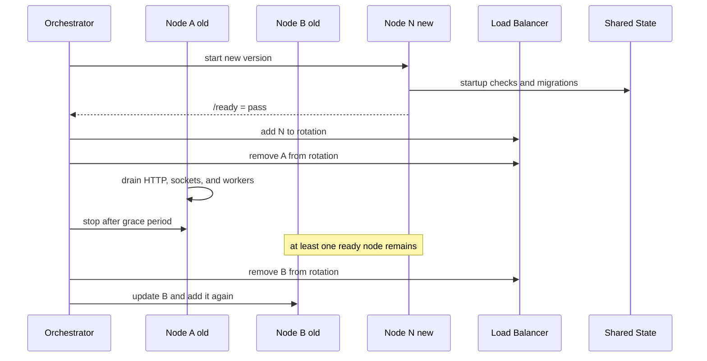

<!-- SPDX-License-Identifier: AGPL-3.0-or-later -->

# Operating a multi-instance cluster

[Documentation](../../README.md) / [Operations](../README.md) / [Deployment](./README.md)

Run multiple API instances behind one public endpoint, with shared PostgreSQL authority, Redis coordination and blob storage.

<details>
<summary>On this page</summary>

- [Purpose and release boundary](#purpose-and-release-boundary)
- [Reference topology](#reference-topology)
- [Mandatory cluster contract](#mandatory-cluster-contract)
- [Current cluster readiness](#current-cluster-readiness)
- [Load-balancer contract](#load-balancer-contract)
- [Shared-state configuration](#shared-state-configuration)
- [Scaling](#scaling)
- [Rolling updates](#rolling-updates)
- [Failure matrix](#failure-matrix)
- [Monitoring and alerts](#monitoring-and-alerts)
- [Socket.IO timeout budget](#socketio-timeout-budget)
- [Operational verification](#operational-verification)
- [Notification delivery recovery](#notification-delivery-recovery)
- [Related runbooks](#related-runbooks)

</details>

## Purpose and release boundary

This runbook defines the operating model for horizontally scaled Myoxus
servers behind a load balancer. It documents prerequisites, rollouts, capacity
limits, failure behavior, and operational verification.

The bundled self-host Compose stack remains a single-API deployment.
`docker-compose.multi-instance.yml` is a test harness, not a production HA
manifest. A production cluster platform must provide its own load balancer,
high-availability data services, secrets, certificates, and scheduling.

For introductory architecture diagrams see [Choose a deployment](../getting-started/installation-decision.md#multiple-hosts-with-container-api-nodes).
Use [Sizing](./sizing.md) to budget each service and surviving capacity.

## Reference topology



## Mandatory cluster contract

| Area                  | Operational requirement                                                                                                                                                                                                                                    |
| --------------------- | ---------------------------------------------------------------------------------------------------------------------------------------------------------------------------------------------------------------------------------------------------------- |
| Public origin         | Every node uses exactly the same `server.origin`. Clients see only the load-balancer URL.                                                                                                                                                                  |
| PostgreSQL            | Every node connects to the same logical database and schema. Replication or failover must never create two writable authorities.                                                                                                                           |
| Redis                 | Every node uses the same logical endpoint and namespace for each role. Roles may use separate Redis clusters, but must never be isolated per API node.                                                                                                     |
| Blob storage          | Every node sees the same bucket and prefix. Use S3, R2, or compatible object storage for multi-host production.                                                                                                                                            |
| Other writable assets | The PDF font library and other writable server assets use a shared backend contract. Frontend and branding artifacts are distributed identically and immutably to every serving node.                                                                      |
| Secrets               | Application encryption, OAuth, SMTP, and storage secrets are identical on every node and distributed through the platform secret store.                                                                                                                    |
| Version               | A rollout mixes only schema- and protocol-compatible versions. Incompatible migrations require a separate cutover.                                                                                                                                         |
| Traffic               | HTTP, GraphQL, and new Socket.IO connections may reach any `ready` node. Workspace, user, and operation affinity are prohibited. Only an active Engine.IO polling transport session may be technically pinned to one node.                                 |
| Node identity         | Each API start creates exactly one technical UUID and injects it into `ApiState`, the cache bus, and the socket adapter. Hostnames need not be unique. A restart replaces the UUID; it must not control domain partitioning or durable operation identity. |

Independent Myoxus installations with separate PostgreSQL databases are not
nodes in the same cluster. They have no implicit workspace transfer or shared
session state.

## Current cluster readiness

HTTP requests and durable data can be handled by different API nodes when they
share PostgreSQL, Redis and storage. The cluster does not require assigning
users or workspaces to fixed nodes. There are, however, specific delivery and
recovery limitations:

| Area                                 | Behavior with multiple API nodes                                                                                                                                                                                                                                                                |
| ------------------------------------ | ----------------------------------------------------------------------------------------------------------------------------------------------------------------------------------------------------------------------------------------------------------------------------------------------- |
| HTTP, GraphQL and sessions           | Shared PostgreSQL/Redis allow successive requests to use different nodes.                                                                                                                                                                                                                       |
| Document edits and Database realtime | Redis distributes validated workspace and owner-only userspace document events in their existing protocol rooms, plus Database realtime. Every node needs the shared `socket` role. Private reconnect loads and compaction resolve the owner scope without changing deployed binary-row FKs.    |
| Document cursors and presence        | Redis distributes document-scoped Awareness updates and collection requests. Join/reconnect collects current connected peers across nodes; missed cursor state has no persistent replay. Database presence retains its separate Redis-coordinated path.                                         |
| Notification and reminder pushes     | Generic notification jobs, calendar reminders, Database row reminders and read-state changes reach subscribed sockets through the shared user-scoped Redis transport. Persisted notifications remain readable after a missed ephemeral push; reconnect invalidates the client inbox projection. |
| Copilot                              | Normal requests can use any node. An active response and its transient stream state remain on the serving process. If it fails, the live response is interrupted and cannot continue from that state on another process. Persisted session/message data is separate.                            |
| Socket.IO polling                    | Requests belonging to an active polling session must reach the same node until WebSocket upgrade or disconnect. Ordinary API requests do not need affinity.                                                                                                                                     |
| Browser update policy                | PostgreSQL holds the authoritative policy. Notifications accelerate delivery; a new query or socket reconnect rereads the policy after a missed wakeup.                                                                                                                                         |
| Calendar mutations                   | Redis distributes realtime signals; PostgreSQL retains the data if a signal is lost.                                                                                                                                                                                                            |
| Multipart uploads                    | PostgreSQL holds upload IDs and part metadata; shared storage holds the bytes. Upload requests can switch nodes.                                                                                                                                                                                |
| Workers and scheduler                | Every API starts workers. A Redis queue lease selects one scheduler per namespace; jobs must remain idempotent.                                                                                                                                                                                 |
| Git and calendar provider sync       | Shared Redis locks serialize each Git profile or provider account. Coordination failures make the job retryable; there is no process-local lock fallback.                                                                                                                                       |
| Email mutation cooldown              | Redis coordinates the fixed 60-second limit per user and mutation. Redis failure rejects the mutation before token or mail side effects.                                                                                                                                                        |
| Readiness                            | `/ready` reports successful startup checks and initialization. Additional monitoring must detect database, Redis and storage failures after startup.                                                                                                                                            |

For workspace-content operations, see
[Copy, Move and recovery](../administration/workspace-content.md).

## Load-balancer contract

The load balancer terminates TLS or forwards it deliberately. It must support
HTTP/1.1 upgrades and the WebSocket connections required by the selected
Socket.IO transport.

The current `standalone` client uses `polling` followed by `websocket`.
Engine.IO polling consists of multiple HTTP requests carrying a transport
session ID. Until upgrade or disconnect, those requests must reach the same
node. Configure cookie-based transport affinity for `/socket.io` while this
client path remains active. Do not extend affinity to workspace IDs, user IDs,
or domain operations. After reconnect, the load balancer may choose another
`ready` node. A separately verified WebSocket-only client path does not require
affinity.



### Routing rules

- Send new traffic only to nodes whose `GET /ready` succeeds after startup.
- `GET /ready` confirms that startup checks, startup reconciliation, and the
  complete production capability check succeeded. It reports stored
  startup/process state; it is not a continuous PostgreSQL, Redis, or storage
  probe. Runtime dependency failures require additional platform probes and
  alerts.
- Use `GET /live` for process restarts. `GET /health` reports process state and
  the stored startup-check snapshot.
- WebSocket upgrade, idle, and drain timeouts must exceed normal HTTP timeouts.
- Engine.IO polling requests from a current `standalone` client need transport
  affinity until upgrade or disconnect. Normal API and GraphQL requests must
  remain unaffected.
- During rolling updates, remove a node explicitly from load-balancer rotation
  before draining existing connections within the configured shutdown timeout.
- Accept `X-Forwarded-Proto`, host, and client IP information only from trusted
  proxies.

## Shared-state configuration

### PostgreSQL

Each API process owns a SQLx pool:

```text
Total connections = node count * database.max_connections
                    + migrations, CLI, monitoring, and reserve
```

Keep the sum below the PostgreSQL cluster's `max_connections`. A pooler may be
appropriate for many nodes, provided it preserves the transaction and session
semantics used by the SQLx paths.

Each API node also holds one reconnecting `LISTEN` connection for
`myoxus_client_update_control`. Its payload is not state and must not be
interpreted as state. Every node rereads `client.updateControl` from
`app_configs` when a browser calls the public GraphQL query or opens a new Web
socket. PostgreSQL therefore remains the sole policy authority across lost
notifications and listener reconnects.

### Redis roles

The `session`, `queue`, `lock`, `cache`, and `socket` roles have separate
namespaces. Small installations may map them to one Redis endpoint. Larger
installations may separate roles, but every node must use the same mapping for
each role.



The endpoint split is illustrative. Identical role-to-endpoint and namespace
mappings on every node are mandatory.

Repository tests prove shared Redis endpoints. Redis Sentinel and Redis Cluster
are not separately verified Myoxus product paths. Operators must complete a
platform-specific failover test before approving their Redis service's HA
properties.

### Blob storage

Process-local or host-local storage is invalid for a multi-host cluster. Use
`storage.backend: s3` or `r2`, or a shared filesystem path mounted identically
and operated safely on every node. S3-compatible object storage is preferred.
The shared volume in the multi-instance test stack is only a local substitute.

Treat PostgreSQL and blob storage as one recovery unit. Redis is reconstructed
from the database and live operation; it is not a data backup.

## Scaling

| Resource       | Effect of another node                       | Verify before scaling                                           |
| -------------- | -------------------------------------------- | --------------------------------------------------------------- |
| PostgreSQL     | Another pool and more concurrent queries     | Total pool, CPU, IOPS, locks, and replication lag               |
| Redis queue    | More worker competition                      | Queue latency, retry rate, handler idempotency, external limits |
| Redis socket   | More Pub/Sub subscribers and session entries | Pub/Sub throughput, memory, network, reconnect spikes           |
| Object storage | More concurrent uploads and downloads        | Bucket limits, multipart settings, bandwidth, and egress        |
| API            | More HTTP, GraphQL, and socket capacity      | p95/p99, open sockets, CPU, memory, and database wait time      |

Every server process starts WorkerRuntime and the cron scheduler. The queue
role elects exactly one scheduler leader per namespace. CalDAV and Google
Calendar read provider state and write canonical PostgreSQL rows, while the
mandatory Redis `lock` role serializes each provider account. The fixed account
TTL is 300 seconds and is value-checked and extended every 100 seconds. A
foreign owner skips only that account. A Redis or ownership failure ends the
entire queue run as retryable before further writes. There is neither a local
calendar lock nor a calendar-specific lease implementation.

## Rolling updates



Before rollout:

1. Verify PostgreSQL and blob backups plus restore evidence.
2. Check release notes for migrations that are not rolling-compatible.
3. Ensure capacity with one node unavailable.
4. Confirm normal queue latency, error rate, and replication lag.

After each node:

1. Verify `/live`, `/ready`, and `/metrics/prometheus`.
2. Execute an authenticated request through the load balancer.
3. Verify socket reconnect and at least one durable mutation.
4. Inspect logs for migration, Redis, storage, and worker errors.

## Failure matrix

| Failure                             | Expected behavior                                                                                                         | Operator action                                                                                     |
| ----------------------------------- | ------------------------------------------------------------------------------------------------------------------------- | --------------------------------------------------------------------------------------------------- |
| One API node                        | The load balancer removes it; new requests and reconnects reach other nodes.                                              | Diagnose the cause and replace the node. Process loss alone does not require database repair.       |
| Worker during a job                 | Redis detects a stalled or missing heartbeat and redelivers according to the retry contract.                              | Investigate idempotency defects or permanently failing jobs.                                        |
| Redis `cache`                       | L2/invalidation is degraded; the database remains authoritative and local caches may remain stale until reconnect or TTL. | Restore the role and inspect cache reconnect/invalidation logs.                                     |
| Redis `socket`                      | Node-local realtime may continue, but cluster-wide fanout stops.                                                          | Restore the role with priority; have clients reconnect or reload.                                   |
| Redis `session`, `queue`, or `lock` | Cluster-critical paths are unsafe and affected operations fail. `/ready` may still show the successful startup snapshot.  | Do not force a local fallback. Restore Redis HA and block traffic at the platform if necessary.     |
| PostgreSQL                          | No safe domain mutation is possible. `/ready` alone may not detect the runtime outage.                                    | Follow database failover/restore procedures, exclude split brain, and block traffic until verified. |
| Blob storage                        | Blob access and dependent mutations fail.                                                                                 | Check object-storage availability, credentials, and bucket policy.                                  |
| Load balancer                       | Backends may be healthy but publicly unreachable.                                                                         | Check edge HA, DNS, and certificates; do not normalize permanent direct access.                     |

Realtime events are not canonical truth. Native calendar mutations reach other
API nodes through existing Redis socket fanout; durable calendar data is the
recovery path when that transient signal fails. XWS notification wakeups are
also cross-node, as are generic notification/reminder pushes. Persisted Inbox
state recovers missed notification delivery. Document Awareness recollects current
connected peers after reconnect; it has no durable cursor history. An active
Copilot response cannot resume after its serving process fails. Do not hide those limits behind domain-level sticky
sessions.

Git Sync uses the mandatory Redis `lock` role for the value-checked profile lock
and stale-run inspection. If Redis cannot acquire the lock, no local fallback
run starts: the attempt ends as retryable before domain side effects. Diagnose
through Redis role metrics and retry after restoring shared coordination.

CalDAV and Google Calendar use the same technical lease guard with keys
`calendar-sync:caldav:<account-id>` and
`calendar-sync:google:<account-id>`. Normal contention skips only the affected
account. If the lease cannot be acquired or its heartbeat loses ownership, the
queue job becomes retryable with a static, credential-free coordination
message. Previously persisted provider data remains valid; that run performs no
further event, participant, instance, or sync-token writes.

## Monitoring and alerts

Collect at least these signals per node and in cluster aggregates:

- `/ready`, `/live`, process restarts, and active replica count;
- HTTP/GraphQL p95 and p99, error rate, and open socket connections;
- PostgreSQL pool usage, query latency, locks, and replication lag;
- Redis reachability per role, memory, evictions, queue latency, stalled jobs,
  and failed jobs;
- cache-bus and socket Pub/Sub reconnects and discarded messages;
- blob-storage latency, error rate, and multipart aborts;
- worker throughput, retry rate, and permanently failed jobs;
- duplicate cron enqueues, overlapping external calendar syncs, and aggregate
  email delivery rate.

Alerts must include the node identifier, but must never log tokens, session
cookies, document titles, or raw payloads.

## Socket.IO timeout budget

Every API engine starts with `websocket.eio_ping_interval_seconds = 60` and
`websocket.eio_ping_timeout_seconds = 120` unless YAML/ENV or validated DB
configuration overrides them. Existing Admin/CLI operations can save positive
integral values; restart every API replica to activate them. Admin separates
configured values from the running engine, including override removal.
The existing `websocket.ping_interval_seconds` is the analytics cadence.

The shipped frontend and the isolated two-node gateway use 300-second
Socket.IO read/send defaults, above the default 180-second heartbeat sum.
Deployment ENV `MYOXUS_SOCKET_IO_PROXY_READ_TIMEOUT_SECONDS` and
`MYOXUS_SOCKET_IO_PROXY_SEND_TIMEOUT_SECONDS` configure the frontend startup
renderer; frontend restart/recreation activates them for canonical and basepath
routes. Release templates remain read-only and rendered paths are writable.
These deployment controls are not database settings and do not manage external
proxies. Recalculate **read/send > interval + timeout** at every hop before
raising the engine values; keep polling affinity and balancing unchanged.

See [reverse proxy](./reverse-proxy.md) for deployment order and inspection.

## Operational verification

Document and verify the following for your installation:

1. direct `/ready` responses from every node;
2. distribution of repeated requests through the load balancer;
3. login on one node followed by a request on another;
4. socket reconnect after a controlled node drain;
5. a durable mutation read through another node;
6. queue takeover after controlled worker termination;
7. backup and restore of PostgreSQL plus blob storage.

## Notification delivery recovery

API nodes share Socket-role Redis for user notification wakeups. Clients use
`notification:subscribe`, receive `notification:push` envelopes and acknowledge
`eventId` through `notification:ack`. A reconnect resubscribes and invalidates
Inbox feeds and unread counts. Calendar due reminders use the same envelope.

Pub/Sub is an immediate UI accelerator. A lost ordinary push is recovered by
reading persisted notifications; it is not exactly-once delivery. Publication
failure keeps local delivery and logs a bounded warning. Cross-workspace
operation notifications additionally retain their existing durable outbox and
retry publication after transport recovery. No node affinity is required for
these user events; polling transport affinity remains a separate requirement.

## Related runbooks

- [Runtime overview](./runtime-overview.md)
- [Configuration](../configuration/reference.md)
- [Storage](../data/storage.md)
- [Backups](../data/backup-and-restore.md)
- [Operations lifecycle](../observability/health-and-lifecycle.md)
- [Troubleshooting](../runbooks/README.md)
- [Monitoring](../observability/monitoring/README.md)

### Cluster active-user metric

Restart all API nodes for the ephemeral workspace-membership Set-to-Hash cutover;
the existing Socket-role owner retires old Sets at the same namespaced key.
Live memberships are re-registered on join and analytics heartbeat. The lease
is three `websocket.ping_interval_seconds` intervals: the default 60-second
cadence gives a 180-second lease and two missed heartbeats of grace. A crashed
node therefore ages out without a disconnect callback, while another socket of
the same user keeps that user present.

The Admin metric is a shared leased snapshot. Each API supplies globally unique
users to the unchanged PostgreSQL minute-row UPSERT; observed empty workspaces
receive zero. A Redis outage or five-second sampling deadline skips the sample
with a bounded warning, preserving the last authoritative value until recovery.
It never replaces the value with a local subset. The existing Admin aggregation
is unchanged; this does not claim exact instantaneous or historical occupancy.
Redis stores no durable presence history or new business data.
