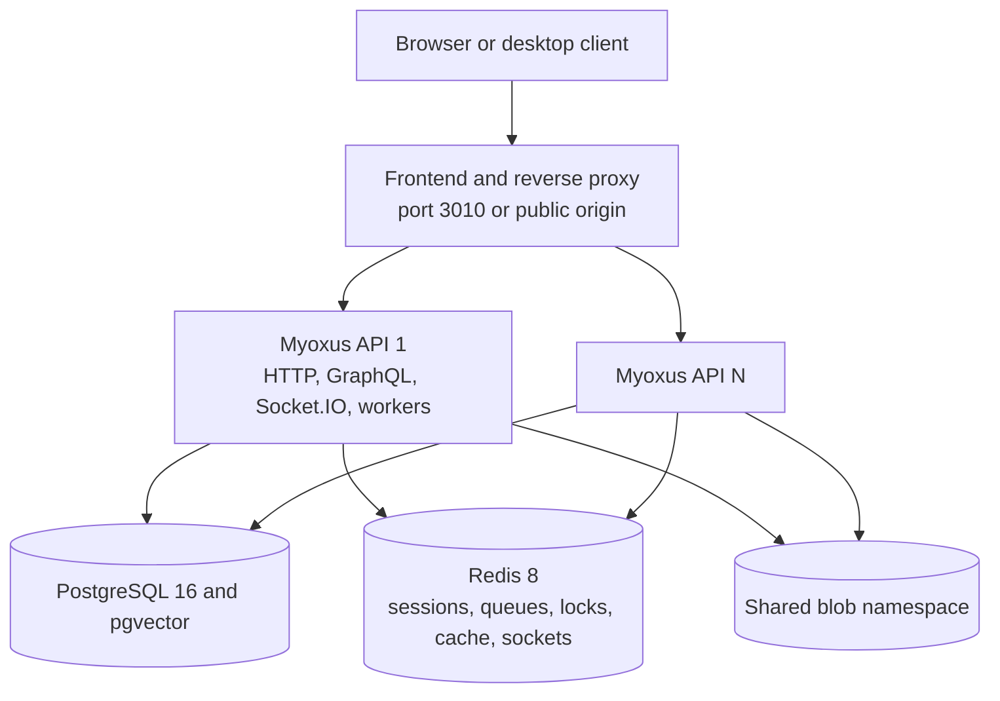

<!-- SPDX-License-Identifier: AGPL-3.0-or-later -->

# Runtime overview

[Documentation](../../README.md) / [Operations](../README.md) / [Deployment](./README.md)

This reference describes the running self-hosted topology. New operators should
start with [Start here](../getting-started/start-here.md). The default Compose
stack runs one API node; [Multi-instance deployment](./multi-instance.md)
documents the shared-state requirements for multiple interchangeable nodes.

An **API instance** is one `myoxus-api` process with a technical UUID created at
startup. A **logical deployment** is every instance sharing one PostgreSQL
authority, one Redis role configuration, and one blob namespace. The instance
UUID is diagnostic metadata, not a durable job or workspace identifier.

## Services and ports

| Service      | Role                                                             | Default port |
| ------------ | ---------------------------------------------------------------- | -----------: |
| `myoxus-api` | HTTP API, GraphQL, real-time synchronization, and worker runtime |       `3001` |
| `postgres`   | Primary persistent authority with pgvector                       |       `5432` |
| `redis`      | Sessions, queues, locks, cache, and socket fan-out               |       `6379` |
| `frontend`   | Nginx serving Web and Admin and proxying API traffic             |       `3010` |
| `verapdf`    | Optional PDF/A validation profile                                |       `8080` |

PostgreSQL and Redis ports should remain private in production. The public edge
must forward HTTP, GraphQL, and WebSocket traffic consistently.

## Deployment mode

Use `server.deployment_type: standalone` for the packaged self-hosted topology.
The alternative `cloud` value is a client transport/storage configuration
signal; application scaling and server features use their own settings.

| Client behavior | `standalone`                   | `cloud`                 |
| --------------- | ------------------------------ | ----------------------- |
| Socket.IO       | Polling with WebSocket upgrade | WebSocket only          |
| Telemetry       | HTTP batches                   | Authenticated WebSocket |
| Workspace cache | Self-hosted namespace          | Cloud namespace         |

Set the value in YAML, `MYOXUS__SERVER__DEPLOYMENT_TYPE`, or
**Admin → System → Server → Deployment Type**. It requires an API restart;
reload clients afterward. Changing the value refreshes their cache namespace
while authoritative workspace data stays on the server. Apply the normal
[configuration precedence](../configuration/README.md#configuration-lifecycle-and-precedence).

The API exposes `serverConfig.deploymentType` as `Standalone` or `Cloud`.
The legacy `serverConfig.type` string projects the same value.

## Health and control plane

| Endpoint                  | Meaning                                                                                                  |
| ------------------------- | -------------------------------------------------------------------------------------------------------- |
| `GET /health`             | The process is alive.                                                                                    |
| `GET /ready`              | Stored result of PostgreSQL, Redis, storage, reconciliation, and capability checks performed at startup. |
| `GET /live`               | Liveness probe for orchestration.                                                                        |
| `GET /metrics`            | Operational JSON snapshot.                                                                               |
| `GET /metrics/prometheus` | Prometheus exposition format.                                                                            |

`/ready` does not continuously re-probe dependencies. Platform probes and
service metrics must detect failures that begin after startup.

All replicas in a logical deployment must use the same durable and coordination
services. PostgreSQL, Redis, and object storage may themselves be managed
high-availability services, but that availability is an operator-owned policy.
