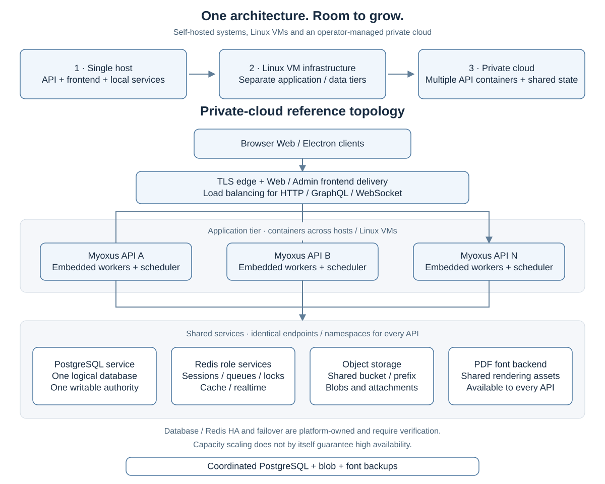

<!-- SPDX-License-Identifier: AGPL-3.0-or-later -->

# Scaling: from self-hosting to a private cloud

[Documentation](../../README.md) / [Operations](../README.md) / [Deployment](./README.md)

**Start on one host, separate services as demand grows, and run multiple Myoxus
instances against shared data services when you need more application capacity.**
The same server-owned product model supports a personal installation, a managed
Linux VM deployment and an operator-managed private cloud.

Self-hosting describes who operates the installation. Linux VMs and containers
describe how it runs. A private cloud can also be self-hosted, with containers
running across several Linux VMs. These are deployment choices within the same
architecture, with the same product capabilities.

| Layout                                        | Application tier                                               | Data and coordination tier                                                                                            | What it gives you                                                  |
| --------------------------------------------- | -------------------------------------------------------------- | --------------------------------------------------------------------------------------------------------------------- | ------------------------------------------------------------------ |
| One self-hosted system                        | One API instance and frontend delivery on one host             | PostgreSQL, Redis and persistent files on that host                                                                   | A straightforward starting installation                            |
| Linux VM deployment                           | Containers or manually installed binaries managed by systemd   | Local services or dedicated database/storage VMs                                                                      | Infrastructure separation and independent resource allocation      |
| Split application and data tiers              | Application host or VM connects to dedicated services          | Shared PostgreSQL, Redis and blob/font storage                                                                        | Scale application and data resources separately                    |
| Private cloud with multiple application nodes | Several API containers across hosts/VMs behind a load balancer | One logical PostgreSQL authority, shared Redis role services and shared storage; platform-managed HA where configured | Horizontal application scaling and a basis for resilient operation |

On this page

- [The growth path](#the-growth-path)
- [Private-cloud overview](#private-cloud-overview)
- [What scales, and what stays shared](#what-scales-and-what-stays-shared)
- [Database and Redis clusters: the precise boundary](#database-and-redis-clusters-the-precise-boundary)
- [Capacity and availability are separate decisions](#capacity-and-availability-are-separate-decisions)
- [Choose the next step from measured demand](#choose-the-next-step-from-measured-demand)

## The growth path

Choose the starting layout that fits your infrastructure and workload. A Linux
VM can host a personal installation, while an organization can begin directly
with separate data services. Grow by adding resources, separating service
capacity or adding application instances behind a load balancer.

## Private-cloud overview

The application nodes are interchangeable clients of the shared state tier.
The PostgreSQL and Redis boxes represent **logical services**: the platform may
operate each service with multiple infrastructure nodes, while Myoxus uses the
configured connection endpoints. They do not represent independent databases
or Redis stores attached to individual API containers.

For exact configuration, routing, rollout and recovery procedures, use
[Operating a multi-instance cluster](./multi-instance.md).

## What scales, and what stays shared

Each API process serves HTTP, GraphQL and realtime connections and starts its
worker runtime. Adding application instances increases available request,
connection and worker capacity when the shared services have sufficient headroom.
The Redis queue role elects one scheduler leader per namespace; shared locks
coordinate operations such as Git and calendar synchronization.

| Component                | Growth option                                                | Shared contract                                                        |
| ------------------------ | ------------------------------------------------------------ | ---------------------------------------------------------------------- |
| API and embedded workers | More CPU/RAM per instance or more instances                  | Same origin, compatible version, configuration and application secrets |
| Frontend delivery / edge | Platform-managed delivery and load balancing                 | Identical Web/Admin release assets and runtime branding                |
| PostgreSQL               | Dedicated capacity and operator-managed replication/failover | All APIs use one logical database with one writable authority          |
| Redis                    | More capacity or separate role services                      | Identical role-to-endpoint and namespace mappings on every API         |
| Blobs and PDF fonts      | Shared storage sized for growth and concurrent access        | Same authorized content accessible from every serving instance         |

Plan application and data capacity together. Each API adds a database connection
pool and Redis activity. Budget their totals, query latency, queue pressure,
storage bandwidth and PDF compiler memory against the expected workload.

The centrally maintained Template Registry, themes, memberships and database
state remain part of the same logical installation. Adding an application node
does not create another catalogue, a separate organization or a workspace shard.
Separate databases instead mean separate Myoxus installations.

## Database and Redis clusters: the precise boundary

An operator-managed PostgreSQL HA cluster can provide the shared database
service. Myoxus must continue to reach one writable authority through failover;
this overview does not claim application-level database sharding, read-replica
routing or multiple writable primaries.

Redis coordinates sessions, queues, locks, cache and cross-node realtime.
Roles may share one service or use separate services, with the same mapping on
every API. **Shared Redis endpoints are covered by the Myoxus multi-instance
verification; Redis Sentinel and Redis Cluster are not separately verified
product paths.** A platform-specific failover test is required before treating
a selected Redis HA topology as validated. A diagram showing Redis HA
infrastructure is not a claim of native Cluster/Sentinel client support.

Shared storage is equally necessary. Host-local blobs or PDF fonts cannot be
used as independent copies in a multi-host installation. Prefer compatible
object storage for blobs, and follow the shared writable-asset contract for
fonts and other assets. Back up authoritative PostgreSQL, blobs and fonts as
one recoverable checkpoint; Redis does not replace that backup.

## Capacity and availability are separate decisions

| Goal                                | Required work                                                                                      |
| ----------------------------------- | -------------------------------------------------------------------------------------------------- |
| More application capacity           | Measure the bottleneck; add resources or API instances with shared-service headroom                |
| Survive an application-host failure | Multiple ready instances on separate hosts, load-balancer health/drain handling and spare capacity |
| Survive a data-service failure      | Platform-managed PostgreSQL/Redis/storage redundancy with tested failover                          |
| Recover from deletion or corruption | Coordinated retained backups and a verified restore procedure                                      |
| Update with bounded disruption      | Compatible versions, planned migrations and connection/job draining                                |

Socket.IO polling requests within an active transport session need temporary
node affinity until WebSocket upgrade or disconnect. Ordinary API requests do
not need user or workspace affinity. A failed node can interrupt active sockets
and Copilot streams; reconnecting to another node does not resume an interrupted
stream. Startup readiness is not a continuous dependency-health check, so the
platform also needs runtime monitoring.

The bundled Compose stack provides the single-API layout. The documented Swarm
bundle keeps its bind-mounted services on one state node. For a private cloud,
the platform operates scheduling, load balancing and HA data services according
to the multi-instance guide. The `server.deployment_type` setting selects
[deployment-mode transport behavior](./runtime-overview.md#deployment-mode);
infrastructure is provisioned by the operator.

## Choose the next step from measured demand

Use the provisioning estimates in [Sizing](./sizing.md) for an initial resource
budget. Measure peak concurrent editing, database queries, uploads, exports and
background jobs with your workload. Scale the component that limits the work,
then validate node loss and recovery for your availability requirements.

- [Deployment choices](../getting-started/installation-decision.md): installation methods and their current release boundaries.
- [Single-node Docker](./docker.md): the maintained container starting point.
- [Manual Linux host or VM installation](./systemd/README.md): the documented native systemd path.
- [Multi-instance operations](./multi-instance.md): shared state, routing, rollout and failure contracts.
- [Sizing](./sizing.md): service budgets and surviving capacity.
- [Observability](../observability/README.md): monitor application and shared-service health.
- [Backup and restore](../data/backup-and-restore.md): coordinated recovery checkpoints.
