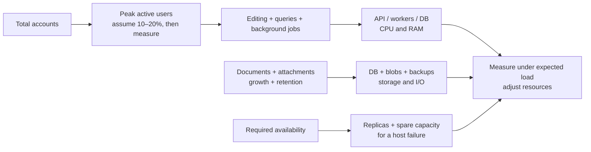

<!-- SPDX-License-Identifier: AGPL-3.0-or-later -->

# Sizing

[Documentation](../../README.md) / [Operations](../README.md) / [Deployment](./README.md)

These are rough starting estimates for provisioning a server. They have not
been established by Myoxus load benchmarks. Use them to plan the first
installation, then adjust them from observed usage. Containers and directly
installed servers need the same runtime resources; builds need separate capacity.

On this page

- [CPU and RAM by user count](#cpu-and-ram-by-user-count)
- [Memory limits and database connections](#memory-limits-and-database-connections)
- [Disk and backup storage](#disk-and-backup-storage)
- [Capacity during a host failure](#capacity-during-a-host-failure)
- [Check the estimates against actual use](#check-the-estimates-against-actual-use)

## CPU and RAM by user count

The table assumes ordinary document editing, Database queries and attachments,
with occasional imports and PDF exports. Assume **10–20% of accounts are actively
working at the same time**. Use your actual busy-hour concurrency if it is known.
Idle browser tabs and Electron clients also keep connections open.

CPU means allocated **vCPUs**, not dedicated physical cores. Use 64-bit CPUs
with sustained capacity and SSD/NVMe for PostgreSQL. The RAM estimates include
the operating system and some spare capacity.

| Users       | Active at once (assumed) | Suggested initial layout                                | Total vCPUs | Total RAM  |
| ----------- | ------------------------ | ------------------------------------------------------- | ----------- | ---------- |
| Up to 10    | 1–2                      | API, frontend, PostgreSQL and Redis on one host         | 2–4         | 8–16 GiB   |
| Up to 50    | 5–10                     | The same single-host layout                             | 4–8         | 16 GiB     |
| Up to 500   | 50–100                   | One larger host, or separate application and data hosts | 8–16        | 32–64 GiB  |
| Up to 5,000 | 500–1,000                | Three application nodes, dedicated PostgreSQL and Redis | 22–44       | 64–128 GiB |

For **up to 500 users** with two hosts, a starting allocation is 4–8 vCPU and
16–32 GiB RAM for the application host, plus the same for the data host.
Separating the services makes it easier to expand them independently. It does
not provide automatic failover.

For **up to 5,000 users**, the total above is calculated from:

| Component                            | Count | vCPUs per host | RAM per host |
| ------------------------------------ | ----- | -------------- | ------------ |
| API, embedded workers and PDF export | 3     | 4–8            | 8–16 GiB     |
| PostgreSQL primary                   | 1     | 8–16           | 32–64 GiB    |
| Redis                                | 1     | 2–4            | 8–16 GiB     |

This larger layout requires workload validation and the
[cluster configuration](./multi-instance.md). The total excludes separate
frontend/load-balancer hosts, database/Redis replicas, object-storage servers
and backup servers. Add those resources if they are self-hosted.

Large documents, frequent bulk imports, many simultaneous exports, calendar/Git
sync or embedding backfills can need substantially more capacity. AI inference
and transcription are not included: a locally hosted model needs a separate
CPU/RAM/GPU allocation. External AI still consumes some application capacity
while requests and jobs are running.

Editable diagram source (Mermaid)

## Memory limits and database connections

The supplied self-host Compose file sets these physical-memory limits:

| Service                       | Default limit | Configuration variable    |
| ----------------------------- | ------------- | ------------------------- |
| API, workers and PDF compiler | 6 GiB         | `MYOXUS_API_MEMORY_LIMIT` |
| PostgreSQL                    | 4 GiB         | `POSTGRES_MEMORY_LIMIT`   |
| Redis                         | 2 GiB         | `REDIS_MEMORY_LIMIT`      |

These limits sum to **12 GiB**, before Nginx, Docker and the operating system.
They are ceilings, not reserved memory or a guarantee of actual consumption.
For the unmodified stack, start with at least 16 GiB RAM. An 8-GiB host at the
smallest tier needs lower limits and reduced workload expectations, verified
under load. Set all three limits together; reducing only the API limit does
not budget the whole host. Swap does not replace sufficient physical RAM.

PDF export starts the sibling `myoxus-pdf-compiler` process. Include its peak
memory in the API allocation. PostgreSQL memory varies with query concurrency;
`work_mem` can be used by several operations at once. Redis needs room for
allocator overhead, connections and persistence peaks when persistence is enabled.

Each API node also adds a database pool. Budget the total pool connections,
listener connections, CLI and monitoring against PostgreSQL's connection limit.
See the [cluster connection calculation](./multi-instance.md#postgresql).

## Disk and backup storage

User count alone is a poor predictor of storage. Text documents take much less
space than retained PDFs, images and videos. The following gives a rough initial
budget; measure attachment retention and database growth separately.

| Users       | Initial online disk budget                        | Assumption                                                             |
| ----------- | ------------------------------------------------- | ---------------------------------------------------------------------- |
| Up to 10    | 80–150 GiB SSD                                    | System, application files, database and modest attachments on one disk |
| Up to 50    | 150–300 GiB SSD                                   | The same layout, with more room for attachments and temporary files    |
| Up to 500   | 100–200 GiB database disk; 0.5–1 TiB file storage | Roughly 1 GiB retained attachments per user, plus reserve              |
| Up to 5,000 | 0.5–1 TiB database disk; 5–10 TiB file storage    | The same attachment assumption; database size must be measured         |

Include indexes, document history, embeddings, WAL, logs, Git mirrors and
import/export temporary files. Allow approximately 30% free disk as a planning
reserve, and revisit it as data grows. These figures are not product quotas.
Backup storage and replication copies are additional.

For example, 500 users retaining 1 GiB of attachments each need about 500 GiB
for those files alone. With 30% free space, provision about 715 GiB before
adding database and backup storage. An attachment-heavy team may need many
times this amount.

Choose network and storage throughput against the recovery target too.
Restoring 1 TiB in four hours requires roughly 73 MiB/s sustained throughput,
before database replay and checks. Verify the complete restore; a nominal disk
or network speed does not establish the recovery time. See
[Backup and restore](../data/backup-and-restore.md).

## Capacity during a host failure

If a cluster must tolerate losing an application host, the remaining hosts must
carry the busy-hour load. For example, three equally sized nodes at 50% CPU
would each reach approximately 75% when that load is distributed over two
nodes. Reconnection and retried jobs create additional load. Test that case
rather than assuming a fixed headroom percentage is sufficient.

Add database and Redis replicas separately. Spare API capacity helps only if
the load balancer, database, Redis and file storage remain available.

## Check the estimates against actual use

Measure with representative documents and attachments, the expected number of
active users, and the integrations that will be enabled. Include editing,
Database queries, uploads/downloads, PDF exports and background jobs. In a
cluster, also test a node drain and failure. Use an isolated test installation.

Watch response latency, CPU, API/compiler memory, database connection waits,
query and disk latency, Redis memory, queue backlog and free space through a
busy period. Define acceptable response times and backlog recovery before
comparing the results.

Expand when memory limits or disk reserves are approached, queues keep growing,
or response times exceed the target. First identify whether the limiting
component is the API, database or storage: adding API instances will not fix a
slow database or saturated disk. Use [Observability](../observability/README.md)
for ongoing monitoring.
