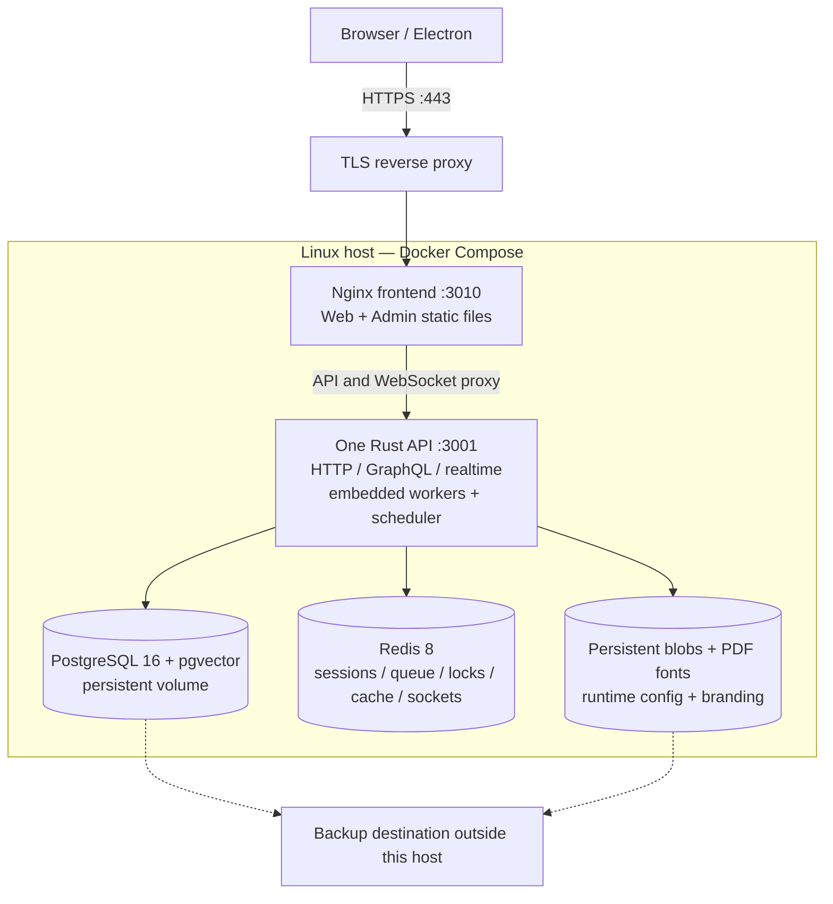
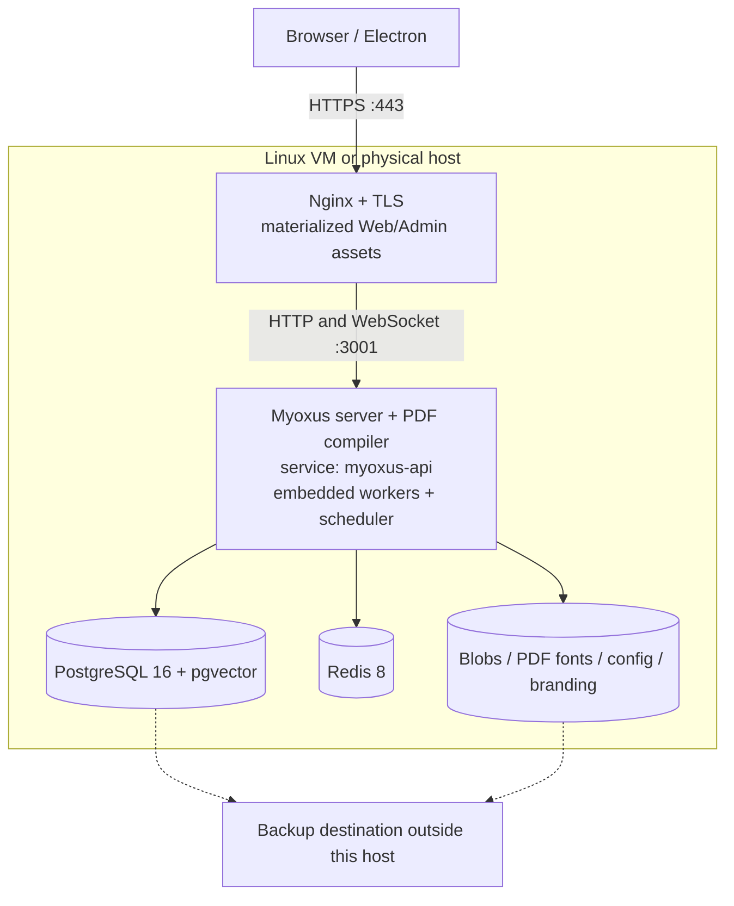
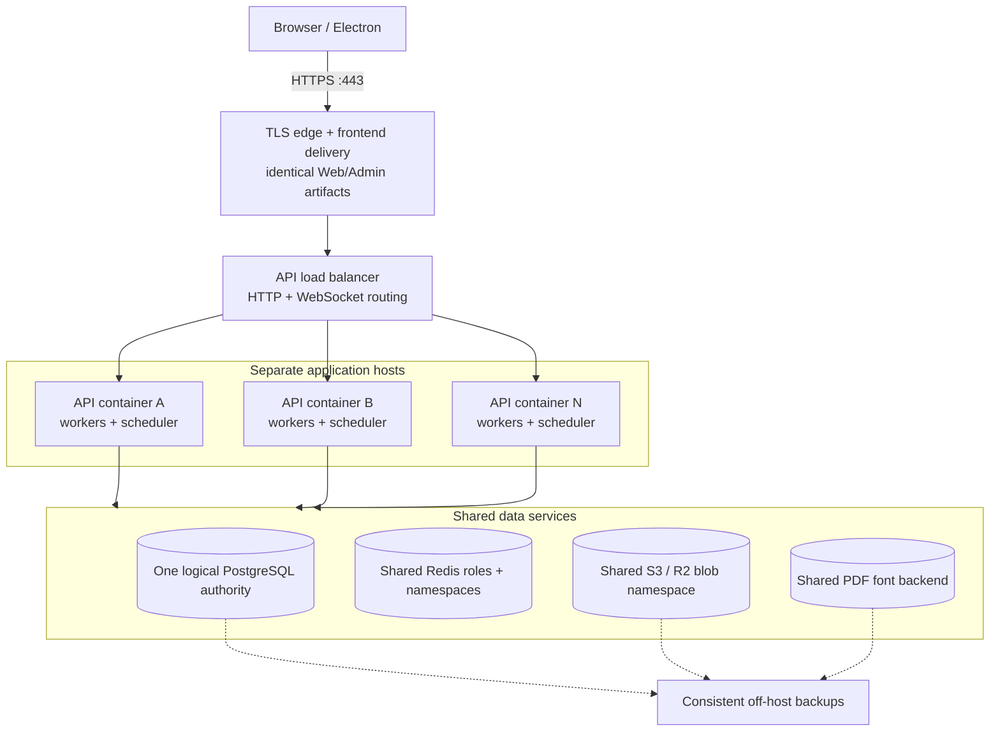

<!-- SPDX-License-Identifier: AGPL-3.0-or-later -->

# Choose a deployment

[Documentation](../../README.md) / [Operations](../README.md) / [Getting started](./README.md)

Choose how to install Myoxus, then decide how many API instances to run.
Containers and distribution packages are installation methods. A single instance
or a cluster describes the running system. Both methods can run on Linux VMs
or physical servers.

For the self-hosting beta, start with the Rust server, Browser Web and Admin on
one Linux host or VM. Check [published distributions](../../user/downloads.md)
for the exact artifacts you can obtain. Desktop packages are optional and
independent. Multi-instance diagrams describe a supported topology, not a
measured capacity or availability guarantee for your installation.

For the growth path from one host to several application nodes and shared data
services, see [Scaling from self-hosting to a private cloud](../deployment/scaling.md).

An **API instance** is one server process, including its background workers
and scheduler. One instance can serve many users, organizations and workspaces.
Several instances sharing a database form one installation. Separate databases
mean separate installations. `server.deployment_type` controls client transport
behavior; it does not set the number of server instances.

On this page

- [Installation methods](#installation-methods)
- [Single host with containers](#single-host-with-containers)
- [Single host without containers](#single-host-without-containers)
- [Multiple hosts with container API nodes](#multiple-hosts-with-container-api-nodes)
- [Distribution packages](#distribution-packages)
- [Plan before installing](#plan-before-installing)

## Installation methods

| Method                | When to use it                                                                                                            | Current installation path                                                                                                       |
| --------------------- | ------------------------------------------------------------------------------------------------------------------------- | ------------------------------------------------------------------------------------------------------------------------------- |
| Containers            | Deploy Myoxus and its dependencies as OCI containers, using Compose on one host or an existing container platform.        | [Published-image installation](../deployment/docker.md#deploy-published-myoxus-images)                                          |
| Distribution packages | Install on a standard Linux distribution, typically in a VM, and manage installation and updates with APT, DNF or Zypper. | DEB/RPM available in 0.41.38; installation checked on Ubuntu 24.04 and Fedora 44. See [package status](#distribution-packages). |
| Manual installation   | Build the server from source and install the binaries and runtime assets directly on Linux.                               | [Manual Linux installation](../deployment/systemd/README.md)                                                                    |

The container release includes the server, Web/Admin artifacts and a deployment
bundle. Native packages and manual Linux installation are also available.
Package dependencies install
system libraries and tools from distribution repositories; these do not belong
inside the Myoxus package.

## Single host with containers

Editable diagram source (Mermaid)

The Compose stack runs one API instance, PostgreSQL, Redis and a frontend Nginx
service. Web and Admin images contain static files that are extracted before
Nginx starts. Database data, uploaded files, PDF fonts, runtime configuration
and branding must survive container replacement.

This is the simplest container topology to install and maintain. A host outage
stops the whole installation; recovery requires repairing the host or restoring
onto a replacement. Keep backups on a separate system.

Expose HTTPS through a reverse proxy. Keep direct API, PostgreSQL and Redis
ports private. The supplied Compose file publishes dependency ports, so restrict
or remove those mappings before exposing the host to users. Follow the
[Docker guide](../deployment/docker.md) for installation and updates.

## Single host without containers

Editable diagram source (Mermaid)

This is the usual layout for a package installation on a Linux VM. The package
manager installs the Myoxus binaries and runtime assets, and resolves declared
system dependencies. The same layout can be installed manually from source.
PostgreSQL and Redis may run locally or on separate database and Redis servers.
Nginx serves the Web/Admin files and forwards API and WebSocket traffic.

The service manager starts and stops the API; it does not determine whether
this is a single-instance or clustered installation. Back up the database and files consistently,
including when using VM backups.

For the currently documented source installation, follow the
[manual Linux guide](../deployment/systemd/README.md). That procedure installs
all three binaries: server, CLI and PDF compiler. Released frontend files can
be extracted from OCI artifacts; the extraction step needs Docker even when
the services themselves run without containers.

## Multiple hosts with container API nodes

Editable diagram source (Mermaid)

A load balancer distributes requests across API instances. Every instance uses
the same database, Redis role mappings, application encryption key, public URL
and blob/font storage. Frontend and branding files must match on every server
that delivers them. A cluster can also use directly installed server processes;
shared state and routing requirements are the same.

Separate application hosts allow maintenance or a host failure without stopping
all API instances. The remaining hosts must have enough capacity for the load.
Database, Redis, storage and frontend delivery also need their own redundancy
if the installation must remain available when any one host fails.

The repository's multi-instance Compose file is an isolated test stack. It is
not a production cluster installer. Use the
[cluster guide](../deployment/multi-instance.md) for shared-state configuration,
load balancing, updates and failure handling. Current document-presence and
notification delivery gaps are listed there. An interrupted Copilot stream
also cannot resume on another process; normal Copilot requests can run on any
node.

## Distribution packages

[Myoxus 0.41.38](https://github.com/superions/myoxus/releases/tag/v0.41.38)
provides **DEB and RPM server packages for Linux x86_64**. The existing CI
installation checks passed on **Ubuntu 24.04 (DEB)** and **Fedora 44 (RPM)**,
including dependency loading, permissions, configuration-preserving reinstall
and removal.

Both formats contain the server, CLI, PDF compiler, runtime assets and original
license/SBOM material. Use **SERVER-PACKAGES-SHA256SUMS** from the release and
follow the [native package instructions](./installation.md#native-server-packages).
The [download overview](../../user/downloads.md) lists the available formats.

Electron DEB/RPM packages install the desktop client. They do not install the
server. The [container installation](../deployment/docker.md) and
[manual source installation](../deployment/systemd/README.md) remain available
alongside native packages.

## Plan before installing

1. Choose CPU, RAM and disk using the [sizing estimates](../deployment/sizing.md).
2. Set the public DNS name and arrange TLS certificates and renewal.
3. Provision PostgreSQL 16 with pgvector, Redis 8 and persistent file storage.
4. Generate and protect the database and application-encryption secrets.
5. Select server and frontend versions, and record their immutable digests.
6. Decide how much data loss and downtime are acceptable. Size backup storage
   and test a restore against those targets.

Continue with [installation](./installation.md) and the
[first configuration steps](./start-here.md).
