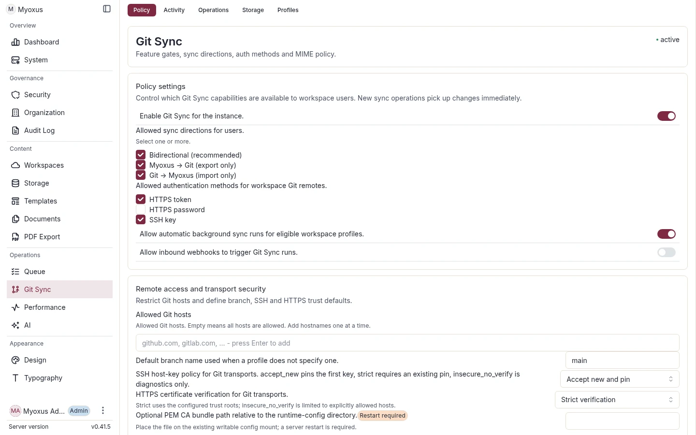

# Git Sync operations runbook

[Documentation](../../README.md) / [Operations](../README.md) / [Integrations](./README.md)

Git Sync enables bidirectional synchronisation between Myoxus workspace documents and a remote Git repository. Documents are exported as Markdown files with YAML frontmatter containing identity metadata.



<details>
<summary>On this page</summary>

- [Markdown compatibility](#markdown-compatibility)
- [Prerequisites](#prerequisites)
- [Configuration](#configuration)
- [Triggering sync](#triggering-sync)
- [Remote truth and reconciliation](#remote-truth-and-reconciliation)
- [Document paths and manifest diagnostics](#document-paths-and-manifest-diagnostics)
- [Conflict resolution](#conflict-resolution)
- [Troubleshooting](#troubleshooting)
- [Log analysis](#log-analysis)
- [Database tables](#database-tables)
- [CLI operations](#cli-operations)
- [MIME policy configuration](#mime-policy-configuration)
- [File sync (non-Markdown)](#file-sync-non-markdown)
- [Version links / provenance](#version-links--provenance)
- [Schema ownership](#schema-ownership)
- [Security notes](#security-notes)
- [Related documents](#related-documents)
- [File synchronization incidents](#file-synchronization-incidents)

</details>

## Markdown compatibility

Myoxus uses CommonMark 0.31.2 as its syntax baseline, with GFM tables, task
lists and strikethrough. It does not currently guarantee full CommonMark/GFM
conformance or lossless interchange for every editor block. The operational
limitations below apply to current imports and exports. Wikilinks, Git identity frontmatter,
native diagrams and JSON citations are Myoxus-specific integrations.

For portable files and predictable server imports:

- Use two trailing spaces or a backslash before a line ending for a visible
  break within a paragraph. A plain source line ending is a soft wrap and
  normalizes to a space. Use a blank line for a new paragraph. Server and
  editor import agree on these meanings; each writer emits backslash-LF for an
  ordinary hard break. A first export may therefore normalize a two-space
  spelling, while later exports through that same path are byte-stable.
- Keep literal HTML in fenced `html` code blocks. Server import rejects raw
  HTML, except `<br>`/`<br />` inside table cells; it does not render arbitrary
  HTML.
- Mermaid source exports in `mermaid` fences and server/client import creates a
  native diagram block without executing the source. Mermaid-native title syntax
  remains part of the source. Separate editor title/caption metadata is not
  portable and makes export partial rather than being silently inferred.
- Ordinary structured footnotes use native containers inside the same parent
  document. Forward/repeated markers share local definition IDs; complete normal
  child blocks export once with continuation indentation. Labels remain
  parent-scoped, and deleting a marker does not delete its body. Missing,
  duplicate, conflicting or nested definitions reject before import writes.
  Existing typed JSON citations retain their deployed citation/Sources contract.
  Normal admitted Git image files below definitions use the existing file/blob
  plan; no auxiliary document or dependency-note file is created.

CLI and Git use the same server Markdown implementation. Direct client
import/export uses separate editor adapters. Line-break meaning is shared, but
unrelated writer choices and HTML handling may still differ. Inspect diagnostics
for the import/export route you are using.
A successful export or sync run alone is not proof of
lossless conversion: inspect item diagnostics and compare representative
content before using bidirectional sync for an existing document collection.
Markdown export is not a replacement for a
[complete backup](../data/backup-and-restore.md).

Bidirectional sync retains the exact Git body hash separately from the
normalized Myoxus projection hash. Importing CRLF files or legacy two-space
hard breaks therefore does not rewrite the Git file merely to align hashes.
Once the binding and repository manifest are current, unchanged runs perform
zero document imports/exports, create no conflict or content commit, and leave
the remote file bytes and HEAD unchanged. A later real edit on either side is
still detected against that side's own last observed hash. An authorized
Myoxus-to-Git export may replace a legacy two-space hard break with the
canonical backslash-LF spelling once; subsequent unchanged exports are stable.

## Prerequisites

- Myoxus server running with PostgreSQL
- Redis available for the Git Sync queue, locks, and status cache
- Writable `git_sync.repo_base_dir` for local mirror repositories
- Blob storage backend configured for non-Markdown file sync
- Network access to the target Git remote
- Valid authentication credentials (PAT, password, or SSH key)

## Configuration

SQL-history expiration uses terminal timestamps, not creation time alone. Open
conflicts, Open partial sessions and newer child items survive. Closed conflicts
with no resolution timestamp remain protected. Bootstrap work with an uncertain
remote result, accepted unassigned webhook work and pending HistoryCapture
intent never expire by age. Webhook expiration also ends its deduplication
window; HMAC validation is unchanged. Recent receipt decisions and live run
references protect their history. Source-history retention and Extract/Undo
receipt lifetimes are unchanged. The existing `nightly.cleanStaleGitSyncRepos`
job performs SQL auxiliary cleanup before run cleanup and then the unchanged
mirror cleanup. Disabled profiles and profiles without mirrors are included.
Each short profile-row transaction freshly skips active/recovery-owned work,
including Succeeded Extract operations with pending Git metadata. There are no
remote Git operations or mirror locks for SQL expiration. Batches contain at
most 1,000 rows, statements are bounded and SQL work stops after 60 seconds to
continue next night. The existing job output reports deletions by kind,
protected/busy profile counts and budget exhaustion; real errors fail the job.

Old terminal runs expire only after eligible children have been explicitly
removed. The newest run per profile always remains available for status.
Non-null completion time, no reconciliation requirement and no retained child
references are mandatory. Newer provenance keeps its old parent; expired
version links of the newest summary can expire independently when no recovery
depends on them. Operational bindings, baselines, tombstones, schedules and
scope fences are not history and are never removed by these predicates. Delayed
delivery of a removed run ID is a no-op rather than new Git work.

`git_sync.retention_days` is the server-wide terminal SQL-history window:
omitted means 7 days; only integers 1..30 are accepted. There is no off/unlimited
value or profile-specific override. It uses normal YAML/ENV/DB precedence and
the existing Admin registry/writeback; removing a DB override restores the file
baseline. The existing nightly Git-Sync maintenance owns SQL cleanup,
independently of mirror retention and
the general document-history policy.

### Enable Git Sync

Git Sync is configured per workspace via a **profile**. A profile contains:

| Field                   | Description                                              | Default           |
| ----------------------- | -------------------------------------------------------- | ----------------- |
| `repo_url`              | HTTPS or SSH URL of the Git remote                       | required          |
| `branch`                | Branch to sync with                                      | `main`            |
| `root_path`             | Subdirectory in repo for content                         | `content/`        |
| `sync_direction`        | `Bidirectional`, `MyoxusToGit`, `GitToMyoxus`            | `Bidirectional`   |
| `trigger_mode`          | `Manual`, `Polling`, `Webhook`, `Cron`, `HistoryCapture` | `Manual`          |
| `polling_interval_secs` | Seconds between auto-sync (polling mode)                 | `300`             |
| `cron_expression`       | Canonical five-field schedule                            | required for Cron |
| `cron_timezone`         | IANA timezone used for local occurrences                 | required for Cron |
| `cron_misfire_policy`   | `Skip` or `RunOnce`                                      | required for Cron |
| `auth_method`           | `HttpsToken`, `HttpsPassword`, `SshKey`                  | required          |

In Admin, open **Git Sync -> Profiles**. Search and the **all/active** selector
filter the loaded inventory independently of the selected profile. The inventory
loads at most the first 100 workspaces and displays ten per page; it is not a
global server-side workspace search. Select a workspace row to inspect its
profile. Its name and ID remain visible above the detail editor even when a
filter hides that row.

Closing details or selecting another workspace asks before discarding a dirty
draft. Switching Git Sync tabs preserves the draft. **Discard Changes** abandons
only local edits; it does not delete a saved profile. Failed saves retain the
entered values and show the server error beside the form. Profile and token
rotation writes disable their controls until the write and readback finish.
Unsaved token-rotation changes must be saved or explicitly discarded before
editing the profile or rotating its token.

### Authentication methods

**HTTPS Token (recommended):**

- Use a Personal Access Token (GitHub, GitLab, etc.)
- Token is stored encrypted in `git_sync_credentials` table
- Never appears in logs (all `#[instrument]` annotations skip auth fields)

A fenced Extract child can reuse its source's active encrypted credential
without copying the secret. Its rotation status names the current steward;
disabled children still retain their reference. Deleting the source profile or
Workspace reassigns stewardship before removal, while deleting the last
dependent removes the secret. Replacing a child's credential detaches only that
child; replacing the steward's credential transfers old-secret ownership to a
remaining dependent. Do not delete a shared credential with direct SQL.
Automatic rotation shares one configuration and attempt across those profiles:
unfinished runs or Workspace handoffs on any dependent defer admission, and a
successful renewal changes every active pointer together. Disabled or
inaccessible stewards hand the unchanged configuration to the lowest-UUID
eligible consumer; a running attempt keeps its steward until reconciliation.
An obsolete queued attempt cannot renew the token a second time.

#### GitLab project-token self-rotation

Automatic renewal is opt-in and applies only to an existing `HttpsToken`
profile whose active credential has an expiry. The GitLab adapter supports a
project access token that can rotate itself with GitLab's `api` or
`self_rotate` scope. Myoxus does not inspect, reproduce, or change scopes,
access level, branch rights, or project membership. The configured repository
URL supplies the exact GitLab origin and URL-encoded project path; there is no
separate API-origin setting and redirects are never followed.

GitLab immediately revokes the previous token and returns the replacement
secret once. Myoxus sends one `POST` to
`/api/v4/projects/<encoded-project>/access_tokens/self/rotate` with only the
requested `expires_at` date. A successful local completion atomically inserts
the encrypted replacement, switches every dependent profile's active credential
pointer, records the provider-reported expiry, and deletes the superseded local
credential. It performs no clone, fetch, push, branch probe, or permission
request.

An error proven before HTTP transmission is a scrubbed `Failed` attempt and
may be tried again on a later UTC day. GitLab rejection, a timeout or broken
response after transmission, malformed success data, and process loss during
the one-time-secret boundary require `ManualIntervention`; they are never sent
again automatically. Recover by issuing a valid project token in GitLab and
using the existing Admin profile credential replacement or
`myoxus-cli git-sync set-credential`. Do not place the replacement token in
logs, shell arguments, evidence, or rotation status fields.

The REST adapter uses supported system trust roots plus the same validated
`git_sync.https_ca_bundle_path` material as Git transport. Unlike libgit2's
explicit diagnostic exception, token rotation has no
`insecure_no_verify` mode. Repository URLs must be credential-free HTTPS URLs.

Automatic rotation uses a shared expiry-derived one-shot, not the retired
`git-sync.scheduleTick` or a native due-list sweep. PostgreSQL atomically admits
one native attempt and its existing outbox handoff. The existing `git-sync`
queue payload still contains only the profile and attempt UUIDs. Lost enqueue
ACKs and Redis recovery use the same deterministic job without resetting its
attempts/backoff. There is no provider-specific Cron, queue or runner. A worker
redelivery is not sent to GitLab again: an attempt still marked `Rotating`
becomes `ManualIntervention`. See the
[controlled transfer](../runbooks/sync-and-workers.md#git-rotation-and-tick-retirement).

The provider-neutral operator commands are:

```bash
myoxus-cli git-sync token-rotation configure <profile-uuid> \
  --provider GitLab --enabled true \
  --renew-before-days 30 --requested-lifetime-days 90
myoxus-cli git-sync token-rotation status <profile-uuid>
myoxus-cli git-sync token-rotation run-now <profile-uuid>
```

`configure` accepts only the implemented provider, enabled state, and the two
lifecycle intervals. `status` and `run-now` return stable scrubbed states:
`Configured`, `Rotating`, `Completed`, `Failed`, or `ManualIntervention`.
They never output the token, provider permissions, access level, branch rights,
or remote token identifiers. `run-now` bypasses only the due-date check; it
still honors profile/run exclusion and the no-retry terminal states. Manual
recovery remains the existing credential replacement command:

```bash
myoxus-cli git-sync set-credential <profile-uuid> \
  --auth-method HttpsToken --credential-stdin
```

**HTTPS Password:**

- Username + password combination
- Same encrypted storage as tokens

**SSH Key:**

- PEM-encoded private key stored encrypted
- Optional passphrase
- SSH host keys are verified by `git_sync.ssh_host_key_policy`:
  - `accept_new` (default) stores the first seen host key in
    `git_sync_ssh_host_keys` and rejects later fingerprint changes.
  - `strict` accepts only already stored and enabled host-key pins.
  - `insecure_no_verify` disables SSH host-key verification intentionally and
    should only be used for short diagnostics.

**HTTPS certificates:**

- `git_sync.https_certificate_policy=strict` is the default and keeps libgit2 X509
  verification enabled.
- For a private PKI, place a PEM bundle below the existing writable
  runtime-config mount (for example
  `runtime-config/git-sync/company-ca.pem`) and set
  `git_sync.https_ca_bundle_path=git-sync/company-ca.pem` in Admin → Git Sync →
  Policy. Restart the server after changing the path or file.
- The bundle may contain one or more currently valid CA certificates and must
  include the issuer chain required by the Git server. It must not contain leaf
  certificates, private keys, unrelated PEM blocks, expired/not-yet-valid CAs,
  symlinks, or paths outside the runtime-config directory.
- The bundle supplements supported system roots; it does not replace them.
  Startup validates the complete bundle before Git-Sync workers start and fails
  if the file is empty, malformed, missing, unreadable, or invalid. The startup
  log records only the canonical path, configuration source, certificate count,
  trust policy, and restart requirement.
- `git_sync.https_certificate_policy=insecure_no_verify` is an explicit fallback.
  It can only be saved with a non-empty `git_sync.allowed_hosts` list and only
  accepts a failed X509 check when libgit2 reports one of those exact hosts.
  Redirected or otherwise unlisted hosts remain under strict verification.

### Create a profile in Admin

Open **Git Sync → Profiles**, select the workspace and configure its repository,
branch, root path, direction and authentication. Save the profile and inspect
the connection result. For automation, use [Git Sync via API](../../api/server/git-sync.md).

Enter credentials through the authenticated configuration form. Keep them out
of diagnostic records and screenshots.

Profile creation performs an authenticated read-only probe of the exact branch
before storing the profile. `updateGitSyncProfile` applies patch semantics and
preserves the profile ID and history. A replacement credential is required when
the authentication method changes. Use `gitSyncProfileDeleteImpact` before
`deleteGitSyncProfile`; deletion is rejected while a run is `Running`.

## Triggering sync

### Manual sync

Open the selected workspace profile under **Git Sync → Profiles** and choose
**Run test sync**, or use the documented CLI. The
[API guide](../../api/server/git-sync.md) supplies the automation call.

The direction is profile-owned. Omitting `direction` uses
`profile.sync_direction`; providing a different direction is rejected and does
not create a run. A successful response means Redis publication was
acknowledged and the queue `job_id` was persisted. A dispatcher outage returns
an error while retaining a recoverable `Pending` run.

### Polling (automatic)

Set `triggerMode: Polling` with a `pollingIntervalSecs` value. The worker will
check for changes at the configured interval only while the effective server
policy keeps `git_sync.enabled=true` and `git_sync.auto_sync_allowed=true`. The
interval is measured against the last run activity, including failed,
cancelled, pending and running runs, so a rapidly failing profile is not
immediately re-enqueued in a tight loop.

Shared scheduling owns the interval cursor. Its `GitPolling` target is unique
per native profile; `activity_at` tracks the later start/finish time and
`next_due_at` adds the native interval. Both facts advance in the same transaction
as Run activity, including manual execution and failure. A profile with no Run
starts due immediately. Existing Pending/Running Runs or credential rotation
block new automatic admission; recovered Runs keep their existing queue identity
and retry/backoff instead of creating another Run. There is no separate polling
selection loop. See the [controlled transfer](../runbooks/sync-and-workers.md#git-polling-scheduling-cutover).

`pollingIntervalSecs` must be positive. The API rejects invalid profiles and
the database prevents an invalid polling profile from being enabled.

### Cron (automatic)

Cron accepts exactly five fields and a valid IANA timezone. Aliases and
sub-five-minute schedules are rejected. For example, hourly in Berlin:

```bash
myoxus-cli git-sync create \
  --workspace <WORKSPACE_UUID> \
  --repo-url https://git.example.test/team/repository.git \
  --branch main \
  --trigger Cron \
  --cron '0 * * * *' \
  --cron-timezone Europe/Berlin \
  --cron-misfire-policy RunOnce \
  --auth-method HttpsToken \
  --credential-file /run/secrets/git-sync-credential.json

myoxus-cli git-sync schedule-preview \
  --cron '0 * * * *' \
  --cron-timezone Europe/Berlin \
  --count 5
```

`Skip` advances past occurrences older than the 90-second on-time window.
`RunOnce` retains only the newest missed UTC slot and admits it once the
profile has no unfinished run. A spring-forward nonexistent wall time does not
run; a fall-back repeated wall time yields two distinct UTC slots. Inspect the
persisted cursor with `myoxus-cli git-sync schedule <PROFILE_ID>`. Manual
GraphQL/CLI sync remains available for Cron profiles and does not mutate the
schedule.

#### Configure and verify cron in Admin

Cron cursor state lives in `scheduling_schedules`, joined by profile ID:
`next_due_at` is the next scheduled UTC slot, and `pending_due_at` is the latest
retained RunOnce slot. Existing API/CLI/Admin next/pending fields are projections;
the rule, enabled state and misfire policy stay native. Shared bounded admission
commits the native Run and outbox handoff atomically. Queue outages retain that
intent; retries reuse the native Run's deterministic job and payload. A running
or pending Run or credential rotation still excludes another automatic Run.
See the [controlled cutover](../runbooks/sync-and-workers.md#git-cron-scheduling-cutover).

Use **Admin → Git Sync → Profiles** at
`/adminfrontend/git-sync?tab=profiles` for profile authoring:

1. Select a workspace and open its profile.
2. Choose **Cron**, enter the five-field expression, select an IANA timezone
   from the server catalog, and choose `Skip` or `RunOnce`.
3. Verify all five server-calculated occurrences before saving. Each row shows
   the local wall time, explicit UTC offset and localized UTC instant. The Save
   action remains unavailable when the preview is incomplete or invalid.
4. After saving, compare **Next scheduled run** and **Pending catch-up** with
   `myoxus-cli git-sync schedule <PROFILE_ID>`.
5. Use **Run test sync** for a manual run. It does not advance or modify the
   Cron cursor.
6. Open **Activity** for the same workspace. Scheduled rows show source `Cron`
   and `scheduledFor`; manual test rows show source `Manual` and no scheduled
   slot.

The Admin browser never parses Cron or ships a timezone list. It calls
`gitSyncSchedulePreview` and `gitSyncTimezones`; field extensions from an
invalid preview identify `cronExpression` or `cronTimezone`. Core workspace
settings display Cron profiles read-only and direct schedule changes to Admin.

### Saved versions (automatic)

Set `triggerMode: HistoryCapture` to start an outgoing sync after a new
document-history version commits. The trigger requires automatic sync policy
and an outgoing-capable `MyoxusToGit` or `Bidirectional` profile. Every admitted
run is still `MyoxusToGit`: a remote-only change is never imported by this
trigger, while a separately requested manual run retains the profile direction.

The history transaction stores a durable receipt and identifier-only outbox
event. PostgreSQL coalesces receipts that arrive before the same pending run is
claimed; captures committed during a running or conflicting manual run remain
pending for the next scheduler pass. Disabling the profile or selecting another
trigger discards unassigned receipts from that activation. Re-enabling applies
only to future versions and does not backfill history.

### Partial sync batches

If `max_docs_per_sync` is configured and a run plans more document/Markdown
workitems than the limit, the server creates a durable partial-sync session.
The run itself should still finish as `Completed` unless infrastructure,
file-sync or final persistence fails. Item-level import/export failures are
stored on the partial items and surfaced through status counters.

Operationally:

1. Re-run the same profile manually or wait for polling/webhook to continue the
   open session.
2. Inspect `gitSyncStatus.partialHasMore`; `true` means the next run will claim
   the next pending batch.
3. Inspect `partialFailedItems`; non-zero means some items need conflict/error
   review, but other items were allowed to progress.
4. Use `myoxus-cli git-sync status <profile-uuid>` for a DB-local check of the
   latest `partial_session_id`, `partial_status`, `partial_has_more`,
   `partial_total_items`, `partial_processed_items` and
   `partial_failed_items`.

Do not raise `max_docs_per_sync` merely to hide `hasMore`. The limit is a load
control; completed partial sessions are expected for large workspaces.

### Webhook

Set `triggerMode: Webhook`. Configure the Git provider to POST to `/api/git-sync/webhook/{profile_id}`.
The endpoint requires the Myoxus HMAC headers:

- `X-Myoxus-Timestamp`: Unix timestamp in seconds.
- `X-Myoxus-Signature`: `sha256=<hmac(webhook_secret, "{timestamp}.{raw_body}")>`.
- `X-Myoxus-Delivery`: optional provider delivery id. GitHub
  `X-GitHub-Delivery` and GitLab `X-Gitlab-Event-UUID` are also accepted.

The JSON payload must include a `ref`, for example `refs/heads/main`. The ref
must match the profile branch; wrong-branch deliveries are persisted as rejected
deliveries and do not create runs. Valid deliveries are stored in
`git_sync_webhook_deliveries` before a run is created. Duplicate delivery IDs,
or duplicate HMAC-bound payload fingerprints when no provider id exists, are
idempotent even after the original run completed.

Ordinary document update outbox events never trigger Git Sync. `Manual`,
`Polling`, `Webhook`, `Cron`, and version-history capture are owned exclusively by the
ingress paths described above.

### Recovering pending dispatch

`git_sync_runs` is the durable queue intent. The API process continuously scans
`Pending` rows and republishes each run with the stable job ID
`git-sync-{run_id}`. Redis or process recovery therefore needs no direct SQL
status edit.

1. Confirm the profile remains enabled and its direction/trigger mode still
   match the Pending run.
2. Restore PostgreSQL and Redis connectivity and start the normal API/worker
   process.
3. Confirm the run has a non-null `job_id` and that the same ID appears once in
   the `git-sync` queue.
4. Confirm the worker either claims it as `Running` or records a terminal error.

Do not insert queue jobs manually and do not change a Pending run to `Running`
through SQL. A run that remains Pending with a `job_id` after Redis recovery
indicates a dispatcher/queue fault; inspect `git-sync pending dispatch` log
events and Redis connectivity.

## Remote truth and reconciliation

`Completed` is a proof-bearing state: `commit_after` and
`observed_remote_oid` are both non-empty and identical. A successful libgit2
callback or a local commit is not sufficient. Myoxus re-reads the authenticated
remote branch after every failed, timed-out or contradictory push result.

Inspect unresolved cross-system outcomes without modifying them:

```sql
SELECT id, profile_id, job_id, status, commit_before, commit_after,
       observed_remote_oid, reconciliation_required, reconciliation_reason,
       docs_created, docs_updated, docs_deleted, conflicts_found,
       started_at, finished_at
FROM git_sync_runs
WHERE reconciliation_required = true OR status = 'Running'
ORDER BY started_at;
```

The server runs stale-run and blob-promotion reconciliation at startup and
periodically. It acquires the distributed profile lock before classifying a
stale `Running` run. If the remote still equals `commit_before`, the run fails
normally. If it differs, the run is marked `reconciliation_required` with the
observed remote OID. For a verified remote movement followed by SQL rollback,
the row also retains the document counters prepared before push. These
counters describe materialized selected actions, not proof that normal
bindings or baselines committed.

Use the normal operator surfaces before direct SQL:

```bash
myoxus-cli --json git-sync status <profile-uuid> --limit 20
```

The same fields are available through `workspace.gitSyncRuns` and the Admin
Git Sync Activity tab. Interpret them as follows:

- `commit_after` is present only for `Completed` and must equal
  `observed_remote_oid`.
- A failed run with no `observed_remote_oid` failed before verified remote
  movement.
- A failed run with `reconciliation_required=true` and an
  `observed_remote_oid` applied remotely but did not finalize in PostgreSQL.
  The Admin warning is actionable; do not report this state as no changes.
- `docs_created`, `docs_updated` and `docs_deleted` count selected document
  actions that were materialized before push. They remain available on a
  reconciliation-required failure and do not claim that binding/baseline
  persistence committed.
- JSON `null` means evidence does not exist. Empty strings and `"-"` are not
  revision evidence; dashes are used only in the human-readable CLI table.

Inspect durable blob recovery work:

```sql
SELECT p.id, p.run_id, p.profile_id, p.stage_key, p.final_key,
       p.newly_promoted, p.db_committed, p.created_at, r.status
FROM git_sync_blob_promotions p
JOIN git_sync_runs r ON r.id = p.run_id
ORDER BY p.created_at;
```

Do not edit `git_sync_baselines`, `git_sync_file_baselines`, run OIDs, or
promotion rows manually. First preserve the run, remote ref, logs and ledger
evidence. Repair the underlying profile/credential/storage problem, then let
the server reconcile or perform an explicitly reviewed database repair.

An uncommitted promotion row attached to a
`reconciliation_required=true` run is expected evidence, not an orphan to
delete manually. The periodic recovery path removes only staging data and
newly promoted objects that remain unreferenced; a completed transaction marks
the promotion committed before normal cleanup removes its ledger row.

## Document paths and manifest diagnostics

Existing Git-Sync profiles retain their control manifest at
`.myoxus/git-sync-manifest.json`; their existing bytes and schema are not moved
by the scope migration. A separately owned extracted subtree uses a derived
`<root>/.myoxus/git-sync-manifest.json` address, never an editable manifest
setting. A source-owned path exclusion survives removal of its destination
profile. Source syncs can continue outside an excluded subtree without
importing, rewriting or deleting its files, including its README and child
manifest. A configured nested profile on the same remote/branch needs a
complete chain of directory exclusions from its parent through any intermediate
profiles; disabled profiles and identical manifest addresses remain in scope
of collision checks. A detached fence keeps the source runnable but is not
permission to configure a new child profile. If scope preflight reports an
ambiguity or a binding whose document moved without a handoff, inspect actual
ownership; do not delete a manifest, remove a fence or choose a profile merely
to clear the error. The control manifest is outside the normal document/file scan
and contains the Organizer revision, empty folders, stable folder/link IDs,
document IDs, canonical paths, titles and content hashes. Use the manifest to
distinguish a deliberately empty folder from lost content and to compare CLI
export with the server projection.

Extract content publication and external Git completion are separate. The SQL
transaction installs source exclusions immediately and leaves the target profile
disabled while its ownership metadata is pending. The target Workspace remains
editable and the source continues syncing its remaining scope. The existing
operation status exposes a safe pending cause and explicit Retry; retry never
creates another Workspace. An outage may use the last authenticated complete
inventory only while the exact configuration/scope revision still matches.
Remote completion still checks the current branch and owned bytes. It neither
exports intervening target edits nor blindly rebases old file snapshots. A
changed body/owner remains a pending conflict; shared authored asset files are
retained at the source. Public Git-enabled Extract uses the explicit Git choice
in the existing dialog. Its backend
uses receipt-owned counter-Move Undo rather than restoring old document state.

Disconnect instead leaves the target without a Git profile. Its local SQL
publication installs a durable detached fence and retires only the departed
bindings/active baselines, selected open conflicts and unassigned capture intent.
It performs no remote write and preserves authored files. Remaining source sync
cannot reimport or remove the detached subtree. A pending cleanup cause remains
visible until an enabled outbound-capable source completes a later outbound run;
neither Retry nor reconciliation upgrades a read-only direction. After that run
updates its manifest, the existing metadata worker may remove only unchanged
generated outputs proved by the receipt. Edited, shared and delegated files
survive, including later external reintroductions during acknowledgement recovery.

Optional `overview` descriptors on the workspace and folder records describe
derived Markdown output by `repoPath` and SHA-256 `contentHash`. They are not
synchronized documents and do not own document/file bindings. Older schema-1
manifests omit them unchanged. `overview_preflight` rejects unknown marked read-only outputs as well as invalid workspace,
path/hash or conflicting ordinary content ownership before Git/SQL content
writes; fix the actual source collision rather than editing the path ledger.

The server reserves active paths in `git_sync_path_owners` across document and
file bindings before writing outbound content. A path-preflight failure means
that two object identities would claim one path. Inspect without mutating:

```sql
SELECT profile_id, repo_path, owner_kind, owner_id
FROM git_sync_path_owners
WHERE profile_id = '<profile-id>'
ORDER BY repo_path;
```

The canonical schema requires one active owner per profile/path. If an upgrade
from a supported release rejects ambiguous bindings, correct the intended
binding with that source server, verify repository content, and retry the API
upgrade. Do not delete an arbitrary row or edit the SQLx ledger merely to
satisfy the constraint.

For a transport-independent projection check:

```bash
myoxus-cli --json export-docs \
  --workspace '<workspace-id>' \
  --output /tmp/myoxus-export > /tmp/myoxus-export-result.json
```

Stdout is one JSON result. Progress and diagnostics are on stderr. A non-empty
`failed` array produces a non-zero exit. An active empty document is listed in
`exported`, not `skipped`: its `.md` file contains canonical frontmatter and an
empty body, while its manifest `contentHash` is the hash of the empty string.
A missing output file for such a document indicates a projection regression.
Current-state load or Yjs conversion failures remain in `failed` and must not
be treated as empty content.

The Git-oriented export also includes workspace/folder README projections and
referenced native assets. Their paths and byte hashes appear in the manifest,
not in document counters. An unrelated existing README occupies its path; the
shared allocator chooses another generated destination. Only validated previous
manifest artifacts may be retired. Symlinked output trees are rejected. The CLI
uses its established trusted database access; `--actor-id` remains specific to
the separate Obsidian format. It uses the configured profile's root and
manifest even when that profile is disabled; multiple configured profiles in a
Workspace block a Git export instead of silently choosing one.

Git Markdown import resolves `[[target]]`, `[[target|label]]` and relative
`.md` links after all selected document identities are reserved. Resolution is
limited to normalized paths inside the configured root and exact unique titles;
missing or ambiguous targets remain source text and produce a content-free WARN
count. Export plans all final paths first, writes relative links between managed
documents, then computes content hashes, baselines and the manifest. References
outside the export set, or references with navigation parameters, remain
canonical Myoxus URLs. A target rename or move may therefore legitimately
change a referring document's hash and schedule it in a later bounded batch.

If `root_path` is absent before the first successful outbound run and no
manifest exists, the runner creates it as an empty initial state. If a manifest
or earlier successful run established that root, absence fails the run with
phase `missing_root`. Restore the expected branch/root or intentionally change
the profile; do not treat the empty scan as a successful deletion.

Manifest-owned overview files are derived, read-only content: pulling edits or
deletions does not alter Myoxus documents, settings or Organizer membership. Their
regeneration source remains the authorized Myoxus capture, never the edited Git
page. The next authorized outbound run regenerates edited or missing outputs
with ordinary changes in one guarded commit; inbound-only runs do not publish
those bytes. Unchanged output creates no extra commit. A copied marker grants no ownership. Recovery verifies the captured output
hash and header; ordinary user README files keep their normal import behavior.

## Conflict resolution

Conflicts occur when both sides (Myoxus and Git) modify the same document between sync runs.

### Viewing conflicts

Open **Git Sync → Activity** and select the workspace. Expand document or file
conflicts to inspect the repository path, current values and resolution state.

### Resolving conflicts

In **Git Sync -> Activity**, select a workspace with the search control. Reset
clears both the selected workspace and the search draft. Document/file conflicts
use expandable rows; run commit/job details and recovery diagnosis IDs are shown
under **Technical details**. Reconciliation warnings remain visible even when
run details are collapsed.

Every conflict action opens a confirmation showing the workspace ID, repository
path and strategy consequences. Cancel or Escape writes nothing and returns
focus to the action. Manual merge drafts survive closing the row and switching
Git Sync tabs. Workspace selection and Reset stay locked until the merge is
applied or explicitly discarded; discarding a local draft never resolves a
server conflict.

Controls stay locked through the confirmed write and runtime readback. A rejected
write retains the merge and shows a scrubbed error in the dialog. If the write
was applied but readback failed, the notice says so and offers a read-only reload;
conflict actions remain locked until that reload succeeds. Do not submit another
resolution merely because its old row is still cached. A negative mutation
acknowledgement is not treated as success.

The mutation returns `true` after the resolution was applied server-side.
`GitWins` updates the Myoxus document, `ManualMerge` requires `mergedContent`
and prepares the next push to Git, `MyoxusWins` prepares that push without
rewriting the snapshot, and `Dismissed` closes the conflict without preferring
either baseline. Submitting an already resolved conflict is treated as a stale
client action and is not silently overwritten.

### Conflict types

| Type             | Meaning                                    |
| ---------------- | ------------------------------------------ |
| `BothModified`   | Both sides changed content since last sync |
| `DeleteVsModify` | Deleted in Git, modified in Myoxus         |
| `ModifyVsDelete` | Modified in Git, deleted in Myoxus         |
| `RenameVsRename` | Both sides renamed (different targets)     |
| `RenameVsModify` | One side renamed, other modified           |

## Troubleshooting

### Admin Git-sync configuration recovery

The Admin Git-Sync page keeps Policy, Activity, Operations, Storage, and
Profiles independently navigable when one query, field, or tab fails. A
configuration warning exposes a stable `GITSYNC-...` diagnosis ID under
**Technical details** and offers
two distinct recovery actions:

1. **Reload server values** refetches both the server-owned configuration
   schema and the effective value snapshot. Use this after a server upgrade,
   configuration deployment, or suspected stale browser cache.
2. **Discard local changes** replaces unsaved Admin edits with the latest
   normalized server snapshot, after explicit confirmation. It does not change
   server state. Cancel retains the draft. Failed reloads remain visibly failed;
   they do not announce successful recovery or hide the original warning.

When escalating a failure, retain the diagnosis ID, active tab, approximate
time, and the API request ID from structured Admin logs. The diagnostic record
contains only bounded structural metadata: route, tab, frontend version,
GraphQL operation and request correlation, field path, expected/actual type,
schema/config revisions, and component names. It deliberately excludes raw
configuration values, secrets, payloads, exception text, and source file
paths.

Field provenance and write policy are independent:

- A descriptor with `databaseWritable=true` remains editable even when its
  current winning source is YAML or environment.
- File-only and secret-file descriptors are read-only. Change them in the
  owning deployment source, then restart or redeploy as required.
- A **restart required** marker means a successful save persists the value but
  the running process keeps the old effective behavior until restart. After
  restart, use **Reload server values** and verify that the value, provenance,
  and marker match the intended deployment.

Do not work around a wrong-type warning by repeatedly saving the visible
fallback. The page validates effective values against the independently
versioned server schema and uses the descriptor default only to keep unaffected
controls operable. Correct the authoritative source, restart when required,
then reload the server snapshot.

### Auth failures

**Symptoms**: Sync run fails with `error_class: GitAuth`

**Log messages to look for** (at WARN level):

```text
WARN git_sync::git2_adapter: Authentication failed for ...
```

**Resolution**:

1. Verify the token/password is still valid
2. Check the repository URL is correct
3. For SSH: verify the key format (must be PEM-encoded)
4. For SSH host-key errors: inspect `gitSyncSshHostKeys` in GraphQL/Admin,
   compare the `fingerprintSha256` with the provider's documented key, and
   disable/delete stale pins only after an intentional key rotation.
5. If the diagnosis says the HTTPS credential target is not allowed, inspect
   the provider's redirect chain and add every intentional target hostname to
   `git_sync.allowed_hosts`. Do not allow an unfamiliar redirect target merely
   to make authentication succeed.
6. Check the Git host is reachable from the server

An authentication denial is terminal after the first worker attempt for that
run; replaying the terminal run performs no Git I/O. The server preserves an
existing mirror, including its HEAD, index, dirty tracked/untracked files and
stashes, and does not delete or re-clone it. Do not remove the profile, mirror,
bindings or baselines to repair credentials. Rotate the credential with the
normal Admin/GraphQL lifecycle or `myoxus-cli git-sync set-credential`, then
trigger a new run. A successful recovery uses fetch against the same mirror and
should be followed by an immediate No-op run with matching remote OIDs.

Open, checkout, reset, corrupt/missing-ref and filesystem permission/stat
failures on an existing mirror also fail closed so the directory remains
available for inspection. Only a path proven genuinely absent permits a first
clone; a dangling symlink is not absence. A first clone is built under the
profile/attempt staging area and becomes the canonical mirror only after its
origin, branch, commit/tree, configured root and authenticated remote OID have
all been verified. A failed clone or failed pre-publication check leaves no
partial canonical mirror. If another canonical path appears concurrently, the
server preserves both it and the rejected staging evidence instead of replacing
either.

For repository-integrity or staging failures, stop repeated runs and preserve
the suspect canonical directory, staging owner metadata, logs and any operator
backup before investigating. Do not rename a different repository into the
profile path, delete the profile to force a clone, or reset bindings/baselines
with SQL. Correct capacity, permissions, remote configuration or credentials
through their owning surfaces; replacement of a corrupt or foreign existing
mirror requires a separately reviewed recovery procedure.

Disabling a profile does not surrender its mirror. The nightly maintenance job
retains mirrors for enabled and disabled profiles and removes a canonical UUID
directory only after the profile is absent and both distributed and physical
ownership have been acquired. It may remove valid attempt-owned staging after
24 hours only when no Pending or Running run exists. Busy owners, current or
malformed staging, unknown directory names, symlinks and enumeration/database
errors are retained and reported for inspection. Never delete lock files or
unknown paths to make the maintenance job succeed.

### HTTPS certificate failures

**Preferred resolution:**

1. Export the currently valid issuing CA chain as a PEM bundle. Do not include
   the Git server's leaf certificate or any private key.
2. Use **Security → Authentication → Global TLS trust → Upload and Apply**
   with a writable runtime YAML overlay. Alternatively, copy the bundle to the
   runtime-config directory and configure `tls.additional_ca_bundle_path` in
   YAML/ENV as its relative path. Preserve existing operator paths; do not create
   a Git-only database override.
3. Inspect configured file count, expiry and fingerprint separately from loaded
   trust. Replacement retains one previous-file backup; Restore Previous and
   explicit removal use the same surface. ENV-owned/read-only trust remains an
   operator configuration task. See [CA file administration](../configuration/README.md#additional-certificate-authorities).
4. Restart the affected processes. Confirm that the startup log reports the expected
   canonical path, source, certificate count, `additional_ca_plus_system_roots`
   policy, and restart requirement without printing PEM. The snapshot identifier
   is a non-secret correlation value, not a private key.
5. Run the supported Git-Sync connection test. It uses the same adapter and
   certificate callback as clone, fetch, push, remote-ref verification, and
   conflict reads.
6. Keep `git_sync.https_certificate_policy=strict`.

### Additional CA migration

The old `git_sync.https_ca_bundle_path` file/ENV input is deprecated but accepted
as a global bootstrap alias. Different explicit old/new values are rejected;
an explicit new empty string is not absence. A DB-only old value remains
Git-only and reports `tls_legacy_git_migration_required` in startup status.

1. Use `myoxus-cli config export --overrides` to inventory existing overrides and
   retain the CA file. Treat exported configuration as operator-private material.
2. Persist the same relative path as `tls.additional_ca_bundle_path` in the
   runtime YAML or `MYOXUS__TLS__ADDITIONAL_CA_BUNDLE_PATH`. Use the existing
   validated configuration mechanism, not a database write for the new key.
3. Restart all consuming processes and inspect `additional_ca_trust` startup
   status. Verify the loaded source, count and snapshot ID and exercise the
   required transports before removing the legacy override.
4. After global activation is verified, remove the old DB override using the
   existing CLI config import removal contract: import an operator-owned JSON
   document containing `{"git_sync.https_ca_bundle_path": null}`. Do not replace
   the entire configuration or delete the CA file. Remove a redundant old
   file/ENV key as well before a later path change would create a conflict.

There is no filesystem/DB distributed transaction, automatic promotion of a
DB-only value, or live CA-file reload. The original Git certificate/hostname
policy is independent of this additional trust source.

Interpret TLS failures before changing policy:

- A missing or unreadable bundle is a startup configuration error.
- An empty, malformed, non-CA, expired, or incomplete bundle is invalid and
  must be replaced with the correct CA chain.
- A wrong CA or hostname mismatch means the remote identity does not match the
  configured trust material; changing the allowlist does not repair strict
  verification.
- A runtime `TLS certificate verification failed` Git-Sync error is
  non-retryable. Correct the trust material, hostname, or remote chain before
  retriggering the run.

If verification must be disabled temporarily, first restrict
`git_sync.allowed_hosts` to the required host, then select
`insecure_no_verify`. An empty allowlist is rejected and the runtime callback
also fails closed if inconsistent data reaches it. The bypass is exact-host
only, emits an explicit warning, and must be removed after diagnosis.

### Network issues

**Symptoms**: `error_class: GitNetwork`

**Log messages**:

```text
WARN git_sync::git2_adapter: unable to access ...
WARN git_sync::git2_adapter: could not resolve host ...
```

**Resolution**:

1. Check DNS resolution from server host
2. Verify firewall rules allow outbound HTTPS/SSH
3. Check if the Git provider is experiencing an outage

### Import errors

**Symptoms**: `error_class: ImportError`, files classified as `MalformedFrontmatter`

**Log messages** (at WARN level):

```text
WARN git_sync::import: malformed frontmatter — quarantining
```

**Resolution**:

1. Check the file's frontmatter YAML for syntax errors
2. Verify all required fields present: `sync_id`, `doc_id`, `workspace_id`, `title`
3. Verify UUIDs are valid format
4. Files with malformed frontmatter are quarantined (not processed), not lost

### Content hash mismatches

If the same content produces different hashes between runs, check:

1. Trailing whitespace differences
2. Line ending differences (CRLF vs LF)
3. Git binding hashes describe observed Markdown after frontmatter stripping;
   Myoxus baselines describe the canonical projection of the persisted native
   body through the final path/target plan, not raw Yjs bytes. Different spellings
   can normalize to the same Myoxus content without implying a local edit.

For heading/block links, inspect both the referring Markdown fragment and the
actual target file. Explicit `^block-id` provenance is retained; otherwise the
export-only copy receives a deterministic `^myoxus-…` anchor. Never repair a
precise link by dropping its fragment or resetting bindings. Deleted, ambiguous,
inaccessible or nonportable targets stay diagnosed rather than becoming a
working whole-document link. No generated export anchor is written into the
live document.
For a source-only pull, unchanged targets must still contain those unique
generated aliases in their observed Git bodies. The import inventory binds
them to current native IDs without changing the live target. An alias removed
from the file, duplicated, placed only inside literal content, or referring to
a deleted native block does not resolve. Inspect that state before retrying;
do not substitute a newly guessed block ID.

Precise links can require complete body capture even during a partial sync, so
anchors used by unchanged referrers remain present. `projectedDocumentPayloads`
can exceed the selected write count; ordinary document links still use the
incremental dependency subset. A `prepare_myoxus_documents` or
`document_reference_plan` failure occurs before repository mutation. Repair the
reported source/target state and retry; do not rewrite baselines manually.

### Sync run stuck in "running"

If a run stays in `Running` status:

1. Check worker logs for panics or timeouts
2. The run can be cancelled via the status transition API
3. Only `Pending` and `Running` runs can transition to `Failed` or `Cancelled`

## Log analysis

### Key log levels

| Level   | What to look for                                                               |
| ------- | ------------------------------------------------------------------------------ |
| `TRACE` | Git adapter operations, file I/O operations, individual binding reconciliation |
| `DEBUG` | Frontmatter parsing, branch checkout, file counts                              |
| `INFO`  | Sync run start/complete, conflict detection, summary counters                  |
| `WARN`  | Auth failures, malformed frontmatter, unexpected states                        |
| `ERROR` | Database errors in store operations                                            |

### Useful log filters

```bash
# All git sync activity
RUST_LOG=myoxus_application::git_sync=debug,myoxus_infrastructure::git_sync=debug

# Troubleshoot auth/network
RUST_LOG=myoxus_infrastructure::git_sync::git2_adapter=trace

# Troubleshoot reconciliation
RUST_LOG=myoxus_application::git_sync::reconcile=debug,myoxus_application::git_sync::doc_reconcile_plan=info
```

## Database tables

| Table                         | Purpose                                                 | Key queries                             |
| ----------------------------- | ------------------------------------------------------- | --------------------------------------- |
| `git_sync_profiles`           | Workspace config                                        | By workspace_id                         |
| `git_sync_bindings`           | Doc-file mappings                                       | By profile_id, filter tombstone=false   |
| `git_sync_runs`               | Execution history                                       | By profile_id, ORDER BY started_at DESC |
| `git_sync_conflicts`          | Conflict records                                        | By profile_id, filter resolution='Open' |
| `git_sync_baselines`          | Last common state                                       | By binding_id (1:1)                     |
| `git_sync_credentials`        | Encrypted secrets                                       | By id (never expose encrypted_data)     |
| `git_sync_file_bindings`      | Blob-file mappings                                      | By profile_id, filter tombstone=false   |
| `git_sync_file_baselines`     | Last synced file state                                  | By profile_id + blob_key                |
| `git_sync_file_conflicts`     | File conflict records                                   | By profile_id, filter resolution='Open' |
| `git_sync_partial_sessions`   | Durable batch/session state for `max_docs_per_sync`     | By profile_id + status                  |
| `git_sync_partial_items`      | Claimed/pending/failed items in one partial session     | By session_id + status + sort_key       |
| `git_sync_webhook_deliveries` | Durable webhook idempotency and branch rejection ledger | By profile_id + dedupe_key              |
| `git_sync_ssh_host_keys`      | SSH host-key pins for Git transports                    | By host + port + key_type               |
| `git_sync_version_links`      | Run↔commit provenance                                   | By run_id, by commit_sha                |

## CLI operations

`myoxus-cli git-sync` is a direct-Postgres operator surface. It does not clone
or push as part of a sync run and does not publish Redis jobs itself. Lifecycle
commands do use the production `Git2Adapter` for read-only exact-branch probes.
Reconciliation uses a temporary full-history clone but never writes or pushes
the remote. Manual triggers create or reuse one unfinished `Pending`/`Running`
run through the shared Git-Sync store and wait for the server dispatcher to
persist a queue acknowledgement. Without a running dispatcher the command
fails clearly while leaving the Pending intent recoverable.

```bash
myoxus-cli git-sync profiles
myoxus-cli git-sync status <profile-uuid> --limit 20
myoxus-cli git-sync conflicts <profile-uuid> --all
myoxus-cli git-sync trigger <profile-uuid> --wait --timeout 300

chmod 600 /run/secrets/git-sync-credential.json
myoxus-cli git-sync create \
  --workspace <workspace-uuid> \
  --repo-url https://git.example.test/team/repository.git \
  --branch main \
  --auth-method HttpsToken \
  --credential-file /run/secrets/git-sync-credential.json

myoxus-cli git-sync update <profile-uuid> --root-path content/
myoxus-cli git-sync set-credential <profile-uuid> \
  --auth-method HttpsToken \
  --credential-stdin < /run/secrets/git-sync-credential.json
myoxus-cli git-sync test \
  --repo-url https://git.example.test/team/repository.git \
  --branch main \
  --auth-method HttpsToken \
  --credential-file /run/secrets/git-sync-credential.json

```

Credential JSON is accepted only from a regular file without group/other
permissions or from stdin. It is never accepted as an argument. Do not redirect
shell tracing, stdout, or stderr into the credential file. Supported payloads
are `{"token":"..."}`, `{"username":"...","password":"..."}`, and
`{"privateKey":"...","passphrase":"..."}` according to the selected method.

Create, update, credential rotation, and test can fail with stable diagnoses:
`InvalidRepositoryUrl`, `RedirectLoop`, `Authentication`, `Tls`,
`MissingBranch`, `PolicyDenied`, `NetworkTimeout`, `Network`, or `Repository`.
No profile mutation is committed after a failed probe. Updating a profile
cancels obsolete `Pending` intent and is rejected while a run is `Running`.

`--direction` is optional and may only repeat the configured profile direction;
it cannot widen or narrow the profile.

Profile deletion removes the profile together with its runs, bindings, open
conflicts, and encrypted credential. Disable it, require no `Pending` or
`Running` run, and capture a verified PostgreSQL checkpoint before previewing:

```bash
myoxus-cli git-sync delete <profile-uuid>
```

Review every impact count and abort if it differs from the intended profile.
Apply only that reviewed target, then require `profiles`, `status`, and the
Admin list to show it absent while the remote repository remains unchanged:

```bash
myoxus-cli git-sync delete <profile-uuid> --apply
```

Restore the PostgreSQL checkpoint if the wrong profile was removed. The command
does not delete or rewrite the remote repository, so remote rollback is neither
required nor performed.

`status` includes explicit document/file conflict and binding counters. The
legacy aggregate run field `conflicts_found` remains the run-level value, while
`open_doc_conflicts`, `open_file_conflicts`, `total_doc_bindings` and
`total_file_bindings` reflect the current profile state. `conflicts` returns
both document and file conflicts; file rows include `run_id`, `blob_key` and
`binding_id` when available.

### Reconciliation procedure

Reconciliation is database repair against authenticated remote facts. The
profile must be disabled and have no `Running` run.

1. Back up PostgreSQL and record the current remote branch OID.
2. Run the dry-run and retain its JSON report:

   ```bash
   myoxus-cli --json git-sync reconcile <profile-uuid> \
     > /secure/operator/git-sync-reconcile-dry-run.json
   ```

3. Independently compare the reported counts with read-only queries for
   `git_sync_runs`, bindings, baselines, file baselines, and version links.
   Review every entry in `bindingAdoptions` and
   `unresolvedRemoteDocuments`. An adoption names the exact document ID, sync
   ID, and repository path that will receive a binding and baseline. An
   unresolved entry includes the same identity plus a stable reason and makes
   apply fail without changing any row.
4. Apply only with the exact OID copied from the reviewed report:

   ```bash
   myoxus-cli --json git-sync reconcile <profile-uuid> \
     --apply --expected-remote-oid <40-hex-oid>
   ```

The command re-probes the branch immediately before the transaction. A moved
branch or changed profile aborts all writes. It verifies manifest workspace and
schema identity, unique document IDs/paths, every Markdown frontmatter identity,
and every content hash. A verified unbound entry is adoptable only when its
document ID resolves to one active workspace document and no active,
tombstoned, sync-ID, document-path, or file-path conflict exists. The
transaction uses the shared path planner, inserts adopted bindings and
baselines, lets the existing binding trigger derive path ownership, rebuilds
document baselines only from verified remote content, clears unreachable
commit references, finalizes only matching reconciliation-required runs, and
writes one scrubbed `git_sync.reconcile.apply` audit event. Running the
unchanged command again is a no-op and creates no second audit event.

With `--json`, a rejected unresolved apply still writes exactly one complete
report to stdout and exits non-zero; the concise diagnostic remains on stderr.
Retain that report for operator review. Never bypass an unresolved reason with
manual binding or path-owner SQL.

Rollback is a PostgreSQL restore of the reviewed pre-apply backup. Do not
reverse individual rows manually and never rewrite the branch to match local
metadata. After apply, enable outbound/manual mode, run once, inspect the
resulting commit, then run a second time and require an exact no-op before
considering bidirectional operation.

### Authoritative outbound bootstrap

Use bootstrap only when a profile's bindings or baselines cannot be repaired by
reconciliation and current Myoxus workspace state is authoritative. Bootstrap
never imports Git content. It replaces the managed Markdown tree, bound file
objects, and `.myoxus/git-sync-manifest.json`, then rebuilds normal binding and
baseline state. Its preview includes generated overview writes/deletes and
hashes in the same desired-tree fingerprint and expected remote-OID guard.
Overview artifacts never receive document bindings. The profile remains disabled
throughout and after recovery.

1. Disable the profile and wait until it has no `Pending` or `Running` run.
2. Create and verify the database portion of a protected checkpoint before
   applying. Keep the profile disabled while the matching blob state is
   captured according to the backup owner:

   ```bash
   myoxus-cli --database-url-file /protected/path/database-url \
     backup create --output /secure/checkpoints/git-sync-bootstrap
   myoxus-cli --database-url-file /protected/path/database-url \
     backup verify /secure/checkpoints/git-sync-bootstrap
   ```

   This CLI checkpoint does not copy blobs; follow
   [Backup and restore](../data/backup-and-restore.md) before continuing.

3. Run the read-only inspection:

   ```bash
   myoxus-cli --json git-sync bootstrap <PROFILE_ID>
   ```

4. Review `expectedRemoteOid`, every `writes` and `deletes` path, object
   counts, and `desiredTreeFingerprint`.
5. Apply only the OID returned by that exact dry-run:

   ```bash
   myoxus-cli --json git-sync bootstrap <PROFILE_ID> \
     --apply --expected-remote-oid <OID>
   ```

Dry-run performs an authenticated probe and temporary full clone but writes no
Git, PostgreSQL, or blob state. The compare-and-swap fails before creating an
attempt if the branch moved. Git-only `.md` files below `root_path` are explicit
planned deletions. Unknown non-Markdown content below `root_path`, or an
unexpected control entry inside that managed root, aborts before a push and
reports exact paths. Fenced child subtrees, their manifests and their files
are omitted from the deletion inventory and retained unchanged; an unfenced
overlapping profile cannot pass scope preflight. A manifest outside this
profile's root and other files outside `root_path` are also preserved.
Every active file binding must resolve to blob bytes whose SHA-256 matches its
persisted content hash.

Apply persists a scrubbed attempt before changing Git. After an authenticated
push receipt, it records the observed OID before the single SQL finalization.
Inspect an interrupted attempt without mutation:

```bash
myoxus-cli --json git-sync bootstrap <PROFILE_ID> --resume <ATTEMPT_ID>
```

| Attempt state                                                  | `--resume ... --apply` behavior                                    |
| -------------------------------------------------------------- | ------------------------------------------------------------------ |
| `Prepared`, remote still equals expected OID                   | Rebuild the same desired tree and perform the guarded push         |
| `Prepared`, remote tree exactly equals the desired fingerprint | Record the authenticated OID and finalize SQL without another push |
| `Prepared`, remote is any third tree                           | Fail closed without remote or normal-state SQL mutation            |
| `RemoteApplied`, remote still equals observed OID              | Perform SQL-only finalization                                      |
| `RemoteApplied`, remote moved                                  | Fail closed; do not finalize stale state                           |
| `Completed`                                                    | Return the completed report without mutation                       |
| `Failed`                                                       | Resolve the pre-push cause and start a new dry-run                 |

After SQL finalization, the command performs a fresh authenticated clone and
reloads current Myoxus state. Success requires an exact no-action plan. Do not
enable the profile until this verification succeeds and the repository has been
reviewed. Rollback is explicit: restore PostgreSQL from the recorded backup and
reset the branch through normal repository administration; bootstrap performs
no hidden reverse mutation.

## MIME policy configuration

Git Sync enforces a MIME policy on file uploads to control which file types are allowed to sync.

### Configuration fields

| Canonical path                  | Type                   | Default    |
| ------------------------------- | ---------------------- | ---------- |
| `git_sync.mime_allowlist_admin` | `string[]`             | See below  |
| `git_sync.mime_blocklist_admin` | `string[]`             | `[]`       |
| `git_sync.mime_validation_mode` | `"strict"` or `"warn"` | `"strict"` |

### Default allowlist (10 types)

```text
text/markdown, text/plain, image/png, image/jpeg, image/gif, image/svg+xml,
application/pdf, application/json, text/csv, image/webp
```

### Blocklist priority

The blocklist is evaluated **before** the allowlist. If a MIME type appears in both lists, it is **blocked**. This lets admins start with a broad allowlist and carve out exceptions.

### Validation modes

| Mode     | Behaviour                                                                                                                        |
| -------- | -------------------------------------------------------------------------------------------------------------------------------- |
| `strict` | Files with disallowed MIME types are **rejected** (HTTP 415). They appear in run summary as `filesDenied`.                       |
| `warn`   | Files with disallowed MIME types are **synced** but logged at WARN level. `filesDenied` counter still increments for visibility. |

### Configure via Admin GUI

1. Navigate to **Git Sync → Policy tab → MIME Policy** section
2. Edit the allowlist/blocklist (comma-separated MIME types)
3. Select validation mode (`strict` / `warn`)
4. Save — changes take effect on the next sync run

### Configure via Admin GraphQL

Pass three updates with `module: "git_sync"` and keys
`mime_allowlist_admin`, `mime_blocklist_admin` and `mime_validation_mode`.

### Troubleshooting: upload rejected with 415

**Symptoms**: Sync run completes but `filesDenied > 0`, or individual file sync fails with HTTP 415.

**Resolution**:

1. Check the current MIME policy: Admin GUI → Git Sync → Policy tab
2. Verify the file's detected MIME type (logged at DEBUG level during loader stage)
3. Either add the MIME type to the allowlist, or switch to `warn` mode for testing
4. Re-trigger the sync run

---

## File sync (non-Markdown)

Non-Markdown files (images, PDFs, attachments) are now synced as blobs alongside document Markdown.

### Pipeline

```text
Loader (classify + MIME check) → Reconcile (3-way) → Executor (blob↔git) → Persist bindings
```

1. **Loader** classifies each file by MIME type. The MIME policy is applied here — denied files are skipped before reconciliation.
2. **Reconcile** performs 3-way merge logic using stored baselines, identical to document reconciliation.
3. **Executor** transfers blob data between Myoxus storage and the Git working tree.
4. **Persist** writes/updates binding and baseline records.

### Database tables

| Table                     | Purpose                                                |
| ------------------------- | ------------------------------------------------------ |
| `git_sync_file_bindings`  | Maps Myoxus blob IDs to Git repo paths                 |
| `git_sync_file_baselines` | Stores last-synced state (hash, size) per file binding |
| `git_sync_file_conflicts` | Conflict records for file-level conflicts              |

### File conflict resolution

File conflicts use the same resolution enum as document conflicts:

| Resolution   | Effect                                                                  |
| ------------ | ----------------------------------------------------------------------- |
| `MyoxusWins` | Keeps the Myoxus blob authoritative; the next sync pushes it to Git     |
| `GitWins`    | Reads the Git file, writes/updates the Myoxus blob binding and baseline |
| `Dismissed`  | Conflict is acknowledged without changing blob/baseline state           |

Note: `ManualMerge` is not available for binary files.

### Inspect file synchronization

Use **Git Sync → Activity** for file conflicts and run counters, or the
[API inspection examples](../../api/server/git-sync.md) for automation.

Use the explicit file fields when diagnosing non-Markdown sync state:

Resolve a file conflict through the server mutation; clients must not mark file
conflicts locally:

Valid file resolutions are `MyoxusWins`, `GitWins` and `Dismissed`.
`ManualMerge` returns a validation error for file conflicts.

### Run summary counters

Sync run summaries now include file-specific counters:

| Counter           | Meaning                           |
| ----------------- | --------------------------------- |
| `filesPulled`     | Files pulled from Git into Myoxus |
| `filesPushed`     | Files pushed from Myoxus to Git   |
| `filesDeleted`    | Files deleted (either side)       |
| `filesConflicted` | Files with unresolved conflicts   |
| `filesDenied`     | Files rejected by MIME policy     |

These appear alongside the existing document counters (`docsPulled`, `docsPushed`, etc.).

---

## Version links / provenance

Each sync run records provenance metadata linking Myoxus operations to Git commits.

### Commit trailers

Commits created by Git Sync include trailers for auditability:

```text
Myoxus-Workspace: <workspace_id>
Myoxus-Run: <run_id>
Myoxus-Profile: <profile_id>
Myoxus-Direction: Push | Pull
Myoxus-Docs-Pushed: 3
Myoxus-Files-Pushed: 7
```

### Database table

| Table                    | Purpose                                                     |
| ------------------------ | ----------------------------------------------------------- |
| `git_sync_version_links` | Maps run IDs to Git commit SHAs with direction and counters |

### Audit query

```sql
-- All version links for a specific run
SELECT * FROM git_sync_version_links WHERE run_id = '<run_id>';

-- All commits for a workspace (via join)
SELECT vl.*
FROM git_sync_version_links vl
JOIN git_sync_runs r ON r.id = vl.run_id
JOIN git_sync_profiles p ON p.id = r.profile_id
WHERE p.workspace_id = '<workspace_id>'
ORDER BY vl.created_at DESC;
```

---

## Schema ownership

The Git-Sync relations above are part of baseline `1000`. Later schema changes
are applied automatically by the central migration runner at server startup.
Do not replay removed historical migration files or intervene in the SQLx
ledger manually.

---

## Security notes

- Credentials are stored encrypted in `git_sync_credentials.encrypted_data`
- The `GitCredentialRef` API type never exposes the encrypted data
- All `#[instrument]` annotations on auth-related methods use `skip(auth)`
- `RepoPath` validation rejects path traversal (`..`), absolute paths (`/`), and null bytes
- Authed URLs used for fetch/push are restored to the original (clean) URL after the operation

---

## Related documents

- [Configuration Reference](../configuration/reference.md) -- `git_sync.*` config fields
- [Troubleshooting](../runbooks/README.md) -- Git Sync file sync, MIME policy, and conflict diagnosis

## File synchronization incidents

### Non-markdown files not syncing

**Symptoms:** Sync run completes but only Markdown documents appear; images, PDFs, and other files are missing.

**Diagnosis:**

1. Check the sync run summary for `filesPulled` / `filesPushed` counters. If they are zero, the file pipeline did not find eligible files.

2. Check whether the MIME policy is blocking the file types. Look for `filesDenied > 0` in the run summary or WARN-level log entries:

   ```bash
   docker compose -f build/server/docker-compose.selfhost.yml logs api | grep -i "mime.*denied\|filesDenied"
   ```

3. Verify files are within the configured `root_path`. Files outside this directory are not scanned.

4. Check file bindings in the database:
   ```sql
   SELECT repo_path, mime_type, tombstoned
   FROM git_sync_file_bindings
   WHERE profile_id = '<profile_id>' AND tombstoned = false;
   ```

**Resolution:**

- Add the required MIME types to the allowlist (see MIME Policy section below)
- Verify the files exist under the profile's `root_path` in the git repo
- Check that the blob store is writable (same storage backend as regular uploads)

---

### File conflicts

**Symptoms:** Sync run reports `filesConflicted > 0`. File conflicts occur when both Myoxus and Git modify the same file between sync runs.

**Viewing conflicts:**

```sql
SELECT id, repo_path, conflict_type, resolution, git_hash, myoxus_hash
FROM git_sync_file_conflicts
WHERE profile_id = '<profile_id>' AND resolution = 'Open';
```

For automation, use the [file conflict query](../../api/server/git-sync.md).

**Resolving conflicts:**

File conflicts support three resolutions (no `ManualMerge` for binary files):

| Resolution   | Effect                                           |
| ------------ | ------------------------------------------------ |
| `MyoxusWins` | Myoxus blob overwrites the Git file on next push |
| `GitWins`    | Git file overwrites the Myoxus blob on next pull |
| `Dismissed`  | Conflict acknowledged, no action taken           |

After resolution, trigger a new sync run to apply the resolved state.

---

Document Markdown import/export uses the shared Rust table codec. Exactly one
header row remains GFM; zero, multiple and absent counts use bounded standard
HTML table blocks. Headerless tables retain all body rows, basic cell marks,
links, empty cells, breaks, escaped literal tags and bounded column alignment.
Fresh import may materialize an absent count as zero. This does not mutate the
original snapshot or change untouched Public HTML/PDF legacy fallback.
Complete tables remain successful projections and baseline/file updates;
unrelated HTML, active attributes, spans, nested tables and arbitrary CSS fail
before document writes. For example:

```markdown
<table><tbody><tr><td><strong>Label</strong></td><td></td></tr><tr><td>first<br>second</td><td>&lt;literal&gt;</td></tr></tbody></table>
```

Git Sync imports and exports this subset through its existing shared Markdown
projection. A headerless table updates the file and document baseline normally;
no fake header row or proprietary marker is needed.
