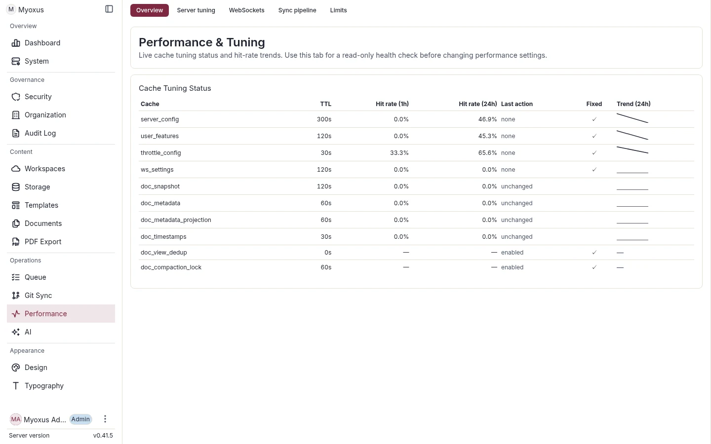

<!-- SPDX-License-Identifier: AGPL-3.0-or-later -->

# Observability

[Documentation](../../README.md) / [Operations](../README.md)

Establish service health, monitor trends and trace individual failures.
Operational logging, business metrics and product telemetry have distinct
purposes and retention settings.

| Signal or task                                  | Guide                                             |
| ----------------------------------------------- | ------------------------------------------------- |
| Liveness, startup readiness and upgrades        | [Health and lifecycle](./health-and-lifecycle.md) |
| Structured logs and temporary diagnostic levels | [Logging](./logging.md)                           |
| Business counters, rollups and retention        | [Metrics](./metrics.md)                           |
| Product events and privacy choices              | [Telemetry](./telemetry.md)                       |
| Cache health and document projections           | [Redis document cache](./redis-document-cache.md) |
| Queue depth, retries and stalled jobs           | [Worker runtime](./worker-runtime.md)             |
| Prometheus rules and Grafana dashboards         | [Monitoring assets](./monitoring/README.md)       |

Route an active symptom through the [Runbooks](../runbooks/README.md).
