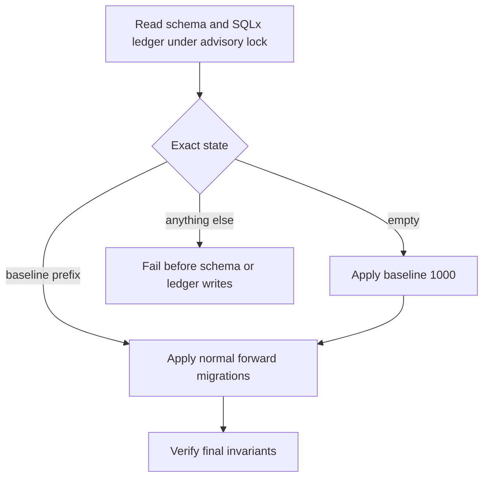

# Database and migration troubleshooting

[Documentation](../../README.md) / [Operations](../README.md) / [Operations runbooks](./README.md)

Restore database connectivity and diagnose startup migrations from the recorded schema and ledger state.

<details>
<summary>On this page</summary>

- [Database connection refused at startup](#database-connection-refused-at-startup)
- [Migration errors](#migration-errors)
- [Performance](#performance)

</details>

## Managed Database readiness

SQL migrations run first through the append-only ledger. Startup then validates
the complete file catalog and verifies/updates managed Project installations.
A malformed required source prevents catalog admission. A missing, failed or
unsupported installed revision is scoped unavailable/read-only; inspect its
`managedSchema.reasonCode` and startup counts rather than treating incomplete
Task coverage as empty. Never edit version markers, unlock schemas or delete
workspace data to recover readiness.

Recover a missing default with `myoxus-cli workspaces ensure-tasks <workspace-id>`
using the configured current catalog. It reuses the canonical identity and does
not reseed Tasks. Managed upgrades require explicit pinned Update YAMLs and a
complete forward route through the admitted Feature selection; historical
`supported_predecessors` metadata does not grant an update. Replacing a definition
or Update file under an existing pin is invalid. Normal template preparation
retains their immutable endpoint files and rejects changed history before catalog
promotion. Restarted/delayed nodes must use the matching admitted catalog.

Each update edge commits independently under the native Database lock. A failed
edge rolls back its values, definitions and version together; earlier committed
edges remain stored and invalidated. `MANAGED_UPDATE_INCOMPLETE` denotes a stored
intermediate version, which stays unavailable until retry reaches current.
Repair the actual source/delivery/storage failure and retry through the same
startup/initializer path. Do not change version markers or replay value mappings
manually. A final-current recovery refreshes Row search using the existing
projection owner. Free Generic instances remain outside managed updates.

The supported value operation is `map_select_options`: simultaneous original-ID
mapping within the schema transaction, including recoverable Trash, Row-template
values and personal View selectors. Unsupported type/cardinality, requiredness,
role-policy and Status lifecycle changes fail admission. A content failure carries
its native reason and identity path without logging the original value.

## Database connection refused at startup

**Symptoms:** Server exits immediately with `Connection refused` or `error connecting to database`.

**Causes and fixes:**

1. PostgreSQL is not running:

   ```bash
   sudo systemctl status postgresql
   # or in Docker:
   docker compose -f build/server/docker-compose.selfhost.yml logs postgres
   ```

2. Wrong `database.url` — verify the host, port, username, and database name
   from the protected configuration source. Check reachability without putting
   credentials in shell history:

   ```bash
   pg_isready --host localhost --port 5432 --dbname myoxus --username myoxus
   ```

   This checks server acceptance, not application authentication. Use the same
   protected database URL file as `myoxus-cli` for an authenticated check.

3. Schema validation or migration failed. The central runner executes before
   readiness; check the API log for its credential-free ledger class and next
   action.

4. The database role lacks privileges required by the current migration or
   application query. Use the exact denied object and operation from the
   PostgreSQL error; do not grant blanket ownership or fabricate SQLx ledger
   rows. Restore the intended role grants from deployment configuration, then
   retry readiness.

---

## Migration errors

**Symptoms:** Server fails to start with migration errors in the logs.

The runner accepts only an empty database or baseline `1000` plus an exact
prefix of known later migrations. Classification, SQLx migration execution and
final invariant checks are protected by one transaction advisory lock. The old
0.41.4 and 0.41.5 ledgers are unsupported direct upgrade sources.



**Diagnosis and recovery:**

1. Check `DATABASE_URL` is correct and the database is reachable:

   ```bash
   docker compose -f build/server/docker-compose.selfhost.yml logs api
   ```

2. Inspect the ledger read-only. A current installation normally shows baseline
   `1000` plus later forward migrations:

   ```bash
   myoxus-cli system migrations
   ```

   The command exposes versions, descriptions, timestamps and SQLx SHA-384
   checksums for diagnosis. Do not update or delete these rows.

3. If the error reports `unknown-pre-baseline-ledger`,
   `invalid-baseline-ledger`, `schema-without-ledger` or
   `empty-ledger-with-schema`, stop. For an old 0.41.4/0.41.5 or other
   pre-baseline ledger, restore the unchanged database with its matching older
   server. The current server does not accept those ledgers; preserve the
   original data and plan its migration separately.
   Never copy checksums, insert a baseline row, replay removed SQL or enable
   missing-migration tolerance.

4. After the source state is known-good, restart the API. Completed baseline
   and forward migrations are idempotent:

   ```bash
   docker compose -f build/server/docker-compose.selfhost.yml restart api
   ```

The runner does not look for, read or create a backup. Backup availability is
an operator recovery concern and is intentionally not part of state detection.

---

## Performance

### Slow response times / high database CPU

**Diagnosis:**

If `pg_stat_statements` is already enabled, capture query identity and timing
without parameter values. Queue payloads live in Redis, so investigate the SQL
actually reported by the API rather than assuming a `worker_jobs` table:

```sql
SELECT query, mean_exec_time, calls
FROM pg_stat_statements
ORDER BY mean_exec_time DESC
LIMIT 20;
```

Inspect the candidate query plan on an isolated copy with representative
statistics. Compare the SQLx ledger with `myoxus-cli system migrations` before
concluding that a schema object is absent. A manually assembled schema is an
unsupported ledger state; restore or migrate from an accepted state instead of
applying migration fragments.

### High connection count in pg_stat_activity

Each API instance owns a pool bounded by its effective
`database.max_connections`. Sum the configured bounds of all API instances and
other clients, then compare that total with PostgreSQL capacity and observed
peak usage. Keep reserved operator access; do not infer a safe value from the
repository default alone.

Reduce per-instance bounds or instance count only through a planned change with
readiness and workload verification. Raising PostgreSQL `max_connections` is a
database capacity decision that also changes memory and failover requirements;
follow the database operator's tested procedure and rollback plan.

---
