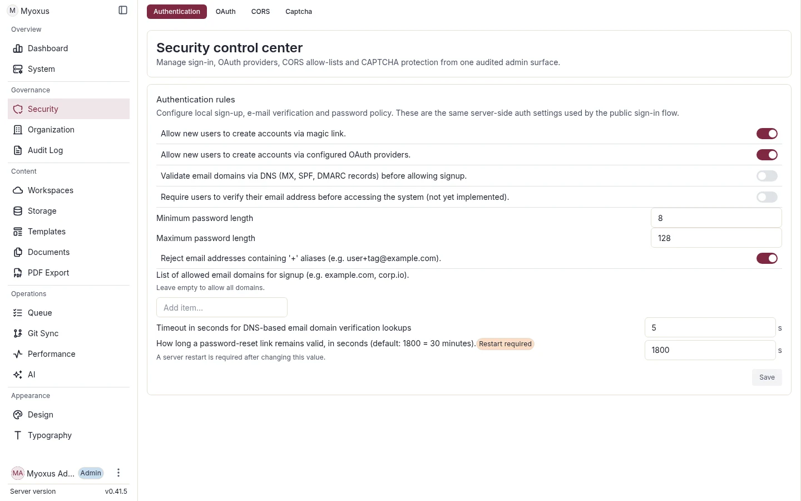

<!-- SPDX-License-Identifier: AGPL-3.0-or-later -->

# Security operations

[Documentation](../../README.md) / [Operations](../README.md)

Configure sign-in, review access and protect credentials. Myoxus provides
server-side authentication, authorization and audit; your operating policy
defines TLS, identity-provider rules, retention and incident response.

| Task                                            | Guide                                          |
| ----------------------------------------------- | ---------------------------------------------- |
| Configure authentication, sessions and SSO      | [Authentication and OIDC](./authentication.md) |
| Protect public sign-in with local proof of work | [CAPTCHA](./captcha.md)                        |
| Operate privacy controls and data requests      | [Privacy](./privacy.md)                        |
| Review dependencies and apply fixes             | [Security updates](./security-updates.md)      |

Use [Organization administration](../administration/organization.md) for SSO
mapping and workspace access. During incidents, follow the
[recovery runbooks](../runbooks/README.md).
