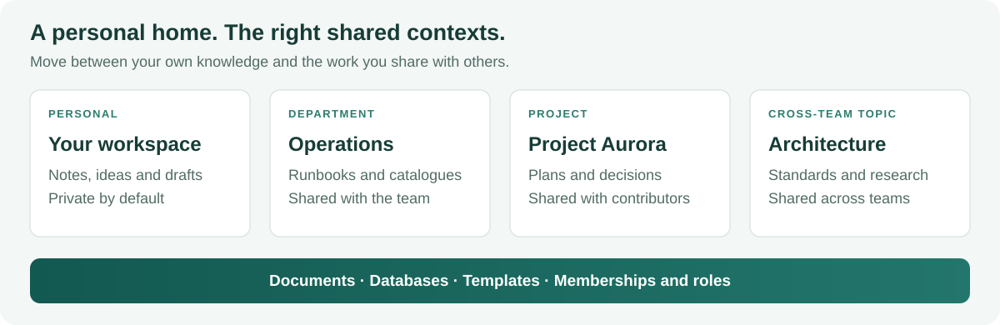

<!-- SPDX-License-Identifier: AGPL-3.0-or-later -->

# Myoxus features in depth

[Documentation](../README.md) / [User guides](./README.md)

Myoxus connects personal knowledge, shared work and professional publication.
This guide explains how its features fit together and gives you concrete ways
to use them. The [handbook](./handbook/index.md) covers the interface step by
step; operator links provide configuration details where you need them.

Myoxus is beta software. The self-hosting entry is the Rust server with Browser
Web and Admin; desktop packages have independent availability. See
[downloads and release channels](./downloads.md) for published artifacts.

| Build your working context                                                                                                                                                                                             | Put it to use                                                     |
| ---------------------------------------------------------------------------------------------------------------------------------------------------------------------------------------------------------------------- | ----------------------------------------------------------------- |
| **Create** · [Workspaces](#workspaces-your-own-space-and-the-right-shared-contexts), [documents](#documents-from-a-note-to-a-shared-knowledge-base), [canvas and diagrams](#canvas-and-diagrams-think-beyond-the-page) | Keep private thinking and shared knowledge in the right places    |
| **Organize** · [Databases](#databases-turn-information-into-working-records), [collaboration](#collaboration-and-organization)                                                                                         | Turn information into records, views and shared activity          |
| **Govern** · [Enterprise standards](#enterprise-use-maintain-standards-centrally), [appearance](#appearance-clients-and-operation)                                                                                     | Maintain templates, access and organizational identity centrally  |
| **Deliver** · [HTML](#publishing-give-readers-a-real-html-page), [Typst PDF](#pdfs-typst-as-a-document-production-engine), [interchange](#import-and-export-bring-your-knowledge-along)                                | Reach readers online and hand over portable documents             |
| **Connect** · [Integrations](#integrations-and-automation), [clients](./web-and-rich-clients.md)                                                                                                                       | Bring Git, calendars, AI and desktop workflows into the workspace |

## Workspaces: your own space and the right shared contexts

**Workspaces are a core Myoxus feature.** Every user receives a personal
workspace automatically, private by default, for notes, ideas, drafts and
individual knowledge work. Shared workspaces sit alongside that personal home
and bring the right people together around a department, a topic, a team or a
project.

The structure follows your work. A department can use several workspaces, a
project can have a dedicated workspace, and a portfolio of related projects can
share one. A person can participate in several shared workspaces while keeping
their personal knowledge in their own area. Each workspace brings together its
documents, databases, templates and membership context.

| Workspace context    | Example                                               | What it gives you                                                    |
| -------------------- | ----------------------------------------------------- | -------------------------------------------------------------------- |
| Personal             | Notes, drafts and individual research                 | A private starting point automatically provided for every user       |
| Department or team   | Operations, HR or engineering                         | Shared knowledge and working records for the people maintaining them |
| Topic or community   | Architecture, quality standards or a specialist group | Collaboration across departmental boundaries                         |
| Project or portfolio | A single delivery effort or several related projects  | Documents, decisions and structured records grouped around the work  |

Organizations and organizational units provide the surrounding management
structure. A unit can own, manage or link multiple workspaces; memberships,
roles and server-owned permission checks govern participation. Central template
assignments and workspace appearance profiles let operators apply common
standards across these distinct working areas.

See [organizations and workspace management](../ops/administration/organization.md)
and [the wiki comparison](./why-you-should-replace-your-wiki.md#your-own-workspace-shared-spaces-for-shared-work).

## Documents: from a note to a shared knowledge base

The Virgultum editor supports rich documents with headings, lists, task content,
code, images, links and other structured blocks. Folders, collections and tags
help organize growing workspaces. Document links and supported embeds connect
related material without maintaining manually copied versions everywhere.

Comments keep discussion close to the work. Document history and restore
workflows help inspect earlier content; they complement operator backups.
Workspace navigation, search and recently edited documents provide entry points
when you return to a project.

Server-owned metadata and permissions keep the surrounding organization
consistent while the document content is edited collaboratively. Start with the
[handbook](./handbook/index.md) and
[document metadata/versioning](../ops/administration/document-metadata-versioning.md).

> **Building a knowledge base?** See [Why you should replace your wiki](./why-you-should-replace-your-wiki.md)
> for handbook, service-catalogue and project examples, plus a comparison with
> MediaWiki, DokuWiki and Confluence.

## Canvas and diagrams: think beyond the page

Canvas work provides a spatial way to arrange ideas and relationships alongside
documents. Author Mermaid diagrams from text or import their source through
`.mmd` files; BPMN has its own process-diagram editor. The catalog labels
**Flowchart Beta** and other entries **Alpha**. A separate **Source only** label
identifies Mermaid families without visual editing. These experimental diagram
capabilities do not imply that every family has the same editing support.

Use diagrams for architecture, processes and relationships. The
[handbook](./handbook/index.md) explains the editor entry points; the
[publishing](../ops/data/public-publishing.md) and [PDF](../ops/data/pdf-export-templates.md)
guides describe the corresponding reading outputs.

## Databases: turn information into working records

Myoxus databases give you server-backed records with typed fields, saved views,
filtering and grouping. Use them to
build project trackers, catalogues and research collections. Calendar, Gantt and
timeline views provide time-oriented perspectives. Activity and reminders help
connect stored information with the work that follows.

Database state lives in PostgreSQL and is accessed through the server API.
Queries, validation and access share the same managed server model across
Browser Web and desktop clients.

CSV import provides column mapping; supported Notion database exports offer
preview, mapping and diagnostics. CSV is useful for simple tabular interchange,
while Myoxus database JSON snapshots preserve more structured information.
Preview diagnostics identify conversions that need attention.
See [databases](../ops/data/databases/README.md),
[import/export](../ops/data/databases/import-export.md) and
[collaboration/recovery](../ops/data/databases/collaboration-and-recovery.md).

## Collaboration and organization

Live document collaboration lets participants work in the same context.
Workspaces, organizations, memberships and roles define the surrounding access
model. Notifications, comments, reminders and activity expose different kinds of
updates across shared workspaces.

The Admin frontend is the operator surface for system configuration and
administration. It is desktop-only. Central ownership lets Web, desktop and
authenticated automation use the same server capabilities instead of maintaining
independent permission rules.

See [organizations](../ops/administration/organization.md),
[administration](../ops/administration/README.md) and
[search](../ops/runbooks/search.md).

## Enterprise use: maintain standards centrally

An enterprise workspace needs a managed foundation for shared access, approved
document standards and dependable background services. Myoxus's client/server
model makes those responsibilities explicit: the server owns shared decisions,
and Admin provides the operator controls. Teams can use Browser Web and rich
clients against that same foundation.

### Central document templates

The **Template Registry** is the administrator-owned catalogue for reusable
document bundles. Operators import bundles, publish versioned revisions and
assign templates to workspaces. Assignments can follow a published revision or
pin a selected revision. Default policies can supply templates to new workspaces;
reconciliation makes update behavior explicit.

| Update mode              | What it does                                                    | Organizational use                                             |
| ------------------------ | --------------------------------------------------------------- | -------------------------------------------------------------- |
| Seed once                | Creates the initial content without managing subsequent updates | Initial guidance or a starting document                        |
| Managed until local edit | Applies managed updates until the source is locally edited      | Shared standards with an explicit local customization boundary |
| Manual update            | Reports updates and requires an explicit application action     | Controlled adoption of revised templates                       |

Workspace-owned templates remain available through **Library → Templates**.
They give teams their own reusable starting points alongside the central
catalogue. Operators configure the Registry for organization-wide distribution.
See [Template Registry](../ops/integrations/template-registry.md),
[document bundles](../ops/integrations/document-template-bundles.md) and
[template variables](../ops/integrations/template-variables.md).

### Shared document production and appearance

Central PDF templates, fonts and document branding let operators maintain report,
letter and documentation output independently of workstation settings.
Server-owned theme profiles, typography and application branding give Web,
Admin, rich clients and supported reading outputs a shared appearance contract.
Workspace profiles support scoped appearance while keeping the server as owner.

### Shared services for dependable workflows

Database validation, automations, reminders, Git and calendar synchronization,
public delivery and authenticated MCP operations use the server's capabilities.
Background services continue independently of open client sessions. Memberships,
roles and publication controls give operators a shared foundation for
organizational standards and reliable workflows. Configuration, maintenance and recovery are
covered in the [Operations manual](../ops/README.md). See also
[administration](../ops/administration/README.md),
[PDF production](../ops/data/pdf-export-templates.md) and
[appearance](../ops/administration/design.md).

## Publishing: give readers a real HTML page

Public publishing delivers anonymous, read-only HTML from the Rust server.
Readers open a dedicated page directly. The renderer turns document blocks
into semantic reading content,
including headings, tables, links and images, using the server-owned theme.

Operators control publication at workspace and document level and can revoke
public delivery at the origin. Choose the output that fits your audience:

| Output                   | Useful for                                | How it behaves                                                      |
| ------------------------ | ----------------------------------------- | ------------------------------------------------------------------- |
| Public HTML page         | Sharing a document with readers           | Served dynamically; current permissions and publication state apply |
| Document HTML download   | Taking a reading copy elsewhere           | A file captured at export time                                      |
| CLI public HTML snapshot | Operator-created offline reading material | A static snapshot, separate from live publication                   |

See [public publishing](../ops/data/public-publishing.md) for setup,
access boundaries and caching, and
[portable exports](../ops/data/backup-and-restore.md#portable-workspace-exports)
for interchange behavior.

## PDFs: Typst as a document-production engine

Myoxus renders PDFs on the server with **Typst**. Templates, page layout, fonts
and document branding form a complete typesetting pipeline for documentation,
reports, letters and presentations.

The bundled template catalogue includes a neutral default, report, DIN-5008
letter, documentation and presentation templates. Operators manage the PDF
template/font configuration. Separate document branding lets you give exported
material its own identity, independently of the application appearance.

Footnotes are typeset at the page foot; endnotes follow the body. The PDF guide
covers templates, mathematical content and output diagnostics.

See [PDF templates and fonts](../ops/data/pdf-export-templates.md) and
[appearance](../ops/administration/design.md).

## Import and export: bring your knowledge along

| Source or destination            | Myoxus route                                           | What to inspect                                     |
| -------------------------------- | ------------------------------------------------------ | --------------------------------------------------- |
| Markdown                         | Document files and supported ZIP collections           | Links, assets and syntax-specific conversions       |
| HTML / DOCX                      | Document import; HTML reading export                   | Structural and formatting differences               |
| Obsidian vault                   | Explicit vault ZIP import; compatible vault ZIP export | Preview diagnostics and `myoxus-export-report.json` |
| Notion database export           | Supported CSV/HTML/ZIP database imports                | Field mapping, relations and unsupported content    |
| Existing AFFiNE workspace export | Supported legacy SQLite / snapshot ZIP importer        | Accepted format and conversion diagnostics          |
| Tabular data                     | CSV and Myoxus database JSON                           | CSV losses versus structured snapshot content       |
| Mermaid source                   | `.mmd` diagram import                                  | Family-specific maturity and destination rendering  |

### Obsidian-compatible vault interchange

Vault import can preserve supported Markdown notes, folder structure, YAML
properties, aliases, tags, links and referenced assets. Supported content also
includes callouts, annotations, whole-document embeds and footnotes, with
documented conversion limits. Each deliberate import creates a new server-owned
workspace. Review the preview before applying it.

Workspace Settings exports supported current content as a vault ZIP; operators
can use the same server-owned projection through the CLI. The archive includes
an export report so you can review the transferred notes and assets together.

Vault interchange transfers content, properties and assets. The vault guide
details precise links, embed conversions, plugin-authored content and the
export report. Markdown normalizes endnote placement to footnotes on reimport;
native snapshots and Myoxus HTML preserve placement. Operators use a complete
server backup to protect permissions, history and configuration.

The canonical [vault interchange guide](../ops/data/backup-and-restore.md#obsidian-vault-interchange)
documents the exact boundaries. Obsidian is a third-party trademark; the name
identifies the compatible format. Myoxus has no affiliation with or endorsement
from its owner.

## Integrations and automation

**Git Sync** connects documents with a Git repository in both directions. Its
configured synchronization and conflict behavior matter when repository files
and workspace documents both change. See
[Git Sync](../ops/integrations/git-sync.md).

**Calendars** connect external CalDAV and Google calendars with configured
synchronization and writeback. Operators manage providers, authentication and
schedules centrally. See
[calendar synchronization](../ops/integrations/calendar.md).

**Workspace automations** run server-owned workflows subject to configured
limits and permissions. **MCP** exposes authenticated server capabilities to AI
tools and integrations, including document publication operations, with the server’s current access
checks. See
[database/automation configuration](../ops/data/databases/README.md) and
[MCP](../ops/integrations/mcp/README.md).

**AI and Copilot** support configurable providers, streaming responses and
embeddings. Operators choose whether to enable AI and which endpoints process
requests, making provider choice part of your installation’s configuration.
These optional integrations depend on their provider and configured capabilities;
enabling them does not make every provider/tool combination beta-qualified. See
[AI configuration](../ops/integrations/ai.md).

## Appearance, clients and operation

The global server-owned theme controls appearance, typography and branding
across the applicable clients and outputs. Document branding has its own scope.
Operators can configure themes and fonts through the shared system; Browser
Web requires the server theme projection.

Use Browser Web for direct access to a server workspace, or the Electron rich
client for desktop integration and limited native/offline capabilities. Package
instructions describe each actual platform release, signature state and update
route; desktop availability does not determine Server/Web/Admin availability.
Mobile payloads are outside the current release scope. Read [Web and rich clients](./web-and-rich-clients.md) and
[downloads](./downloads.md).

### Scale the installation with your organization

Start with one Linux host or VM and grow into dedicated data services and
multiple API containers in a private cloud. Shared PostgreSQL, Redis and
blob/font storage preserve central templates, branding and access across nodes.
The scaling guide covers topology, sizing estimates and platform-managed
availability. Its examples are planning inputs, not a guaranteed user capacity
or a high-availability claim for a single-host beta installation.

See [Scaling from self-hosting to a private cloud](../ops/deployment/scaling.md)
for the topology diagrams and operating requirements. Continue with the
[Operations manual](../ops/README.md),
[Deployment guide](../ops/deployment/README.md),
[Docker installation](../ops/deployment/docker.md),
[Linux VM / systemd installation](../ops/deployment/systemd/README.md) or
[Multi-instance operations](../ops/deployment/multi-instance.md).

Myoxus has no license fee or paid seat tiers. Operators manage infrastructure,
optional providers and coordinated PostgreSQL, blob and PDF-font backups. Start
with
[self-hosting](../ops/getting-started/README.md) and
[backup/restore](../ops/data/backup-and-restore.md).
