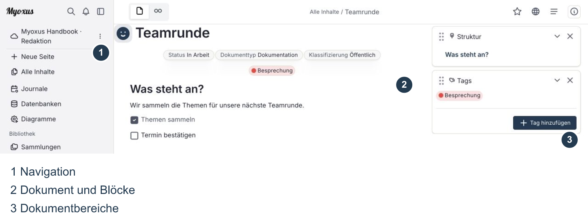
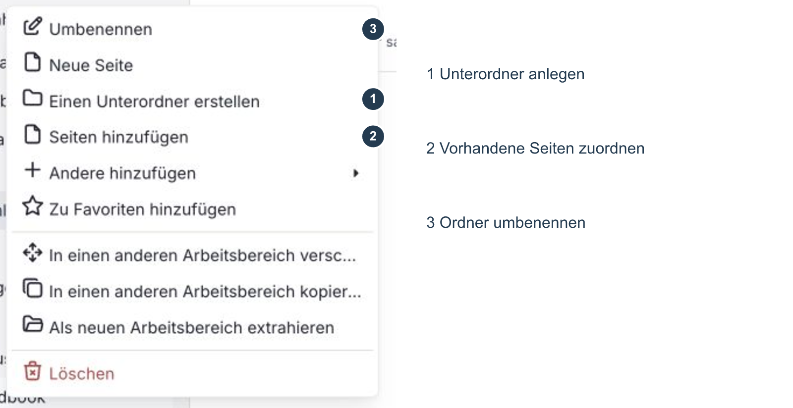
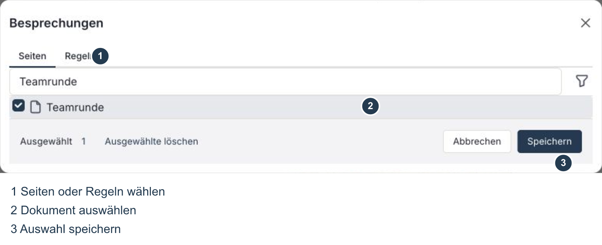
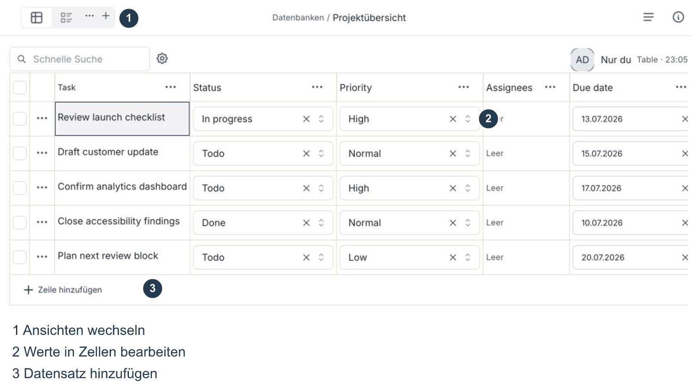
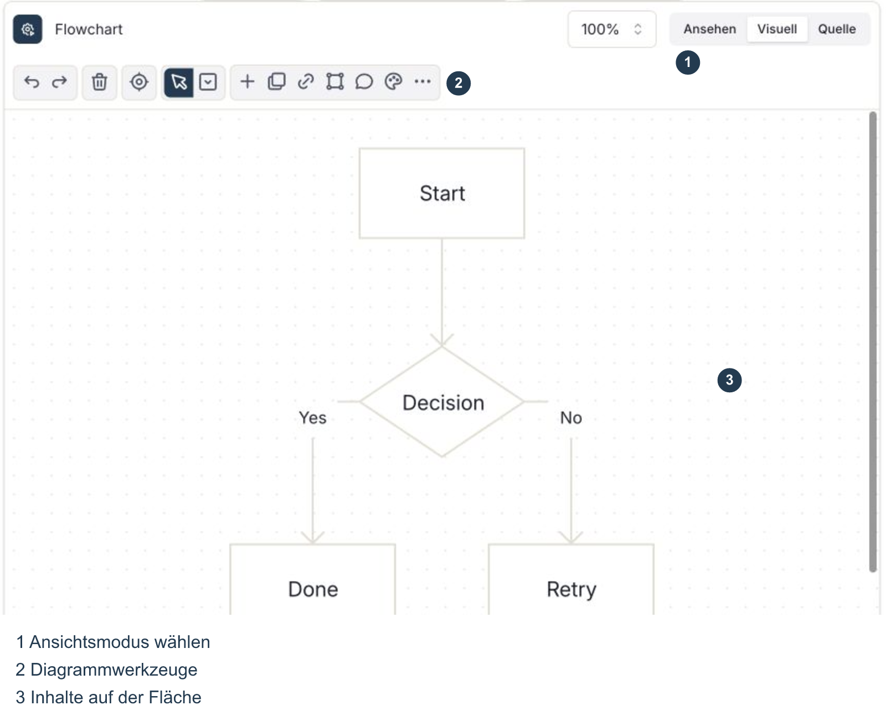
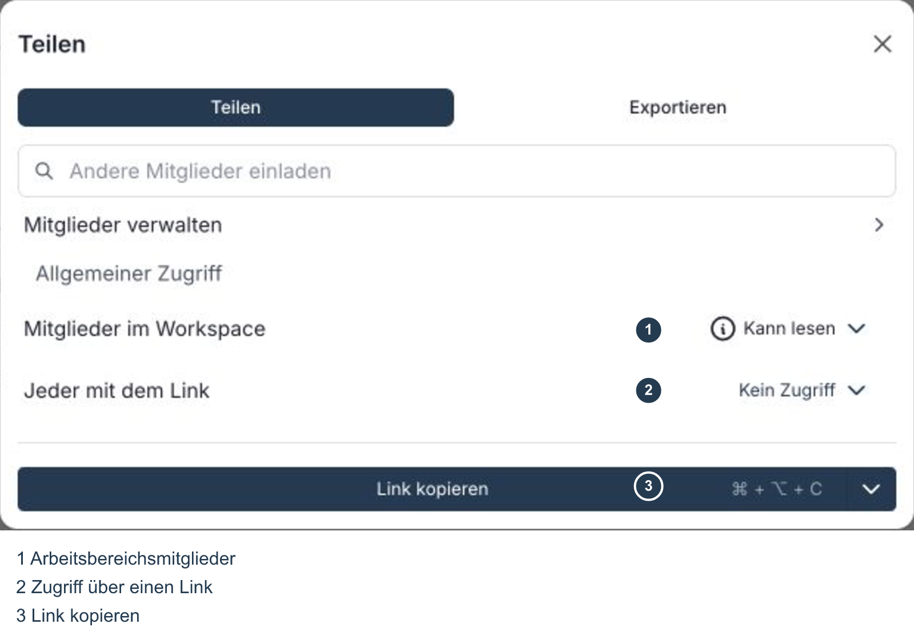
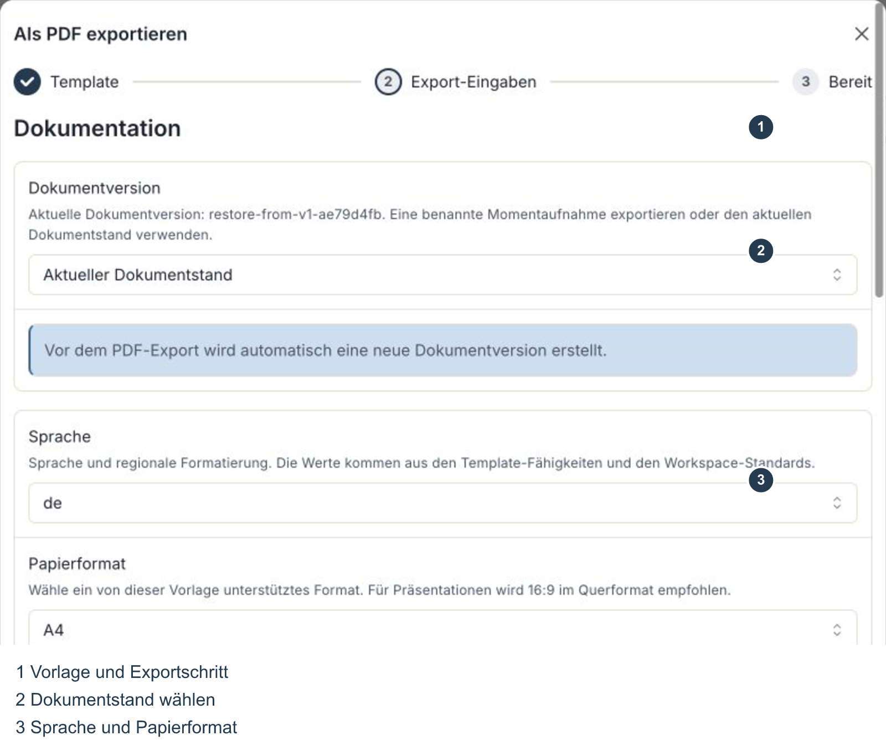
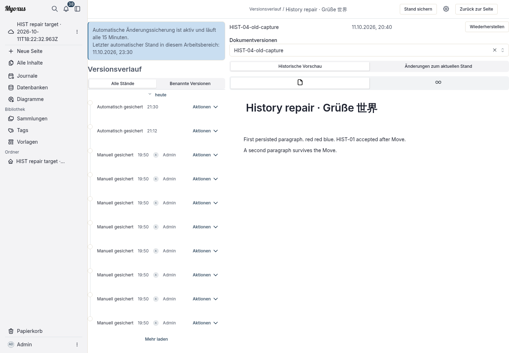

<!-- Generated from the Myoxus editorial document. -->

# Myoxus · Handbuch

[Dokumentation](../../../README.md) / [Benutzerhandbuch](../../README.md)

[PDF herunterladen](myoxus-user-guide.pdf) · [English](../index.md)

Inhalt

- [01 Einstieg und Orientierung](#01-einstieg-und-orientierung)
- [02 Dokumente erstellen und bearbeiten](#02-dokumente-erstellen-und-bearbeiten)
- [03 Inhalte organisieren und wiederfinden](#03-inhalte-organisieren-und-wiederfinden)
- [04 Daten und Ideen darstellen](#04-daten-und-ideen-darstellen)
- [05 Gemeinsam arbeiten und Inhalte teilen](#05-gemeinsam-arbeiten-und-inhalte-teilen)
- [06 Inhalte importieren und exportieren](#06-inhalte-importieren-und-exportieren)
- [07 Änderungen nachvollziehen und Inhalte wiederherstellen](#07-änderungen-nachvollziehen-und-inhalte-wiederherstellen)
- [08 Clients, Updates und Hilfe](#08-clients-updates-und-hilfe)

## 01 Einstieg und Orientierung

Myoxus bündelt Dokumente, Datenbanken und visuelle Arbeitsflächen in Arbeitsbereichen. Dieses Handbuch führt dich durch die Oberfläche und die wichtigsten Handgriffe. Es beschreibt die Browser-Anwendung; Unterschiede zur Desktop-App stehen im letzten Kapitel. Die Abbildungen zeigen die helle Darstellung mit Beispieldaten.

### Anmelden und den Arbeitsbereich wählen

Öffne die Myoxus-Adresse deiner Organisation und melde dich mit dem dafür vorgesehenen Konto an. Welche Anmeldeverfahren angeboten werden und ob du selbst einen Arbeitsbereich anlegen darfst, legt der Betreiber fest. Eine Einladung gilt für den darin genannten Server und Arbeitsbereich. Wenn Inhalte fehlen, prüfe deshalb zuerst die Serveradresse, dein Konto und den gewählten Arbeitsbereich.

Den Arbeitsbereich wechselst du über seinen Namen oben in der linken Seitenleiste. Wähle dort den gewünschten Eintrag. Dokumente, Ordner, Tags und Sammlungen gehören zum jeweiligen Arbeitsbereich; ein Wechsel kann deshalb eine andere Übersicht zeigen.

_Die Dokumentansicht: links die Navigation, in der Mitte der Inhalt, rechts die eingeblendeten Dokumentbereiche._

### Die Oberfläche lesen

Links öffnest du mit „Neue Seite“ ein Dokument. „Alle Inhalte“ führt zur Übersicht, die Lupe zur „Schnellen Suche“. Journale, Datenbanken und Diagramme haben eigene Einstiege. Unter „Bibliothek“ findest du Sammlungen, Tags und Vorlagen; darunter folgt die Ordnerstruktur. Die linke Leiste lässt sich über ihr Seitenleistensymbol ein- und ausklappen.

Wähle den zur Quelle passenden Einstieg: Markdown erstellt Dokumente, Obsidian einen Workspace und Notion eine Datenbank. Bewahre das Original auf und prüfe die übernommenen Inhalte.

### Markdown-Dokument oder Sammlungs-ZIP

Bewahre die Originaldateien auf. Wähle im Menü oben rechts eines geöffneten Dokuments Importieren → Markdown-Dateien für eine .md-Datei oder Markdown mit Mediendateien für eine Sammlung als .zip. Erhalte relative Anhangspfade und Ordner im ZIP. Dieser Dokumentweg importiert direkt: Lies Abschlussmeldungen und Diagnosen und öffne das neue Dokument. Prüfe Überschriften, Zeilenumbrüche, Links, Tabellen und Bilder. Nicht unterstützte Verweise können als Quelltext erhalten bleiben; eine Abschlussmeldung beweist keine vollständige Übernahme.

### Obsidian-Vault als ZIP

Packe Notizen und Anhänge so ins ZIP, dass der Vault-Inhalt an der Archivwurzel liegt; ein einzelner umschließender Ordner bleibt erhalten. Wähle in der Workspace-Auswahl Workspace importieren, dann Obsidian-Vault und das ZIP. Prüfe Dokumente, Ressourcen und Diagnosen in der Vorschau. Einstellungen in .obsidian, Papierkorb und Betriebssystem-Metadaten werden ausgeschlossen. Nicht unterstützte Inhalte können normalisiert oder als Wiederherstellungsquelle statt als bearbeitbare Blöcke erhalten bleiben. Bestätige angezeigte Änderungen und wähle Workspace erstellen und Workspace öffnen. Es entsteht ein neuer Workspace, keine Zusammenführung. Öffne eine Notiz, folge einem internen Link und prüfe Bild oder Anhang; ein relatives Inline-Bild kann Markdown-Quelltext bleiben.

### Notion-Datenbank als HTML/ZIP

Exportiere die betreffende Notion-Datenbank als HTML und bei Bedarf mit Dateien im ZIP. Öffne Datenbanken und dort das Kopfmenü → Als neue importieren → Notion HTML/ZIP. Wähle den Export und prüfe Feldtypen, Zeilen, zugeordnete Seiten und Diagnosen in der Vorschau. Übernimm mit Snapshot importieren. Öffne die neue Datenbank und prüfe Titel, Feldwerte und gegebenenfalls verknüpfte Zeileninhalte. Ansichtstypen, Zeilenvorlagen, synchronisierte Blöcke, Erwähnungen oder Rechte können fehlen; richte unterstützte Ansichten und Vorlagen anschließend ein. Es entsteht eine neue Datenbank ohne Überschreiben; beliebige Seiten oder vollständige Workspaces werden nicht über den Dokumentdialog importiert.

Wird Vorschau oder Übernahme abgewiesen, behalte das Original und lies den Fehler. Brich ab, korrigiere oder begrenze die Quelle und prüfe erneut die Vorschau. Lösche weder Quelle noch bestehende Inhalte, um den Import zu erzwingen. Auch eine erfolgreiche Vorschau kann beim Übernehmen scheitern; melde den Fehler, statt von importierten Inhalten auszugehen.

### Dokumentdetails ein- und ausblenden

Der Pfeil neben einer Bereichsüberschrift klappt nur diesen Bereich ein oder aus. Das × entfernt den Bereich aus der Seitenleiste; es löscht nicht das Dokument. Verwende zum bloßen Einklappen den Pfeil. Über die dokumentbezogenen Aktionen wie „Info anzeigen“ und „Links & Verweise“ erreichst du die zugehörigen Informationen. Welche Bereiche sichtbar sind, hängt von deiner Ansicht ab.

Unter dem Seitentitel können Eigenschaften wie Status oder Dokumenttyp stehen. Diese Angaben beschreiben das Dokument. Sie sind weder sein Textinhalt noch automatisch eine Zugriffsfreigabe: Ob andere das Dokument öffnen dürfen, prüfst du im Teilen-Dialog.

## 02 Dokumente erstellen und bearbeiten

### Seite, Titel und Blöcke

Klicke links auf „Neue Seite“, gib einen Titel ein und drücke Enter. Der Titel gehört zum Dokument und wird in der Navigation angezeigt. Darunter besteht der Inhalt aus Blöcken: Jeder Absatz, jede Überschrift, jedes Bild und jede einzelne Aufgabe hat einen eigenen Block. Eine Überschrift im Inhalt ist also etwas anderes als der Seitentitel.

Mit Enter beginnst du einen neuen Absatz. In einer Liste setzt Enter die Liste fort; in einer Aufgabenliste entsteht der nächste Eintrag mit eigenem Kästchen. Eine Aufgabe hakst du über dieses Kästchen ab. Änderungen werden während der Arbeit gespeichert beziehungsweise synchronisiert. Achte bei Verbindungsproblemen auf die Meldungen der Anwendung, bevor du das Fenster schließt.

### Blöcke einfügen und Text formatieren

Tippe / in eine leere Zeile. Im Blockmenü wählst du beispielsweise eine Überschrift, Liste, Tabelle, ein Bild oder einen Anhang. Du kannst nach dem Eintrag suchen; Escape schließt das Menü. Es enthält auch Aktionen und Formatierungen: „Fett“ verändert Text, „Überschrift 2“ den Blocktyp.

Markiere Wörter, um die Formatierungsleiste zu öffnen. Darüber setzt du Hervorhebungen oder fügst einen Link ein. Für Aktionen auf einen ganzen Block verwendest du dessen Auswahl und das zugehörige Menü. Dort stehen etwa Duplizieren und das Kopieren eines Blocklinks zur Verfügung. Beim Anordnen von Blöcken zeigt die Einfügemarkierung das Ziel; prüfe danach die Reihenfolge.

### Bilder, Dateien, Tabellen und Verweise

Für ein Bild oder einen Anhang wählst du den entsprechenden Eintrag im Blockmenü und anschließend die Datei. Warte, bis der Upload abgeschlossen ist. Ein Bild steht sichtbar im Dokument; ein Anhang bleibt eine herunterladbare Datei. Dateigrößen und erlaubte Formate können durch den Server begrenzt sein.

Eine Dokumenttabelle eignet sich für Inhalte, die direkt auf der Seite stehen sollen. Du bearbeitest ihre Zellen im Editor und nutzt die Tabellensteuerung für Zeilen, Spalten und Darstellung. Für Datensätze mit Feldtypen, Filtern und mehreren Ansichten verwendest du eine Datenbank; diese wird in Kapitel 4 beschrieben.

Ein Verweis auf ein bestehendes Dokument führt zur aktuellen Seite, ohne deren Inhalt zu duplizieren. Ein Link auf einen Block führt zu einer bestimmten Stelle. Solche Links erteilen keine zusätzlichen Rechte: Die Zielseite muss für die empfangende Person zugänglich sein.

### Vorlagen und Journale

Unter „Vorlagen“ findest du die im Arbeitsbereich angebotenen Vorlagen. Erstelle daraus ein Dokument und bearbeite die entstandene Arbeitskopie. Die zentrale Auswahl kann vom Betreiber eingeschränkt sein. Eine PDF-Vorlage ist davon unabhängig: Sie gestaltet erst die exportierte Datei, nicht das Dokument im Editor.

Daily · Team-Abstimmung hält seit dem letzten Daily, den heutigen Plan und Blocker in einer kurzen Tabelle fest. Trage nächste Schritte mit Verantwortlichen und Nachverfolgung ein. Die Teilnehmer werden beim Erstellen der Arbeitskopie eingefügt; Anwesenheit und die Prüfung offener Aktionen hakst du selbst ab. „Verwenden“ erzeugt eine unabhängige, bearbeitbare Kopie mit Datum im Titel. Änderungen an der Vorlage ändern bereits erstellte Arbeitskopien nicht. Für ein tägliches Journal kannst du die Vorlage in den Workspace-Einstellungen auswählen; beim Erstellen erhält das Journal sein ausgewähltes Datum ohne zusätzliche Pflichtfelder.

Retro · Gemeinsam lernen sammelt konkrete Beobachtungen und trennt, was ihr beibehalten oder verändern wollt. Leitet daraus kleine Experimente ab: erster Schritt, Verantwortliche und Prüftermin stehen in derselben Zeile. Bei der nächsten Retrospektive bewertet ihr die Experimente; die Prüfung bleibt bis dahin unmarkiert. Auch hier trägst du Anwesenheit manuell ein und bearbeitest die unabhängige Arbeitskopie, nicht die zentrale Vorlage.

Journale ordnen Notizen einem Tag zu. Öffne „Journale“ in der Navigation und wähle den gewünschten Tag. Prüfe das Datum, bevor du Einträge ergänzt. Einstellungen zu Kalender und Journal findest du über dein Kontomenü in den persönlichen Einstellungen.

## 03 Inhalte organisieren und wiederfinden

### Ordner: eine eigene Struktur aufbauen

Der Bereich „Ordner“ steht links unterhalb der Bibliothek. Öffne das Kontextmenü des Arbeitsbereichs und wähle „Neuer Ordner“. Im Menü eines vorhandenen Ordners wählst du „Einen Unterordner erstellen“. Gib einen Namen ein und bestätige mit Enter; „Umbenennen“ ändert ihn später. „Seiten hinzufügen“ verknüpft ausgewählte vorhandene Dokumente, „Aus Ordner entfernen“ entfernt nur den Dokumentverweis. Keine dieser Aktionen löscht das Dokument oder gewährt Zugriff.

Im Ordnermenü fügt „Seiten hinzufügen“ vorhandene Dokumente hinzu. Suche die gewünschten Seiten, wähle sie aus und bestätige die Auswahl. „Neue Seite“ legt direkt aus dem Ordner heraus ein neues Dokument an. Unter „Andere hinzufügen“ stehen weitere angebotene Inhaltstypen zur Wahl. Ein Ordner kann dadurch verschiedene Zugänge zu zusammengehörigen Inhalten bündeln.

_Ordnermenü: Unterordner anlegen, vorhandene Seiten hinzufügen und den Ordner umbenennen._

Ein Ordnereintrag ist ein Verweis. Entfernst du diesen Verweis aus einem Ordner, ist damit nicht automatisch das Dokument gelöscht. Zum Löschen des Dokuments verwendest du dessen Papierkorb-Aktion. Lies bei Ordnern die Bestätigung genau; insbesondere das Entfernen eines ganzen Ordners und das Löschen seines Inhalts sind unterschiedliche Vorgänge.

### Sammlungen: Auswahl und Regeln kombinieren

Öffne „Sammlungen“ unter „Bibliothek“, klicke auf „Neue Sammlung“, gib einen Namen ein und speichere. In einer leeren Sammlung stehen „Seiten hinzufügen“ und „Regeln hinzufügen“ bereit. Über „Regeln“ öffnest du später erneut die Bearbeitung.

Im Reiter „Seiten“ suchst du Dokumente und markierst die gewünschten Einträge. Im Reiter „Regeln“ fügst du Filter hinzu, etwa für Tags, Titel oder Bearbeitungsdatum. Passende Seiten kommen automatisch hinzu. Ausdrücklich ausgewählte Seiten können zusätzlich enthalten bleiben. Kontrolliere die Vorschau und speichere die Änderung. Eine Sammlung verändert nicht den Inhalt ihrer Dokumente.

_Sammlung bearbeiten: „Seiten“ für die direkte Auswahl, „Regeln“ für automatisch passende Dokumente._

### Tags: Dokumente kennzeichnen

Öffne am Dokument die rechte Seitenleiste und dort „Tags“. Über „Tag hinzufügen“ wählst du vorhandene Tags. Für ein neues Tag gibst du einen Namen ein und klickst auf „Erstellen“. Es erscheint am Dokument; „Fertig“ schließt die Auswahl. Zum Entfernen einer Zuordnung nimmst du das Tag aus der Auswahl dieses Dokuments.

Der Eintrag „Tags“ in der linken Navigation öffnet dagegen den Katalog des Arbeitsbereichs. Änderungen an Namen oder Darstellung eines Tags betreffen das gemeinsame Tag, nicht nur eine Dokumentzuordnung. Verwechsle daher das Entfernen eines Tags von einer Seite nicht mit seiner Verwaltung oder Archivierung im Katalog.

### Favoriten, Suche und Übersicht

Mit dem Stern am Dokument merkst du dir häufig benötigte Inhalte als Favoriten. Ein weiterer Klick nimmt die Markierung zurück. Über die Lupe öffnest du die schnelle Suche; gib einen Titel oder Suchbegriff ein und öffne den passenden Treffer.

In Übersichten helfen Ansichtswechsel, Filter und Sortierung beim Eingrenzen. Ein ausgeblendeter Treffer ist nicht gelöscht. Wenn du eine Seite vermisst, prüfe Filter, Arbeitsbereich, Zugriffsrechte und Papierkorb. Ordner, Sammlungen, Tags und Favoriten sind ergänzende Zugänge zu denselben Inhalten.

## 04 Daten und Ideen darstellen

### Datenbanken anlegen

Öffne „Datenbanken“ und wähle „Neue Datenbank“. Im Assistenten entscheidest du dich für eine leere Datenbank oder eine angebotene Vorlage. Danach gibst du Name und Beschreibung an, wählst gegebenenfalls einen Ordner und legst fest, ob Beispielzeilen übernommen werden sollen. Prüfe die Zusammenfassung und bestätige mit „Datenbank erstellen“.

Eine Zeile ist ein Datensatz, ein Feld beschreibt eine Eigenschaft und eine Zelle enthält deren Wert. Feldtypen bestimmen, welche Eingaben möglich sind, etwa Text, Zahl, Datum oder Auswahl. Die Felder gehören zur Datenbank; sie ändern sich nicht allein dadurch, dass du eine andere Ansicht öffnest.

_Datenbank: oben die Ansichten, darunter Datensätze und Felder. Namen aus einer Vorlage können von der Oberflächensprache abweichen._

### Datensätze und Felder bearbeiten

In der Tabellenansicht bearbeitest du Werte über ihre Zellen. „Zeile hinzufügen“ erzeugt einen weiteren Datensatz. Für mehr Platz öffnest du die Zeilendetails über den Titel eines Datensatzes und klappst „Details“ auf. Wähle beispielsweise einen Status aus; nach dem Schließen erscheint die Änderung auch in der Übersicht.

Neue Felder legst du über „Feld hinzufügen“ an. Das Menü am Spaltenkopf enthält die Feldkonfiguration. Eine Änderung des Feldtyps betrifft die Werte dieses Felds und kann eine Umwandlung erfordern. Prüfe die angezeigten Auswirkungen, bevor du einen Typ änderst oder ein Feld entfernst.

### Ansichten auswählen

Die Reiter oben zeigen verschiedene Ansichten derselben Daten. Über „Ansicht hinzufügen“ legst du eine weitere Darstellung an. Tabelle und Liste eignen sich zum Bearbeiten und Durchsehen; weitere angebotene Typen stellen beispielsweise Status oder Termine dar. Datumsbasierte Ansichten benötigen passende Datumsfelder.

Über „Ansichtseinstellungen“ steuerst du die angebotenen Filter, Sortierungen und Darstellungsoptionen. Unterscheide persönliche Einstellungen von gespeicherten Vorgaben der gemeinsamen Ansicht. Suche und Filter können Zeilen verbergen, löschen sie aber nicht. Ein geänderter Datensatz bleibt in allen Ansichten derselbe Datensatz.

### Edgeless und Diagramme

Mit dem Umschalter „Seite / Edgeless“ wechselst du von der laufenden Dokumentseite zur freien Fläche. Dort ordnest du Inhalte räumlich an. Auswahlwerkzeuge, Zoom und die Steuerung zum Zentrieren helfen bei der Navigation. Der Wechsel der Darstellung ist keine Sicherungskopie des Dokuments.

Unter „Diagramme“ wählst du zunächst einen Diagrammtyp und erstellst ihn über die angebotene Schaltfläche. Beachte die Kennzeichnung als Alpha oder Beta. Im Diagramm wechselst du zwischen „Ansehen“, „Visuell“ und „Quelle“. Die visuelle Ansicht bietet typabhängige Werkzeuge; „Quelle“ zeigt den Mermaid-Text. Ändere ihn nur, wenn du mit dessen Syntax vertraut bist.

_Diagramm im Dokument: Ansichtswechsel und Werkzeuge gehören zum Diagramm; die Dokumentnavigation bleibt darüber erreichbar._

Die Auswahl eines Diagrammtyps macht nicht alle Modellierungsfunktionen automatisch verfügbar. Verwende die tatsächlich angebotenen Werkzeuge und kontrolliere das Ergebnis in „Ansehen“. Für Darstellungsfehler prüfst du zuerst Quelltext, Auswahl und Zoom.

## 05 Gemeinsam arbeiten und Inhalte teilen

### Gemeinsam bearbeiten und kommentieren

Personen mit den passenden Rechten können am selben Dokument arbeiten. Änderungen werden über den Server abgeglichen. Prüfe bei einer unterbrochenen Verbindung den angezeigten Zustand, bevor du denselben Text an mehreren Stellen weiterbearbeitest.

Für eine Rückfrage zu einer Passage markierst du den Text und verwendest die Kommentaraktion. In Kommentaren kannst du über die angebotene Erwähnungsauswahl eine Person ansprechen. Öffne vorhandene Kommentare, um zu antworten oder einen erledigten Gesprächsfaden abzuschließen. Ob eine Benachrichtigung eintrifft, hängt auch von den persönlichen Einstellungen ab.

### Zugriff im Teilen-Dialog prüfen

Öffne das Dokumentmenü und wähle „Teilen“. Unter „Allgemeiner Zugriff“ steht, welcher Zugriff für Mitglieder des Arbeitsbereichs gilt. Die angebotenen Stufen umfassen Lesen, Bearbeiten, Verwalten oder keinen Zugriff. Welche Änderungen du selbst vornehmen darfst, hängt von deinen Rechten ab.

_Teilen-Dialog: Zugriff für Arbeitsbereichsmitglieder und Zugriff über einen Link sind getrennte Einstellungen._

„Mitglieder verwalten“ führt zur personenbezogenen Verwaltung, wenn diese für dich verfügbar ist. Wähle die vorgesehenen Personen und Rechte bewusst aus. Ein kopierter Link übernimmt die bestehenden Zugriffsregeln; das Kopieren allein ist keine Einladung und keine Freigabe.

### Interner Link und öffentliche Freigabe

„Link kopieren“ liefert einen Zugang zum Dokument. Ein interner Link setzt weiterhin die erforderlichen Rechte voraus. Die Einstellung „Jeder mit dem Link“ betrifft einen anderen Empfängerkreis. Prüfe vor ihrer Änderung, ob der Inhalt öffentlich erreichbar sein soll.

Für eine öffentliche Leseseite öffnest du das Globussymbol über dem Dokument. Dort stehen die Veröffentlichung als Seite oder Edgeless und das Zurückziehen des öffentlichen Links. Ist der Arbeitsbereich nicht für öffentliche Inhalte freigegeben, bleiben diese Aktionen gesperrt. Die Dokumenteigenschaft „Klassifizierung: Öffentlich“ schaltet sie nicht frei.

Eine öffentliche Leseseite nimmst du über das Globusmenü zurück. Prüfe zusätzlich im Teilen-Dialog, ob noch Zugriff über einen Link erlaubt ist. Bereits heruntergeladene oder anderweitig kopierte Dateien werden dadurch nicht zurückgerufen. Auch ein PDF-Export ist eine eigenständige Datei und folgt nach dem Download nicht automatisch späteren Rechteänderungen am Dokument.

## 06 Inhalte importieren und exportieren

### Import auswählen und prüfen

Das Dokumentmenü enthält „Importieren“. Wähle dort das passende angebotene Format und folge der Dateiauswahl. Die verfügbaren Wege unterscheiden sich zwischen Dokumenten, Arbeitsbereichsarchiven und Datenbanken. Ein Import ersetzt keine Prüfung des übernommenen Inhalts: Kontrolliere anschließend Überschriften, Tabellen, Bilder, Anhänge und Verweise.

CSV-Daten importierst du über den Datenbankbereich. Prüfe in der Vorschau die Zuordnung der Spalten und ihre Feldtypen. Erst das Anwenden des Imports erstellt die neue Datenbank. Ein Datenbank-JSON-Snapshot dient zusätzlich der strukturierten Übernahme von Datenbankinformationen; beachte seine Versions- und Formatprüfung.

### Dokumente als PDF ausgeben

Öffne das Dokumentmenü, dann „Exportieren“ und „Als PDF exportieren“. Zuerst wählst du eine der für den Arbeitsbereich verfügbaren PDF-Vorlagen. Im nächsten Schritt prüfst du Dokumentstand, Sprache, Papierformat, Ausrichtung und Bildqualität. Die Sprache steuert Ausgabetexte und regionale Formate; sie übersetzt deinen Dokumentinhalt nicht.

_PDF-Export: Vorlage auswählen, Eingaben prüfen und den Export starten. Die Optionen hängen von der Vorlage ab._

Je nach Vorlage kannst du Deckblatt, Inhaltsverzeichnis, Fußzeile und Seitennummerierung festlegen. Ein Inhaltsverzeichnis setzt geeignete Überschriften voraus. Mit „Export starten“ beginnt die Erstellung; lade die fertige Datei herunter und prüfe sie vor der Weitergabe. Große Dokumente können länger benötigen.

### Weitere Ausgabeformate

Das Exportmenü bietet auch weitere Formate, etwa HTML, Markdown, PNG und Snapshot. Verwende Markdown für Textaustausch und PDF für eine feste Seitendarstellung. Nicht jedes Format erhält alle Editorfunktionen, Dateianhänge oder interaktiven Inhalte. Ein Export ist deshalb nicht ohne Weiteres ein vollständiges Backup.

Datenbanken haben eigene Exportaktionen. CSV überträgt Tabellenwerte; ein Datenbank-JSON-Snapshot kann zusätzlich Struktur und gespeicherte Ansichten enthalten. Prüfe den gewählten Umfang und mögliche Filter. Bewahre die ursprünglichen Daten auf, bis die Ausgabe oder der Wiederimport kontrolliert ist.

## 07 Änderungen nachvollziehen und Inhalte wiederherstellen

### Eine Bearbeitung rückgängig machen

Für eine gerade vorgenommene Änderung verwendest du „Rückgängig“ beziehungsweise das Tastaturkürzel deines Systems. „Wiederholen“ stellt einen rückgängig gemachten Schritt wieder her. Diese Bearbeitungsschritte sind nicht mit einem gespeicherten Dokumentstand oder dem Papierkorb gleichzusetzen.

### Frühere Dokumentstände prüfen

Öffne im Dokumentmenü „Dokumentverlauf öffnen“. Der Versionsverlauf zeigt vorhandene gespeicherte Stände. Wähle einen Eintrag und prüfe die Vorschau, bevor du eine Wiederherstellung bestätigst. Ein neues oder noch nicht versioniertes Dokument kann hier eine leere Ansicht zeigen.

Eine Wiederherstellung ersetzt den aktuellen Inhalt durch den gewählten Stand. Laut Bestätigung bleibt der bisherige Inhalt als unbenannter Wiederherstellungsstand erhalten; Dokumentattribute ändern sich nicht. Stimme dich bei gemeinsam bearbeiteten Dokumenten vorher ab und sichere den aktuellen Stand bei Bedarf separat. Die Vorschau allein verändert das Dokument nicht.

Wähle **Historische Vorschau** für den exakten gespeicherten Stand oder **Änderungen zum aktuellen Stand** für den Vergleich mit dem **Aktuell gespeicherten Dokument**. Ergänzungen zum aktuellen Stand sind grün; Löschungen sind rot und durchgestrichen. Der Vergleich enthält auch bestätigte Änderungen seit der letzten Aufnahme. Er wartet auf ausstehende lokale Speichervorgänge und zeigt die Serverrevision und den Lesezeitpunkt; nach Abruffehlern kannst du „Wiederholen“ wählen. Hinweise benennen Strukturänderungen und nicht vollständig vergleichbare Inhalte. **Keine erkannten Textänderungen** bedeutet nicht, dass Formatierung, Bilder oder Canvas-Inhalte identisch sind. Die Rückkehr zur Vorschau verändert keinen Dokumentstand.

Der Verlauf öffnet sich im normalen Dokument-Workbench: links die Zeitleiste, rechts der schreibgeschützte Arbeitsbereich. Die Kopfzeile nennt das aktuelle Dokument und bietet Stand sichern, die Sicherungseinstellungen des Arbeitsbereichs und Zurück zur Seite. Wähle einen Stand in der Zeitleiste oder explizit eine benannte Version im Arbeitsbereich. Die Sicherungszeit gehört zum Stand. Die URL bewahrt Auswahl und Vorschau-/Änderungsmodus beim Neuladen und bei Zurück/Vorwärts. Die Rückkehr zum Dokument stellt den Fokus auf dem öffnenden Bedienelement wieder her. Angaben zur automatischen Sicherung gelten explizit für den gesamten Arbeitsbereich.

_Versionsverlauf: Wähle einen gespeicherten Stand und prüfe die Vorschau vor der Wiederherstellung._

### Aus dem Papierkorb zurückholen

Öffne „Papierkorb“, wähle das Dokument und klicke auf „Wiederherstellen“. Die Seite erscheint wieder in der Übersicht.

Zum Löschen einer Seite verwendest du „In Papierkorb verschieben“ im Dokumentmenü. Eine entfernte Ordnerverknüpfung musst du nach der Wiederherstellung gegebenenfalls gesondert ergänzen.

Endgültiges Löschen ist ein eigener Schritt. Danach steht die normale Wiederherstellung aus dem Papierkorb nicht mehr zur Verfügung. Lösche deshalb nicht endgültig, wenn du nur aufräumen oder einen Inhalt vorübergehend ausblenden möchtest.

### Was Verlauf und Export nicht ersetzen

Der Dokumentverlauf schützt nicht automatisch sämtliche Daten eines Arbeitsbereichs. PDF und Markdown sind ebenfalls kein vollständiger Ersatz für eine Sicherung. Für eine Wiederherstellung nach Serverausfall oder Datenverlust wendest du dich an den Betreiber; dessen Sicherungs- und Aufbewahrungsverfahren sind unabhängig von diesem Handbuch.

## 08 Clients, Updates und Hilfe

### Browser und Desktop-App

Im Browser arbeitest du mit den Arbeitsbereichen des gewählten Servers. Ein lokaler, dauerhaft offline verfügbarer Arbeitsbereich wird hier nicht angelegt. Die Desktop-App kann je nach bereitgestellter Version lokale Funktionen anbieten. Setze diese nicht mit der Synchronisation eines Server-Arbeitsbereichs gleich.

Serveradresse, angemeldetes Konto und Arbeitsbereich entscheiden darüber, welche Inhalte du siehst. Prüfe diese drei Angaben zuerst, wenn Browser und App unterschiedliche Dokumente zeigen. Ein Serverwechsel überträgt keine Inhalte automatisch.

### Installation und Aktualisierung

Verwende für die Installation eine tatsächlich veröffentlichte Version für dein Betriebssystem und deine Prozessorarchitektur. Lies die Hinweise dieser Version. Wenn für dein System noch kein Paket angeboten wird, verwende die Browser-Anwendung.

Die Browser-Anwendung wird vom Betreiber bereitgestellt. Folge einer angezeigten Aufforderung zum Aktualisieren, nachdem laufende Bearbeitungen synchronisiert sind. Die Desktop-App verwendet ihre mitgelieferte Updatequelle und die Funktionen der jeweiligen Version. Bei Fragen zu einem angebotenen Update wende dich an den Betreiber deiner Instanz.

[Downloads und Versionshinweise](../../downloads.md)

### Wenn Inhalte oder Funktionen fehlen

Keine Verbindung: Prüfe, ob die Serveradresse erreichbar ist, ob deine Sitzung noch gültig ist und ob eine Wartungsmeldung angezeigt wird. Lösche bei ausstehenden Änderungen nicht vorschnell Browserdaten oder lokale App-Daten.

Dokument nicht gefunden: Prüfe Arbeitsbereich, Suchbegriff, Filter und Papierkorb. Bitte die zuständige Person, die Freigabe zu kontrollieren. Ein Link allein beweist nicht, dass dein Konto Zugriff hat.

Aktion ausgegraut: Häufig fehlt eine erforderliche Auswahl, ein passender Zustand oder eine Berechtigung. Prüfe die Erklärung am Steuerelement. Eine Funktion kann außerdem von der bereitgestellten Version oder der Serverkonfiguration abhängen.

Export fehlgeschlagen: Prüfe Vorlage, Eingaben und die angezeigte Fehlermeldung. Notiere für eine Rückfrage das betroffene Dokument und den Zeitpunkt; teile vertrauliche Inhalte nur über den vorgesehenen internen Weg.

### Hilfe finden

Fragen zu Anmeldung, Einladungen, Rechten, Sicherungen und Serververfügbarkeit beantwortet zuerst der Betreiber deiner Myoxus-Instanz. Für einen reproduzierbaren Produktfehler sind Version, Betriebssystem, betroffene Funktion, Arbeitsschritte und Fehlermeldung hilfreich. Screenshots sollten keine Passwörter, Tokens oder vertraulichen Inhalte zeigen.

[Myoxus-Projekt und weitere Informationen](../../../../README.md)
