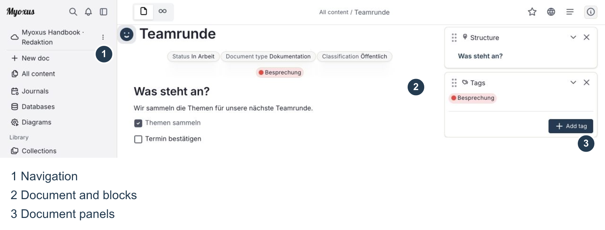
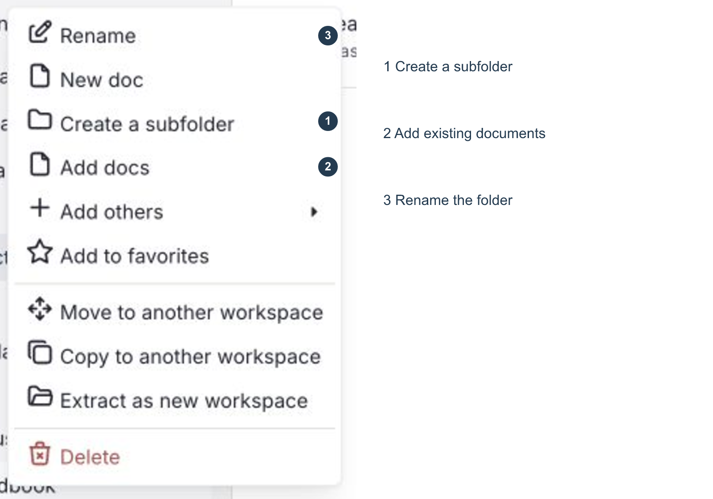
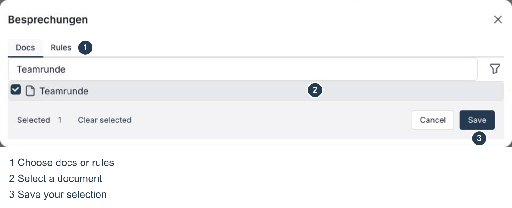
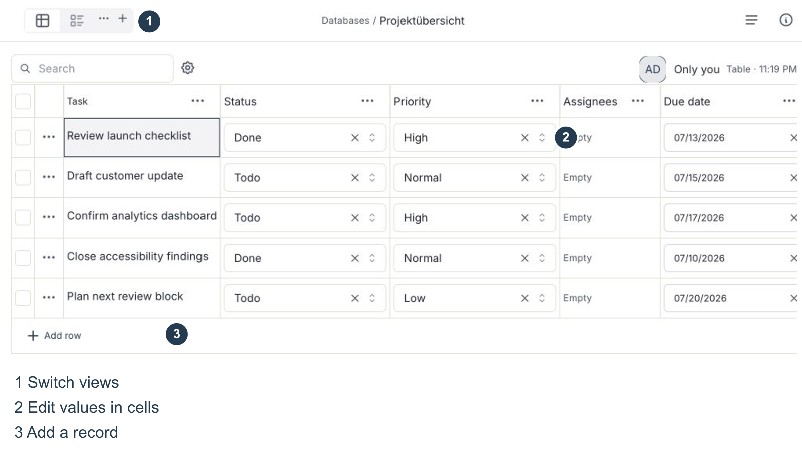
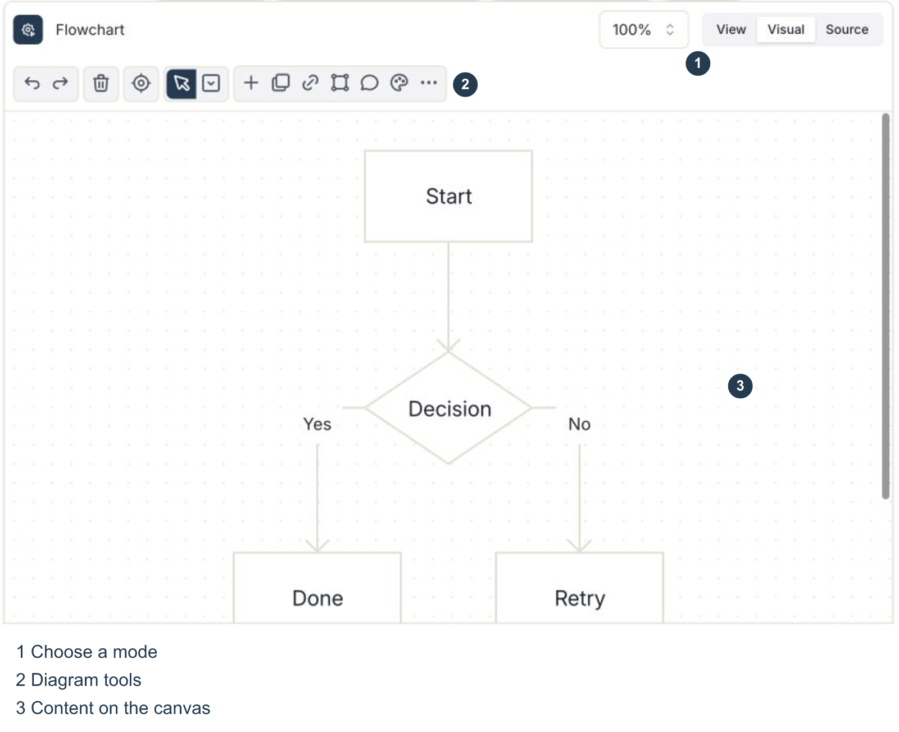
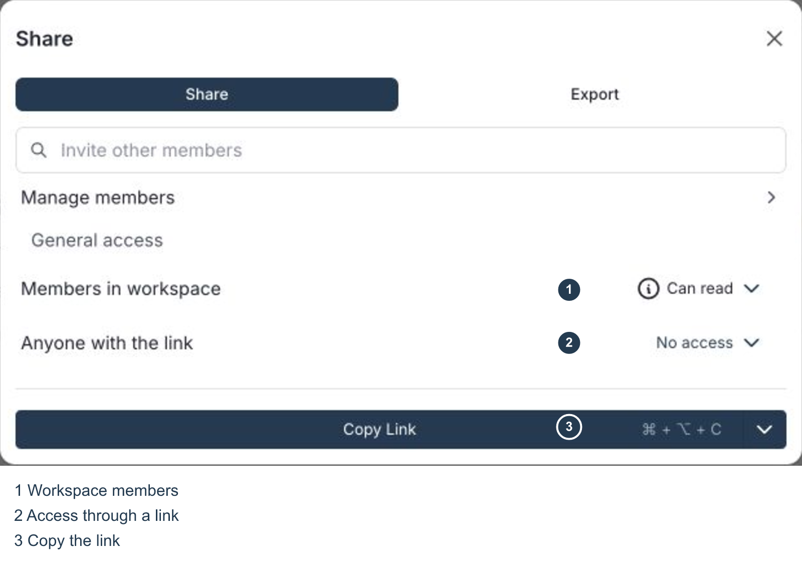
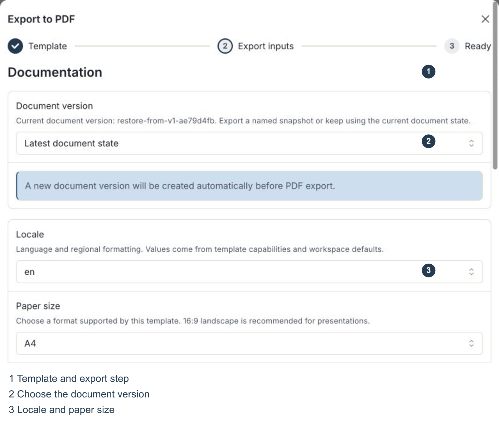
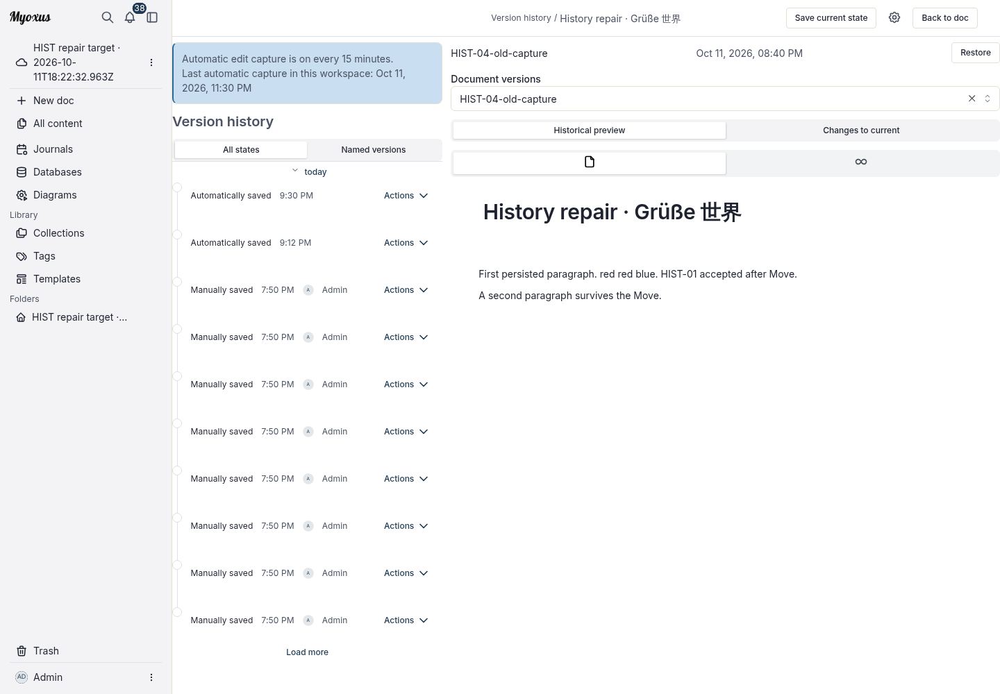

<!-- Generated from the Myoxus editorial document. -->

# Myoxus · User guide

[Documentation](../../README.md) / [User guides](../README.md)

[Download PDF](myoxus-user-guide.pdf) · [Deutsch](de/index.md)

On this page

- [01 Getting started and finding your way around](#01-getting-started-and-finding-your-way-around)
- [02 Create and edit documents](#02-create-and-edit-documents)
- [03 Organize and find content](#03-organize-and-find-content)
- [04 Work with data and visual content](#04-work-with-data-and-visual-content)
- [05 Collaborate and share content](#05-collaborate-and-share-content)
- [06 Import and export content](#06-import-and-export-content)
- [07 Review changes and recover content](#07-review-changes-and-recover-content)
- [08 Clients, updates and help](#08-clients-updates-and-help)

## 01 Getting started and finding your way around

Myoxus brings documents, databases and visual workspaces together. This guide explains the interface and the main tasks you can carry out in it. It covers the browser application; differences in the desktop app are explained in the final chapter. Screenshots use the light theme and example content.

### Sign in and choose a workspace

Open the Myoxus address supplied by your organization and sign in with the intended account. The operator controls which sign-in methods are available and whether you can create workspaces yourself. An invitation applies to the server and workspace it names. If expected content is missing, first check the server address, account and selected workspace.

To switch workspaces, open the workspace name at the top of the left sidebar and choose the one you need. Documents, folders, tags and collections belong to their workspace, so switching can show a different set of content.

_Document view: navigation on the left, content in the centre and document panels on the right._

### Read the interface

New doc in the left sidebar creates a document. All content opens the overview, and the magnifying glass opens Search. Journals, Databases and Diagrams have their own entries. Library contains Collections, Tags and Templates, followed by the folder tree. Use the sidebar icon to collapse or expand navigation.

The navigation path and document actions sit above the content. The star marks a favourite. The document menu contains sharing, history, import and export actions. The framed information icon at the top right shows or hides the right sidebar, which can contain panels such as the outline and tags.

### Show and hide document details

The arrow beside a panel heading collapses or expands that panel. The × removes it from the sidebar; it does not delete the document. Use the arrow when you only want to collapse the contents. Document actions such as View Info and Links & references open the corresponding information. The panels shown depend on your current layout.

Properties such as status or document type may appear below the title. They describe the document, but are neither its body text nor an access grant. Use the sharing dialog to check who may open it.

## 02 Create and edit documents

### Pages, titles and blocks

Choose New doc, enter a title and press Enter. The title belongs to the document and appears in navigation. Below it, content is made of blocks: every paragraph, heading, image and individual task has its own block. A heading inside the content is therefore different from the page title.

Enter starts a new paragraph. Inside a list it continues the list; in a task list it creates another item with its own checkbox. Click a task checkbox to mark that item complete. Changes are saved or synchronized as you work. If the connection fails, check the application’s messages before closing the window.

### Insert blocks and format text

Type / on an empty line to open the block menu. Choose a heading, list, table, image or attachment, or search for the entry you need. Escape closes the menu. It also contains actions and formatting: Bold changes text, while Heading 2 changes the block type.

Select words to open the formatting toolbar, then apply emphasis or add a link. To work with a whole block, use its selection and associated menu, which includes actions such as Duplicate and copying a block link. When arranging blocks, the insertion marker shows the destination; check the order after moving them.

### Images, files, tables and references

To insert an image or attachment, choose its entry in the block menu and select a file. Wait for the upload to finish. Images are displayed in the document; attachments remain downloadable files. The server can limit file sizes and accepted formats.

A document table holds content directly on the page. Edit its cells in the editor and use the table controls for rows, columns and presentation. Use a database when you need records with field types, filters and multiple views; see chapter 4.

A reference to an existing document opens its current content without duplicating its text. A block link points to a particular part of a document. Neither kind of link adds access rights: its recipient must be allowed to open the target.

### Templates and journals

Templates lists the templates available in the workspace. Create a document from a template, then edit the resulting working copy. The operator may control the central selection. A PDF template is separate: it determines how an exported file looks, rather than creating editor content.

Daily · Team coordination records progress since the last Daily, today’s plan and blockers in a short table. Record next steps with an owner and follow-up. Members are inserted when you create the working copy; check attendance and the review of open actions manually. Use creates an independent editable copy with a date in its title. Editing the template does not change existing working copies. For a daily journal, select the template in workspace settings; creating a journal sets its selected date without additional required fields.

Retro · Learn as a team collects concrete observations and distinguishes what to keep or change. Turn them into small experiments: keep the first step, owner and review date in the same row. Evaluate the experiments at the next retrospective; leave the review unchecked until then. Record attendance manually and edit the independent working copy rather than the central template.

Journals associate notes with a day. Open Journals in navigation and choose the required date. Check the date before adding entries. Personal calendar and journal preferences are available through the account menu and settings.

## 03 Organize and find content

### Folders: build your own structure

Folders appears below Library in the left sidebar. Open the workspace root’s context menu and choose New folder. In an existing folder’s menu, choose Create a subfolder. Enter a name and press Enter; Rename changes it later. Add docs links selected existing documents, while Remove from folder removes only a document link. Neither action deletes the document or grants access.

Add docs in the folder menu adds existing documents. Search for the documents, select them and confirm. New doc creates a document from within that folder. Add others offers additional supported content types, so a folder can group access to related items.

_Folder menu: create a subfolder, add existing documents or rename the folder._

A folder entry is a link. Removing the entry does not automatically delete its target document. Use the document’s trash action to delete the document itself. Read folder confirmations carefully: removing a folder and deleting its contents are different operations.

### Collections: combine selection and rules

Open Collections under Library, choose New collection, enter a name and save. An empty collection offers actions to add documents or rules. Rules opens the editor again when you want to change an existing collection.

In the Docs tab, search for documents and select the entries to include. In Rules, add filters for properties such as tags, title or modification date. Matching documents are included automatically; explicitly selected documents can remain included as well. Check the preview and save. A collection does not change the content of its documents.

_Collection editor: Docs selects documents directly; Rules includes matching documents automatically._

### Tags: label your documents

Open the document’s right sidebar and its Tags panel. Add tag opens the picker. Choose an existing tag, or enter a new name and choose Create. The tag appears on the document; Done closes the picker. To remove an assignment, remove that tag from this document’s selection.

Tags in the left sidebar opens the workspace catalogue instead. Changing a tag’s name or appearance changes the shared tag, not just one document’s assignment. Removing a tag from a document is therefore different from managing or archiving it in the catalogue.

### Favourites, search and the overview

Use the star on a document to mark it as a favourite; click again to remove the mark. The magnifying glass opens quick search. Enter a title or search term, then open the matching result.

View options, filters and sorting help narrow an overview. A hidden result has not been deleted. If a document is missing, check filters, workspace, access rights and Trash. Folders, collections, tags and favourites provide complementary ways to reach the same content.

## 04 Work with data and visual content

### Create a database

Open Databases and choose New database. In the wizard, select a blank database or an offered template. Enter a name and description, optionally select a folder, and decide whether to include example rows. Check the summary and choose Create database.

A row is a record, a field describes a property, and a cell contains its value. Field types determine the accepted input, such as text, number, date or selection. Fields belong to the database; opening another view does not create a new set of fields.

_Database view: view tabs above records and fields. Names supplied by a template can differ from the interface language._

### Edit records and fields

In a table, edit values through their cells. Add row creates another record. For more room, open a record’s details through its title and expand Details. Select a status, for example; the saved change also appears in the overview after you close the panel.

Add field creates a field. The menu at a column heading opens its configuration. Changing a field type affects the values in that field and may require conversion. Check the stated effects before changing a type or removing a field.

### Choose a view

Tabs above the database show different views of the same records. Add view creates another presentation. Table and List support editing and browsing; other offered types can present status or dates. Date-based views need suitable date fields.

View settings provides the available filters, sorting and display options. Distinguish personal settings from saved defaults for the shared view. Search and filters can hide records without deleting them. An edited record remains the same record across views.

### Edgeless and diagrams

The Page / Edgeless switch changes from the flowing document page to a free canvas where content can be arranged spatially. Selection tools, zoom and centring controls help you navigate. Changing modes does not make a backup copy of the document.

Open Diagrams, choose a diagram type and use its create button. Pay attention to Alpha and Beta labels. Inside the diagram, switch between View, Visual and Source. Visual offers tools for that diagram type; Source shows the Mermaid text. Edit the source only when you are familiar with its syntax.

_A diagram inside a document: diagram modes and tools sit below the document navigation._

Choosing a diagram type does not imply that every modelling operation is available. Use the tools actually offered and inspect the result in View. If the rendering is unexpected, first check the source, selection and zoom.

## 05 Collaborate and share content

### Edit together and discuss changes

People with the appropriate rights can work on the same document. Changes are synchronized through the server. If the connection is interrupted, check the displayed state before continuing to edit the same text in several places.

To discuss a passage, select its text and use the comment action. The mention picker in comments lets you address someone. Open an existing comment thread to reply or resolve a completed discussion. Notification delivery also depends on personal notification settings.

### Check access in the sharing dialog

Open the document menu and choose Share. General access shows the access granted to workspace members. Offered levels include reading, editing, managing and no access. Your own permissions determine which settings you may change.

_Sharing dialog: access for workspace members and access through a link are separate settings._

Manage members opens person-specific access management when available. Choose the intended people and permissions deliberately. A copied link uses the existing access rules; copying it alone neither invites someone nor grants access.

### Internal links and public access

Copy link provides a route to the document. An internal link still requires the appropriate access rights. Anyone with the link addresses a different audience. Before changing that setting, check whether the content should be publicly reachable.

To publish a public reading page, open the globe icon above the document. It offers publication as a page or edgeless view and revocation of the public link. These actions remain disabled until the workspace allows public content. A document property labelled Public does not enable publication.

Revoke a public reading page through the globe menu. Also check the sharing dialog for any remaining link access. Files that someone has already downloaded or copied are not recalled. An exported PDF is also an independent file: later changes to the document’s permissions do not automatically restrict that downloaded copy.

## 06 Import and export content

### Choose an import and check the result

Choose the entry that matches the source: Markdown creates documents, Obsidian creates a workspace, and Notion creates a database. Keep the original and inspect the resulting content.

### Markdown document or collection ZIP

Keep the original files. In an open document’s top-right menu, choose Import → Markdown files for a .md file, or Markdown with media files for a collection .zip. Keep relative attachment paths and folders intact in the ZIP. This document flow imports directly: read completion notifications and any diagnostics, then open the new document. Check headings, line breaks, links, tables and images. Some unsupported references remain as source text; do not treat a completion message as proof of full fidelity.

### Obsidian vault ZIP

ZIP the vault’s notes and attachments with the vault contents at the archive root; a single enclosing folder is retained. In the workspace selector, choose Import workspace, then Obsidian vault and select the ZIP. Review the preview’s documents, assets and diagnostics. Settings in .obsidian, trash and operating-system metadata are excluded. Unsupported content may be normalized or retained as recovery source rather than editable blocks. Confirm the changes when asked, then choose Create workspace and Open workspace. This creates a new workspace, not a merge. Open a note, follow an internal link and check an image or attachment; a relative inline image can remain Markdown source text.

### Notion database HTML/ZIP

Export the relevant Notion database as HTML, including its files in the ZIP when needed. Open Databases, then its header menu → Import as new → Notion HTML/ZIP. Select the export and inspect the preview: field types, rows, matched pages and diagnostics. Apply with Import snapshot. Open the new database and verify titles, field values and any linked row-content documents. Exports can lose view types, row templates, synced blocks, mentions or permissions; configure supported views and templates afterward. This is a new database, not an overwrite, and not arbitrary-page or full-workspace import through the document dialog.

When a preview or apply is rejected, keep the original and read the error. Cancel, correct or narrow the source, and preview again. Do not delete the source or existing content to force import. A successful preview can still be rejected on apply; report that failure instead of assuming content was imported.

Import CSV data through the database area. Check column mapping and field types in the preview. Applying the import creates a new database. A database JSON snapshot can also carry structural database information; observe its version and format validation.

### Export a document as PDF

Open the document menu, then Export and Export to PDF. First choose a PDF template available to the workspace. Next, check the document version, language, paper size, orientation and image quality. The language controls output labels and regional formatting; it does not translate the document’s content.

_PDF export: choose a template, review the inputs and start the export. Available options depend on the template._

Depending on the template, you can configure a cover, table of contents, footer and page numbering. A useful table of contents requires suitable headings. Start the export, download the completed file and inspect it before sharing. Large documents can take longer to produce.

### Other output formats

The export menu also offers formats such as HTML, Markdown, PNG and Snapshot. Use Markdown for text exchange and PDF for fixed page layout. Not every format preserves all editor features, attachments or interactive content. An export is therefore not necessarily a complete backup.

Databases have their own export actions. CSV exchanges tabular values; a database JSON snapshot can also include structure and saved views. Check the selected scope and any filters. Keep the original data until you have checked the output or reimport.

## 07 Review changes and recover content

### Undo an edit

Use Undo, or the appropriate system keyboard shortcut, to reverse a recent edit. Redo reapplies an undone step. These editing operations are different from a saved document version or an item in Trash.

### Inspect earlier document versions

Choose Open document history in the document menu. The history shows available saved versions. Select an entry and inspect its preview before confirming a restore. A new document, or one without saved versions, can show an empty history.

The current document and an earlier version are different states. Restoring replaces the current content with the selected version. The confirmation explains that the previous content is kept as an unnamed recovery snapshot and document attributes remain unchanged. Coordinate with collaborators and preserve the current state separately if needed. Opening a preview alone does not restore anything.

Choose **Historical preview** for the exact stored snapshot or **Changes to current** to compare it with **Current saved document**. Additions toward the current saved state are green; deletions are red and struck through. The comparison includes acknowledged edits newer than the latest capture. It waits for pending local saves and shows the server revision and read time; refresh errors have Retry. Notices identify structural changes and content that cannot be fully compared. **No detected text changes** does not mean that formatting, images or canvas content are identical. Returning to the preview does not change either document state.

History opens inside the normal document Workbench, with a timeline on the left and a readonly work area on the right. The header identifies the current document and offers Save current state, workspace capture settings and Back to document. Select a timeline capture or explicitly choose a named reference in the work area. The selected capture time belongs to the snapshot. The URL preserves that selection and Preview/Changes mode on reload and browser Back/Forward. Returning to the document restores focus to the opening control. Workspace automatic-capture information is labelled as workspace-wide.

_Version history: inspect the selected document version before restoring its content._

### Recover an item from Trash

Move to trash in the document menu removes a document from the normal working view. Open Trash in the left sidebar, find the item and choose Restore. Check that the document appears in the overview again. A removed folder link may need to be added separately.

Permanent deletion is a separate action. Afterwards, normal recovery through Trash is no longer available. Do not permanently delete content when you only want to tidy the workspace or hide something temporarily.

### Limits of history and exports

Document history does not automatically protect all workspace data. PDF and Markdown exports are not complete backups either. For recovery after server failure or data loss, contact the operator. Their backup and retention procedures are separate from this user guide.

## 08 Clients, updates and help

### Browser and desktop app

In the browser, you work with workspaces on the selected server. It does not create a local workspace for permanent offline use. A desktop release may offer local capabilities; these are different from synchronization with a server workspace.

The server address, signed-in account and workspace determine which content is visible. Check all three if the browser and desktop app show different documents. Switching servers does not transfer content automatically.

### Install and update

Install an actually published release for your operating system and processor architecture, and read its release instructions. If no package is offered for your system yet, use the browser application.

The operator supplies the browser application. Follow an update prompt after ongoing edits have synchronized. Desktop updates use the source and capabilities supplied with that release. Ask your instance operator if you are unsure about an offered update.

[Downloads and release notes](../downloads.md)

### When content or actions are missing

No connection: check the server address, your session and any maintenance message. If edits are still pending, do not immediately clear browser storage or local app data.

Document not found: check the workspace, search, filters and Trash. Ask the responsible person to check access. Having a link does not prove that your account is authorized to open it.

Disabled action: a required selection, state or permission may be missing. Check the explanation at the control. A feature can also depend on the installed version or server configuration.

Failed export: check the selected template, inputs and error message. For help, note the affected document and time of failure. Share confidential content only through the intended internal support channel.

### Find help

Contact your Myoxus operator first about sign-in, invitations, access, backups and server availability. To report a reproducible product issue, include the version, operating system, affected feature, steps and error message. Remove passwords, tokens and confidential content from screenshots.

[Myoxus project and further information](../../../README.md)
