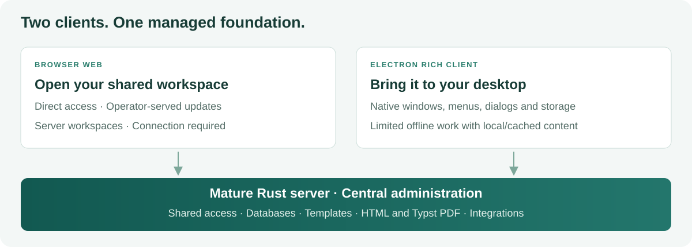

<!-- SPDX-License-Identifier: AGPL-3.0-or-later -->

# Web and rich clients

[Documentation](../README.md) / [User guides](./README.md)

**Choose Browser Web for direct access to your server workspace; choose the
Electron rich client when desktop integration and limited offline work matter.**
Both use the same authoritative server for shared product capabilities.

The self-hosting beta entry is Server, Browser Web and Admin. Desktop releases
are independent; [downloads](./downloads.md) distinguishes existing Forgejo
packages from the public GitHub source/beta release status.

| Question                                         | Browser Web                                    | Electron desktop rich client                                                             |
| ------------------------------------------------ | ---------------------------------------------- | ---------------------------------------------------------------------------------------- |
| How do I start?                                  | Open the served Web application                | Install an available release package or build the desktop client                         |
| Where do shared data and rules live?             | On your Myoxus server                          | On the same Myoxus server for server-backed workspaces                                   |
| Where can I keep local document work?            | Server workspaces accessed through the browser | Native local workspaces and the desktop document store                                   |
| Can I work offline?                              | Server connection required                     | Limited: local content and available cached document content                             |
| How do I use shared databases?                   | Through the server                             | Through the same server                                                                  |
| What about publishing, PDFs and integrations?    | Require the server and any configured provider | The same requirement applies                                                             |
| How does it integrate with the operating system? | Browser capabilities and downloads             | Desktop windows/tabs, menus, file dialogs, native storage and configured OS integrations |
| How are updates delivered?                       | Operator updates the served frontend           | Installed package/update source; availability follows release notes                      |
| What is the current focus?                       | Desktop browser use                            | Electron desktop; mobile clients are outside the current release scope                   |

On this page

- [Why Myoxus puts client ↔ server first](#why-myoxus-puts-client--server-first)
- [Browser Web: a direct path into the shared workspace](#browser-web-a-direct-path-into-the-shared-workspace)
- [Rich clients: the shared workspace with desktop capabilities](#rich-clients-the-shared-workspace-with-desktop-capabilities)
- [One client model across deployment sizes](#one-client-model-across-deployment-sizes)
- [What “limited offline” actually means](#what-limited-offline-actually-means)
- [Mobile: contributions welcome](#mobile-contributions-welcome)

## Why Myoxus puts client ↔ server first

Myoxus deliberately puts authoritative shared data and business logic in its
mature Rust server. Browser Web, Electron and authenticated tools consume those
capabilities, giving every client access to the same managed foundation.

**The central advantage is governed enterprise use.** Shared permissions,
approved templates, organizational appearance and document production need a
common owner. Myoxus's server and Admin frontend make it possible to maintain
those standards centrally and apply them to Web and rich clients alike.

The Template Registry supports published revisions, workspace assignments,
revision pins and explicit update modes. Central Typst templates, fonts and
document branding maintain export standards independently of client machines.
Server-backed databases and background services share the same authoritative
rules. An organization can manage these capabilities without treating each
workstation as an independent product installation.

The client/server model concentrates shared rules in that mature Rust core,
while clients focus on interaction, editing and appropriate local storage. See
[enterprise capabilities](./features-in-depth.md#enterprise-use-maintain-standards-centrally)
and [Template Registry](../ops/integrations/template-registry.md).

| Concern                            | Myoxus approach and benefit                                    | Fully local-first approach                                         |
| ---------------------------------- | -------------------------------------------------------------- | ------------------------------------------------------------------ |
| **Enterprise governance**          | One Admin/server owner for shared access and standards         | Requires a shared governance service alongside device independence |
| **Templates and branding**         | Central revisions, assignments, fonts and output configuration | Needs a separate distribution and update strategy                  |
| **Shared records and permissions** | Common queries, validation and current access checks           | Needs replica reconciliation and disconnected-access policies      |
| **Background workflows**           | Jobs and integrations run independently of open clients        | Device-owned work depends on availability, or uses a service       |
| **Publishing and PDF**             | Shared templates, fonts and delivery pipeline                  | Local output can depend on device resources and version            |
| **Diagnosis and recovery**         | Central operational signals and authoritative backups          | State and recovery can span devices, queues and services           |
| **Connectivity**                   | Shared server services plus limited native offline work        | Local work continues through extended disconnection                |

This balance combines a mature shared server with collaborative editing and
native local storage. It reflects our engineering priorities: central governance,
stable shared rules and useful desktop capabilities.

The [deployment overview](../../README.md#from-one-host-to-an-enterprise-installation)
shows how the same application can grow from a single-host installation to
separate data services and multiple application nodes.

## Browser Web: a direct path into the shared workspace

Browser Web opens workspaces directly on the selected Myoxus server. Workspace
identity, access and authoritative product state stay with the installation;
durable local workspace storage is provided by the rich client.

It is a convenient choice for shared machines or environments where installing
a desktop package is undesirable. The operator maintains the served frontend;
users receive its current version when loading the application.

If connectivity is interrupted, reconnect and confirm synchronization before
closing important work or continuing on another device. Browser Web uses server
workspaces; durable local workspace storage belongs to the rich client.

The [handbook](./handbook/index.md) explains normal document and workspace use.
The Admin frontend provides desktop administration for the same installation.

## Rich clients: the shared workspace with desktop capabilities

“Rich client” currently refers primarily to the Electron desktop application.
It brings the workspace into an installed application with desktop windows and
tabs, application menus, native file dialogs and local SQLite storage. Additional
OS capabilities and package installation are described in the
[published release instructions](./downloads.md) for your platform.

For a server-backed workspace, the desktop app remains a client of the same
server as Browser Web. Local storage helps the document engine and desktop
workflows; it does not transfer ownership of database business rules,
permissions or publication to the device.

Installation and update instructions belong to the selected platform release.
Regular Windows packages can be unsigned and regular macOS packages ad hoc
signed; these states are stated in the release metadata. For macOS, follow the
documented external installation/upgrade route. A native macOS automatic updater
is not a requirement or promise of regular distribution. Use Homebrew only when
the release actually supplies a checksum-pinned Cask and its installation guide.

## One client model across deployment sizes

Web and rich clients connect to the same logical Myoxus installation whether it
runs on one self-hosted system, Linux VMs or several API containers in a private
cloud. In a multi-instance deployment, clients use the common public origin;
the load balancer routes to application nodes sharing PostgreSQL, Redis and
blob/font storage. Adding nodes preserves the central templates and access model
and does not change the clients' offline boundaries.

See the [scalability overview and diagrams](../ops/deployment/scaling.md),
[Operations manual](../ops/README.md),
[Deployment guide](../ops/deployment/README.md) and
[Multi-instance operations](../ops/deployment/multi-instance.md).

## What “limited offline” actually means

The rich client supports two local document contexts:

| Context                                 | Offline use                                                                              | Connection to the server                                                   |
| --------------------------------------- | ---------------------------------------------------------------------------------------- | -------------------------------------------------------------------------- |
| **Native local workspace**              | Device-local documents use their own storage lifecycle                                   | Local work is separate from a server workspace                             |
| **Server workspace with local storage** | Documents and assets already present on the device can support limited disconnected work | Reconnection synchronizes pending changes with the authoritative workspace |

Live collaboration, server-backed databases, current permission checks, search,
HTML publishing, Typst PDF production and background integrations use their
corresponding server services. Check the documents and assets needed before
working disconnected, then reconnect and confirm synchronization afterward.

**Your own network can keep working without public internet.** Clients can use a
reachable Myoxus server on the local network; configured external integrations
follow their providers’ availability.

Back up local-only work and follow the [backup and portable-export guide](../ops/data/backup-and-restore.md)
for server recovery and interchange.

## Mobile: contributions welcome

Mobile clients are **not currently a development focus**. The current release
focus is Browser Web and Electron desktop.

We welcome help from contributors interested in mobile implementation, platform
integration, accessibility and documentation. Start with
[Contributing](../../CONTRIBUTING.md) and agree on a concrete scope that fits the
server-owned product model.
