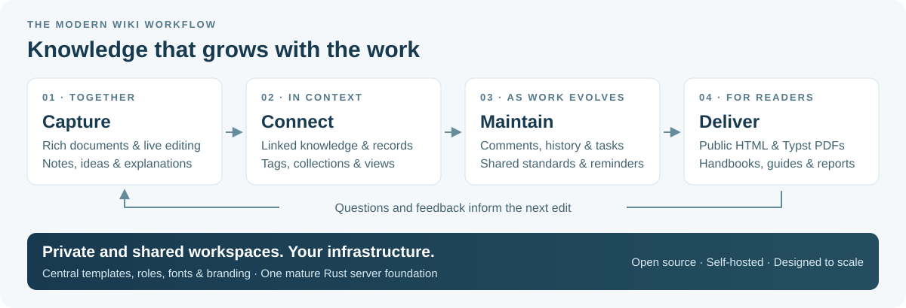

<!-- SPDX-License-Identifier: AGPL-3.0-or-later -->

# Why you should replace your wiki

[Documentation](../README.md) / [User guides](./README.md)

**Turn your knowledge base into a workspace people use every day.** Myoxus is a
modern, open-source wiki replacement that brings shared knowledge, collaborative
writing, structured information and publishing together on your infrastructure.
Your handbook, service catalogue and project documentation can grow alongside
the work they describe.

**Everyone gets a private personal workspace, alongside shared workspaces for
teams, departments, topics and projects.** That combination is a central reason
Myoxus makes such a useful wiki replacement: personal thinking and shared
organizational knowledge each have a proper home in the same system.

| What you want from a modern wiki             | What Myoxus gives you                                                                                       |
| -------------------------------------------- | ----------------------------------------------------------------------------------------------------------- |
| Personal space and the right shared contexts | An automatic private personal workspace, plus shared workspaces for departments, topics, teams and projects |
| Knowledge people actually contribute to      | Rich editing, live collaboration, comments and reusable templates                                           |
| Structure that grows with the organization   | Linked documents, folders, collections, tags and searchable workspaces                                      |
| Information you can act on                   | Typed database records, saved views, reminders and automations                                              |
| Standards across teams                       | A central Template Registry, workspace assignments and shared document production                           |
| A polished experience for readers            | Server-rendered public HTML and Typst PDFs with templates, fonts and document branding                      |
| Long-term control                            | **AGPL open source, no per-seat license fees, self-hosting from a Linux VM to a private cloud**             |

  <a href="#your-own-workspace-shared-spaces-for-shared-work"><strong>Workspaces</strong></a> ·
  <a href="#what-people-find-frustrating-about-wikis"><strong>The friction</strong></a> ·
  <a href="#myoxus-mediawiki-dokuwiki-and-confluence"><strong>The comparison</strong></a> ·
  <a href="#put-it-to-work"><strong>Practical examples</strong></a> ·
  <a href="#a-practical-path-from-your-existing-wiki"><strong>Make the move</strong></a>

## Your own workspace. Shared spaces for shared work.

An organization has many overlapping knowledge contexts. Personal research,
departmental procedures, cross-team standards and project decisions each need
their own home. **Myoxus makes workspaces a first-class part of that structure.**

Every user receives a personal workspace automatically, private by default.
Shared workspaces bring selected people together around the work they share.
Use several for one department, dedicate one to a project, or group related
projects in a common workspace. People can participate in multiple shared
areas while retaining their personal workspace.

| Context                      | Example workspace                                           | Why it is useful                                                                  |
| ---------------------------- | ----------------------------------------------------------- | --------------------------------------------------------------------------------- |
| **My own knowledge**         | Personal notes, drafts and research                         | Capture thoughts in your private workspace before deciding what to share          |
| **Our department**           | Operations handbook, HR procedures or engineering knowledge | Give the department a shared home, or several homes for distinct responsibilities |
| **A common topic**           | Architecture, quality or a specialist community             | Bring contributors from different teams together around the same subject          |
| **One project**              | A delivery team's documentation and decisions               | Keep the project context together with the people doing the work                  |
| **Several related projects** | A programme or product portfolio                            | Maintain common knowledge and structured records across related efforts           |

This is a substantial step beyond organizing a traditional wiki through page
names and namespaces: the working area itself has documents, databases,
templates, members and roles. Organizational units can own, manage or link
multiple workspaces, giving administration a structure that follows the
organization. Central template assignments keep shared standards consistent
across those areas.

Read [workspaces in depth](./features-in-depth.md#workspaces-your-own-space-and-the-right-shared-contexts)
and [organization and workspace management](../ops/administration/organization.md).

## What people find frustrating about wikis

Enterprise wiki research describes a recognizable pattern: contributing feels
like extra work, information lives in competing tools, early structures become
awkward, and maintenance depends on a few enthusiasts. People also hesitate to
share unfinished material or change somebody else's writing. These themes come
from the MITRE case study and the enterprise sustainability study listed in the
[research basis](#research-basis).

Our answer is to make knowledge work useful while it is happening. A shared
document can start as meeting notes, become a maintained guide and reach readers
as HTML or PDF. The following connections are our product response to those
research findings.

| The friction                          | What it feels like at work                                          | The Myoxus approach                                                                                                   |
| ------------------------------------- | ------------------------------------------------------------------- | --------------------------------------------------------------------------------------------------------------------- |
| Documentation is an extra chore       | The team finishes the work, then has to describe it again elsewhere | Write and collaborate in the same workspace as project records, diagrams and follow-up tasks                          |
| People wait until content is finished | Useful work stays in private drafts or email                        | Develop rich documents together; use comments and history to refine them in context                                   |
| The original structure stops fitting  | Growing content becomes difficult to browse and reorganize          | Combine links, folders, collections, tags and search; use saved database views for different questions                |
| Pages lose their usefulness over time | Guidance and manually copied status drift away from current work    | Keep operational facts in structured records; organize review tasks with reminders and use history to inspect changes |
| Standards depend on a few maintainers | Teams invent different structures and output styles                 | Distribute central template sources and maintain PDF templates, fonts and branding in one place                       |
| Information is scattered across tools | The explanation, the data and the discussion are separated          | Bring documents, databases, canvas work and comments into one workspace                                               |

The practical gain is a shorter distance between doing the work and maintaining
the knowledge. Shared editing makes contribution easier; structured records
provide reusable facts; templates give teams a consistent starting point.

## Myoxus, MediaWiki, DokuWiki and Confluence

These three familiar systems represent different choices: an encyclopedia
platform, a file-based documentation wiki and a commercial collaboration suite.
Myoxus brings a broad collaborative workspace to self-hosted knowledge
management, with a mature Rust server and central governance.

### Ownership and operation

|                   | **Myoxus**                                | MediaWiki                       | DokuWiki                                       | Confluence Cloud                                                  |
| ----------------- | ----------------------------------------- | ------------------------------- | ---------------------------------------------- | ----------------------------------------------------------------- |
| Primary model     | **Collaborative knowledge and work**      | Linked encyclopedia-style pages | File-based documentation wiki                  | Hosted team knowledge and collaboration                           |
| Software license  | **AGPL-3.0-or-later**                     | GPL-2.0-or-later                | GPL-2.0                                        | Proprietary subscription service                                  |
| Hosting           | **Your Linux host, VMs or private cloud** | Self-hosted                     | Self-hosted                                    | Atlassian-hosted; Data Center is a separate self-managed offering |
| License cost      | **No license or per-seat fee**            | No software license fee         | No software license fee                        | Free for up to 10 users; paid plans by user count and tier        |
| Server foundation | **Rust, PostgreSQL and Redis**            | PHP and a database              | PHP and plain-text files; no database required | Vendor-operated Cloud service                                     |

### Knowledge workflows

| Workflow                            | **Myoxus**                                                         | MediaWiki                                                                 | DokuWiki                                       | Confluence Cloud                                          |
| ----------------------------------- | ------------------------------------------------------------------ | ------------------------------------------------------------------------- | ---------------------------------------------- | --------------------------------------------------------- |
| Personal and shared working areas   | **Private personal + shared workspaces**                           | User pages and namespaces                                                 | Namespaces with page/namespace access controls | Personal and team/project spaces                          |
| Authoring                           | **Rich block documents and canvas**                                | Wikitext and VisualEditor                                                 | Wiki syntax; visual editing through plugins    | Rich pages and live docs                                  |
| Working on the same document        | **Live collaborative editing**                                     | Revision editing and edit-conflict handling; experimental CollabPad       | Page locking in the standard editor            | Live collaborative editing                                |
| Organizing knowledge                | **Links, folders, collections, tags and search**                   | Links, categories, namespaces and search                                  | Links, namespaces and search                   | Spaces, content tree, labels and search                   |
| Working with structured information | **Server-backed databases, typed fields and saved views**          | Extensions such as Semantic MediaWiki                                     | Plugins for structured data                    | Built-in databases                                        |
| Visual thinking                     | **Canvas and Mermaid integration (alpha)**                         | Diagram/visualization extensions                                          | Diagram/visualization plugins                  | Built-in whiteboards; limits by plan                      |
| Reusable standards                  | **Local templates + central versioned Registry**                   | Transcluded templates and parameters                                      | Namespace page templates                       | Global and space templates                                |
| Team access                         | **Organizations, workspaces and roles**                            | Groups and page protection; selective read access needs additional design | Page/namespace access control lists            | Site, space and content permissions; capabilities by plan |
| Reaching readers                    | **Revocable public HTML, HTML downloads and Typst PDF production** | HTML wiki pages; PDF tooling through extensions                           | HTML wiki pages; PDF export through plugins    | Public links, PDF and space HTML exports                  |

Checked 5 October 2026. MediaWiki and DokuWiki describe the standard systems
and identify extension/plugin routes where relevant. Confluence describes Cloud
features across its plans. Hosting costs apply to self-hosted systems.

Confluence already combines modern editing, databases and whiteboards. Myoxus's
distinctive proposition is to bring that breadth into **an independent,
open-source system you operate**, together with central template distribution,
Typst document production and a Rust server. Against traditional page-focused
wikis, the gain is a wider everyday workspace around your knowledge base.

## Put it to work

### An internal handbook that starts with the team

Create onboarding guides, working agreements and departmental documentation as
linked documents. Use reusable templates for a shared structure, comments for
questions and live editing for joint maintenance. Search and workspace
navigation give people routes back to that knowledge.

The central **Template Registry** distributes published template revisions to
workspaces. Operators can pin a revision, seed a starting source, manage updates
until local edits or require manual adoption. This gives teams a common starting
point with deliberate update control. Registry updates manage template sources;
documents already created from them keep their own content.

See [central template management](../ops/integrations/template-registry.md) and
[organizations and access](../ops/administration/organization.md).

### A service catalogue you can use as well as read

Keep service names, contacts, lifecycle states and review dates in typed database
fields. Create saved views for different teams or questions. Link the related
runbooks and architecture explanations as documents, and organize review work
with tasks and reminders.

This separates reusable operational facts from explanatory prose while keeping
both within the same workspace. Canvas work and Mermaid diagrams (alpha) add
visual context; comments keep questions alongside the material.

See [databases and views](../ops/data/databases/README.md) and
[features in depth](./features-in-depth.md).

### Project knowledge that stays close to delivery

Meeting notes, decisions, research, project records and follow-up work belong in
one shared context. Write together, inspect history, discuss changes and use
database views for the structured side of the project. Git Sync connects
supported documents with repository workflows; authenticated MCP tools give
automation access to server capabilities.

See [Git Sync](../ops/integrations/git-sync.md) and
[MCP integrations](../ops/integrations/mcp/README.md).

### A knowledge base with professional reading output

Publish selected documents as **read-only public HTML** served by the Rust
server. Readers receive a dedicated page without loading the collaborative
editor. Workspace and document publication controls let you choose what becomes
public and revoke delivery at the source.

For manuals, reports and handovers, **Typst produces PDFs** with centrally
maintained templates, fonts and document branding. HTML and Markdown downloads
also provide portable copies. Your workspace can serve both contributors and
people who simply need a readable result.

See [public publishing](../ops/data/public-publishing.md) and
[Typst PDF templates](../ops/data/pdf-export-templates.md).

## A practical path from your existing wiki

Start with a useful part of the knowledge base: onboarding, a service catalogue
or one team's runbooks. Give it a clear structure, agreed maintainers and a
repeatable review routine. Move the work that keeps it relevant into the same
workspace.

| Step                                          | What to do                                                                                                                                              |
| --------------------------------------------- | ------------------------------------------------------------------------------------------------------------------------------------------------------- |
| **1 · Choose a working collection**           | Select actively used documents and their attachments; decide what belongs in prose and what belongs in structured records                               |
| **2 · Bring content into supported formats**  | Use Markdown, HTML or DOCX document imports; convert native wiki markup, macros and extension output into those formats first                           |
| **3 · Establish the shared structure**        | Choose shared workspaces for departments, topics or projects; organize their documents and create typed database records for catalogues and review work |
| **4 · Give the team a common starting point** | Create workspace templates or distribute central Registry sources; configure memberships and access                                                     |
| **5 · Make knowledge part of the routine**    | Maintain content together, discuss it in comments and use reminders for agreed review tasks                                                             |
| **6 · Deliver and grow**                      | Publish selected HTML pages, produce PDFs and grow the deployment alongside the organization                                                            |

Review imported links, attachments and representative page layouts before
handing over the collection. Keep the old system available for its historical
revisions during the transition. This migration uses Myoxus's supported document
imports.

Browser Web and the Electron rich client share the managed server workspace.
Rich clients also offer **limited offline capabilities**. The same central
administration can grow from a self-hosted Linux system to multiple application
containers using shared PostgreSQL, Redis and storage services.

Explore [Web and rich clients](./web-and-rich-clients.md),
[deployment and scaling](../ops/deployment/scaling.md) and the
[Operations manual](../ops/README.md).

## Research basis

The friction discussion draws on enterprise field research; the comparison uses
current official product documentation and licenses. The mapping from those
findings to Myoxus is our assessment of its documented capabilities.

<strong>Research and comparison sources · checked 5 October 2026</strong>

- **Lester Holtzblatt, Laurie Damianos and Daniel Weiss:** _Factors Impeding Wiki
  Use in the Enterprise: A Case Study._ MITRE research report, 2009; CHI 2010.
  Contribution effort, reluctance to share unfinished work, openness and reliance
  on other tools.
- **Jonathan Grudin and Erika Shehan Poole:** _Wikis at Work: Success Factors and
  Challenges for Sustainability of Enterprise Wikis._ WikiSym 2010, article 5.
  Maintenance, changing structures, stale content and fit with existing work.
- **MediaWiki documentation:** _Copyright_, _VisualEditor_, _Help:Edit conflict_,
  _VisualEditor/Real-time collaboration_, _Help:Templates_, _Help:User page_, _Manual:Namespace_, _Manual:Preventing
  access_, _Extension:Semantic MediaWiki_ and _Extension:ElectronPdfService_.
- **DokuWiki official repository:** the bundled _DokuWiki_ introduction,
  `COPYING`, and the implementations of page locking, namespace templates and
  access control in `inc/common.php` and `inc/auth.php`; the maintained `struct`,
  `dw2pdf` and `ckgedit` plugin repositories document the respective structured
  data, PDF and visual-editing routes.
- **Atlassian documentation:** _Confluence Pricing_, _Use spaces to organize your work_, _Customize your personal space_, _Create and edit content_,
  _Create and collaborate in real time with live docs_, _Manage permissions at
  the content level_, _Create a template_, _Export a space's content_ and _How
  whiteboards work under different Confluence plans_.

The field studies describe organizational experiences in 2009–2010; product
capabilities in the tables were checked separately against current sources.

